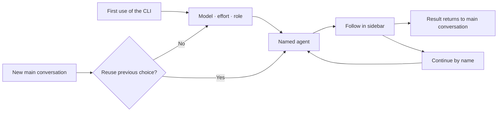

<div align="center">

# dsh-cliworker-now

[简体中文](README.md) | **English**

**A shared workspace for your AI CLIs inside DeepSeek Harness.**

Choose a CLI, model and role, dispatch a named agent, follow its work in the sidebar, and continue the same task.

[](https://github.com/SuperWheel/dsh-cliworker-now/releases/latest)
[](https://github.com/deepseek-ai/deepseek-harness)
[](#supported-clis)
[](LICENSE)

[Install](#install-and-update) · [Get started](#usage) · [FAQ](#faq) · [Report an issue](https://github.com/SuperWheel/dsh-cliworker-now/issues)

</div>

## What it is

dsh-cliworker-now is a **multi-CLI agent plugin for DeepSeek Harness**. It brings your terminal AI CLIs into Harness: the main conversation dispatches work and receives results, and the right sidebar shows each agent in Harness's own full conversation view, with its process, usage and status.

Each CLI keeps its own account, models and native sessions; the plugin organizes the work. It does not include any model service, subscription or API quota.

- **Development**: ask Codex to review code, then keep asking the same named agent.
- **Writing and editing**: set up separate roles for logic, style, commercial review and revision.
- **Long tasks**: each agent keeps its own conversation and records, so you can pick up where it stopped.

Once installed, the plugin appears in Harness as **CLI Worker / CLI Worker Now**.

## Features

- **One entry, many CLIs**: name a CLI in the main conversation and see every task grouped by CLI in the sidebar.
- **Native conversation experience**: child sessions use Harness's own conversation view, composer, model and permission controls, "+" menu and usage indicators, with queueing, stopping and follow-ups.
- **Native CLI behavior**: each CLI uses its own protocol, login and sessions. Models and reasoning effort come from that CLI's real catalog and current account.
- **Named agents with roles**: unique names, role presets and custom instructions, so you can call the same agent again.
- **Predictable scheduling**: nothing starts before you explicitly choose a model (you can turn later questions off and use the saved defaults). One turn per session, serialized writes per directory by default, and no silent fallback to another CLI.
- **Optional parallel writes in one project**: turn on the same-directory parallel writes switch in CLI Worker settings, and a new writer that would wait runs in a plugin-owned copy of the project instead. Merge it back from the task card as uncommitted changes (no Git required, nothing is committed); on conflict the project stays untouched, or discard the copy.
- **Goal, plan, feedback and fork**: use these Harness features in CLI child sessions; unsupported entries explain why.

## Screenshots

Captured from a real demo session in Harness Desktop (taken with v0.6.5; details may differ in the current version).


| Role presets | CLI connections and model preferences |
| --- | --- |
|  |  |

## Supported CLIs

| CLI | Native transport | CLI | Native transport |
| --- | --- | --- | --- |
| Antigravity | stream-json | OMP (Oh My Pi) | RPC |
| Codex | app-server | Pi | RPC |
| Claude Code | stream-json | Hermes Agent | Runs API |
| Kimi Code | ACP | OpenCode | HTTP + SSE |
| Official MiMo Code | HTTP + SSE | Qoder CLI | ACP |
| ZCode | app-server | Qoder CN CLI | ACP |
| Grok Build | ACP | | |

- **Platforms**: macOS / Windows. Install the native build of each CLI you use and complete that CLI's own login or API setup.
- **Host**: DeepSeek Harness (bundled resources target 0.2.1-rc.3; isolated enable/disable, page boot and native settings checks cover 0.2.1-rc.2 and rc.3); Node.js ≥ 22.19.0.
- **Verification**: tested versions and what has or has not been verified for each CLI are in [usage details](doc/usage-details.en.md#42-adapter-coverage-and-verification) and the [implementation log](doc/tasks.md). Listing models does not prove you can call them.

Installation, login and path notes for Qoder, Claude Code (including CC Switch), ZCode, Hermes and others are in [usage details](doc/usage-details.en.md).

## Install and update

End active tasks and quit Harness completely, then run:

```sh
dsh plugin --profile desktop add dsh-cliworker-now@latest
```

Reopen Harness afterwards. Enable the `dsh` command from the Desktop menu "Manage dsh command…". For a Web profile, replace `desktop` with `web`. You can also enter `dsh-cliworker-now@latest` under "Add plugin" on the Plugins page.

- Starting Harness does not update the plugin. pnpm 11 waits 24 hours after a release by default and may keep the previous version; check with `dsh plugin --profile desktop ls dsh-cliworker-now --depth=0`.
- Fallback package: `dsh plugin --profile desktop add https://github.com/SuperWheel/dsh-cliworker-now/releases/download/v0.8.4/dsh-cliworker-now-0.8.4.tgz`. Each release includes `SHA256SUMS.txt`.
- The package ships the interface extensions that native child conversations need; no host build is required, and uninstalling restores the official interface. If it conflicts with an existing interface override, the startup check refuses without changing your configuration. See [runtime-host](runtime-host/README.md).
- Known limitation: live-toggling this plugin with dshmarket 1.70.1 can blank the current window; its restart prompt does not make the live transition safe. Fully restart Harness after toggling; a cold start after disabling restores the stock UI. The root cause is in the market's live-toggle flow and has been reported upstream ([dsh-market/dsh-market#1010](https://github.com/dsh-market/dsh-market/issues/1010)); see the [investigation and verification limits](doc/blank-toggle-investigation.md). Native chat display and busy-Enter preferences retain their original settings entries.
- Uninstall with `dsh plugin --profile desktop remove dsh-cliworker-now`; local accounts, history and preferences are kept.

<details>
<summary>Install from GitHub source or develop locally</summary>

Requires Node.js ≥ 22.19 and pnpm 11.25.0 on `PATH`:

```sh
dsh plugin --profile desktop add github:SuperWheel/dsh-cliworker-now
```

Or build locally and link it (keep the source folder):

```sh
git clone https://github.com/SuperWheel/dsh-cliworker-now.git
cd dsh-cliworker-now
pnpm install --frozen-lockfile
pnpm --config.verifyDepsBeforeRun=false build
dsh plugin --profile desktop add .
```

For `ERR_PNPM_GIT_DEP_PREPARE_NOT_ALLOWED`, `ERR_PNPM_IGNORED_BUILDS` or pinning a commit, see [installation details](doc/usage-details.en.md#5-installation-and-updates).

</details>

## Usage

### 1. Dispatch

In a main conversation with a working folder selected, name the CLI explicitly:

> Use Codex to check this project's login error handling, and name the agent "Code Reviewer".

Short names work too: `agy` → Antigravity, `glm / zhipu` → ZCode, `harmes` → Hermes Agent. An ambiguous name returns candidates instead of dispatching.

The first time you use a CLI in a project, Harness question cards ask for the **model, reasoning effort and role**; the task starts only after all three are confirmed. A new main conversation in the same project asks whether to reuse the previous choice. Cancelling saves nothing and starts nothing.

To skip the questions, turn off **Ask for model before dispatch** under "CLI Worker settings → Task scheduling". It is on by default and applies to every CLI. When off, a new main conversation starts directly with the project's default model, effort and last confirmed role. If no complete choice was ever confirmed (for example, only a model was picked in settings) or it is no longer valid (model removed, effort unsupported, account changed), the full selection still appears; nothing is guessed.



### 2. Follow, stop and continue

- Click a task card to open that agent's native conversation on the right; closing the sidebar does not stop background tasks.
- The "+" menu matches Harness: **Add** (file, image, goal, plan, feedback) and **Commands** (permission, model, fork).
- Stop reports success only after the process has fully exited. Messages sent during a run follow the native Inbox rules.
- After a turn ends, reply in the child session, or say in the main conversation: "Ask Code Reviewer to also check test coverage."
- Right-click a card to rename it or delete it; deleted idle tasks can be restored.

### 3. Roles and CLI settings

| Setting | What it does |
| --- | --- |
| Agent settings | Manage name / summary / role-prompt presets; seven built-in fiction roles, see [role presets](doc/role-presets.md) |
| CLI connections | Enable each CLI, check login status, open its native account terminal; set the CLI path under Advanced |
| Project defaults | Save the default model and reasoning effort for the project; with “Ask for model before dispatch” off, new conversations use them directly |
| Child controls | Change the agent's model or permission with native controls; locked while running or while messages are queued |

### 4. Goal, plan, feedback and fork

| Feature | Behavior | Support |
| --- | --- | --- |
| Goal | Set from the goal bar, the "+" menu or `/goal`; an active goal is sent with each turn and never starts a turn by itself | All CLIs |
| Plan | Maps to the CLI's native plan or read-only mode; CLIs without it show no plan button, and the "+" menu explains why | Not on Hermes, Qoder, Qoder CN or the legacy Kimi transport |
| Feedback | Likes, dislikes and feedback stay in Harness and are never sent to the CLI or its vendor | All CLIs |
| Fork | Creates a native CLI fork from a completed turn as a new child session under the same main conversation | Latest turn: Codex, Claude Code, Kimi (ACP), MiMo, ZCode, Pi, OpenCode, Qoder, Qoder CN; earlier turns: Codex only |

## Permissions and data

- **Runs what you chose**: a missing or failing CLI is never replaced by another one, and CLIs started outside the plugin are not taken over.
- **Native permissions**: each CLI uses its own permission modes; no extra OS sandbox is added. Write tasks are refused while Harness is in plan or read-only mode.
- **Results follow the CLI's own turn outcome**: one failed tool step does not fail the whole turn. When the CLI recovers and finishes, the task is completed with a note "N tool steps failed this turn; the CLI handled them". When the CLI stops right after a failed tool step, the task is marked "Result unverified". Only a failed or interrupted turn, a missing end signal, an unfinished tool or an abnormal CLI exit counts as a failure.
- **Two levels**: main conversation → direct child agents, two concurrent tasks by default (adjustable in "CLI Worker settings", shared by all CLIs, up to 8), no recursive dispatch.
- **Interface language**: "CLI Worker settings → Language" offers Follow DSH (default), 中文 or English. A saved choice switches every open CLI Worker panel at once, without a reload. CLI output, model names, your own content and Host errors that are not in the dictionary stay as they are; the tool descriptions given to the main agent do not change with the interface language.
- **Local records**: stored in `~/.dsh/cliworker-now` (folders `0700`, files `0600`). Each CLI still sends model requests to its provider according to its own configuration.
- **Usage with a source**: only data the CLI provides or that can be checked is shown; unknown values show `—` and are never filled with zeros or guesses.

## FAQ

<details>
<summary><strong>The CLI works in my terminal, but Desktop can't find it.</strong></summary>

Desktop does not read `.zshrc`. The plugin checks common install locations; if it still can't find the CLI, set the full executable path under that CLI's Advanced settings.

</details>

<details>
<summary><strong>After updating, the model menu fails or shows HTTP 404.</strong></summary>

End running tasks, quit Harness completely and reopen it. Refreshing only the plugin list can leave an old Host with a new Client.

</details>

<details>
<summary><strong>I'm logged in, so why do calls still fail?</strong></summary>

Subscriptions, billing and model access are decided by each CLI's provider. Logging in or listing models does not guarantee access; check the CLI account's permissions when you see errors such as 403.

</details>

<details>
<summary><strong>Why is there no reasoning effort or context percentage?</strong></summary>

The plugin offers only the effort levels the CLI supports. When the CLI provides no verifiable context data, the indicator shows `—` instead of a guess based on the model name.

</details>

More account, path and model rules are in [usage details](doc/usage-details.en.md).

## Development

TypeScript ESM + React: the Host owns processes and persistence, and the Client reaches the Host only through the Harness Gateway.

```sh
pnpm install --frozen-lockfile
pnpm typecheck
pnpm test
pnpm build:preview   # isolated package in .cache/preview-package
pnpm build
```

Changes are managed with [OpenSpec](doc/openspec.md) (`pnpm spec:list`, `pnpm spec:check`). Real CLI acceptance uses account quota; start with `pnpm smoke:extended --help`. For Windows remote testing see the [guide](doc/windows-remote-testing.md).

## Documentation

- [Usage details and CLI notes](doc/usage-details.en.md): per-CLI accounts, paths, model rules and full installation notes
- [Design](doc/design.md) · [Native protocols](doc/native-protocols.md) · [Native UI contract](doc/native-conversation-ui.md)
- [Implementation log](doc/tasks.md) · [Version notes](doc/version-notes.md) · [Documentation index](doc/README.md)
- [Report an issue](https://github.com/SuperWheel/dsh-cliworker-now/issues): include Harness / plugin / CLI versions, reproduction steps and redacted logs. Keep tokens and private project content out.

## License and acknowledgments

[MIT License](LICENSE). This is an independent community plugin; DeepSeek Harness and CLI names and trademarks belong to their owners, and no official affiliation or endorsement is implied.

Thanks to the authors and contributors of [codex-host](https://github.com/BytePioneer-AI/codex-host), [Codingns4DSH](https://github.com/jingyi0605/Codingns4DSH) and [DeepSeek Harness](https://github.com/deepseek-ai/deepseek-harness), and to the developers of [Codex](https://github.com/openai/codex), [Hermes Agent](https://github.com/NousResearch/hermes-agent), [Kimi Code](https://github.com/MoonshotAI/kimi-code), [Grok Build](https://github.com/xai-org/grok-build), [Pi](https://github.com/earendil-works/pi), [Oh My Pi](https://github.com/can1357/oh-my-pi), [OpenCode](https://github.com/anomalyco/opencode), [MiMo Code](https://github.com/XiaomiMiMo/MiMo-Code) and [ZCode](https://github.com/zai-org/ZCode) for their public source and protocol documentation. See the [CLI data interface audit](doc/cli-native-data-audit.md) and [Codingns4DSH reference notes](doc/codingns-reference-audit.md) for the scope of these references.
