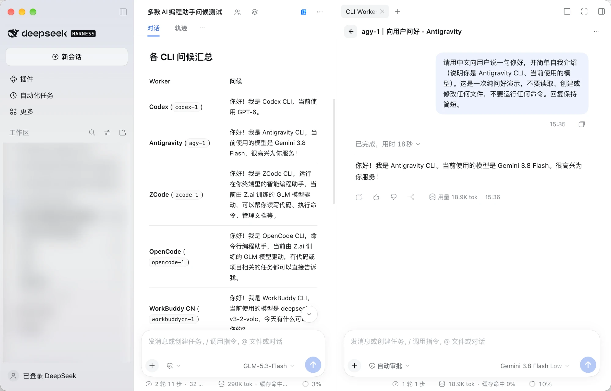
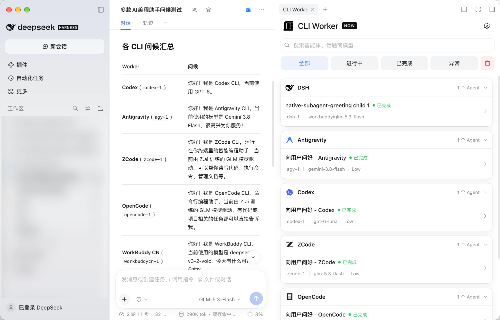
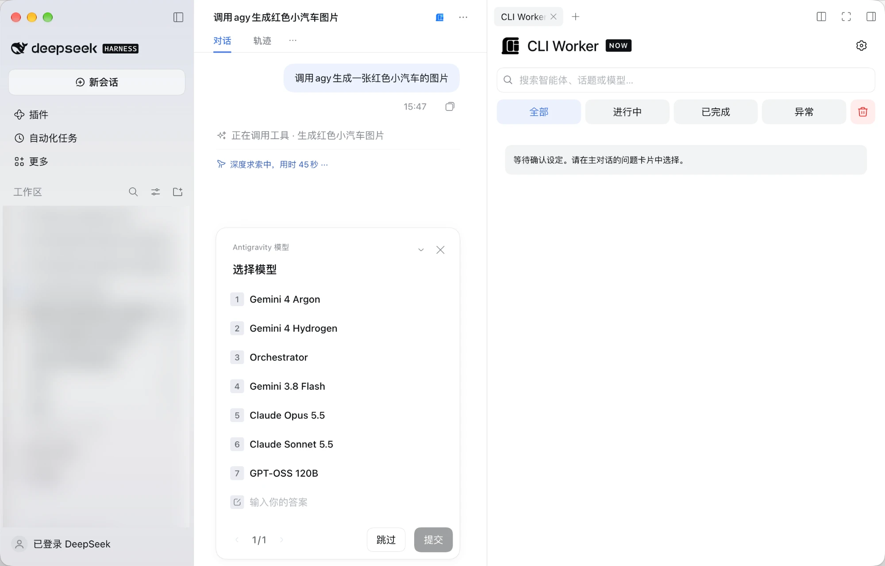
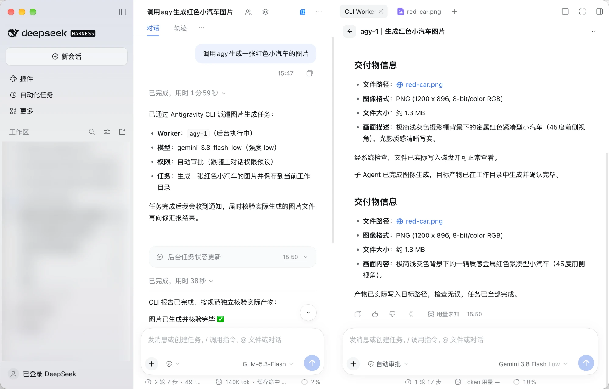
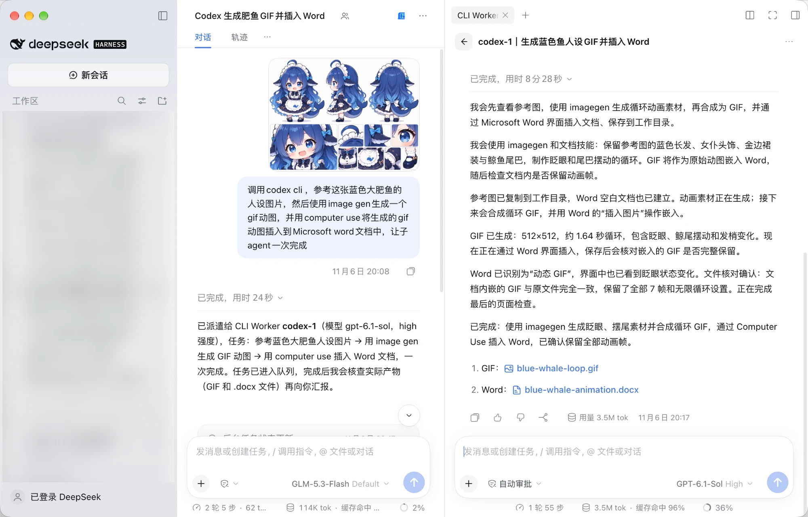
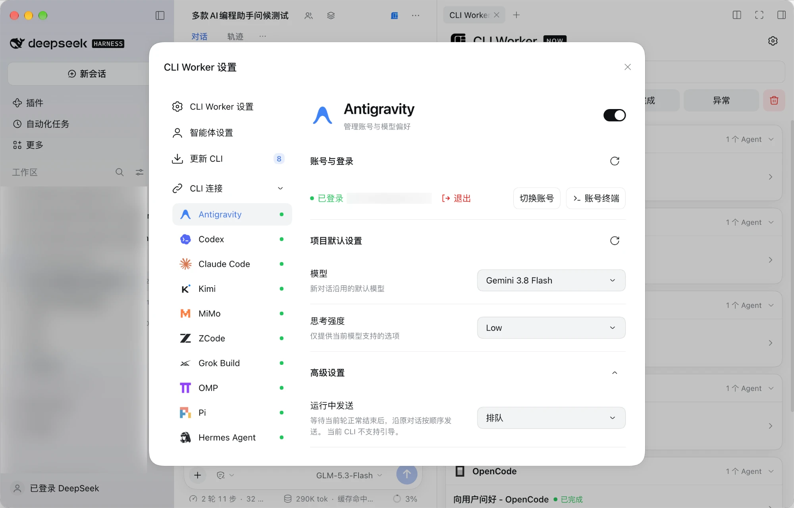
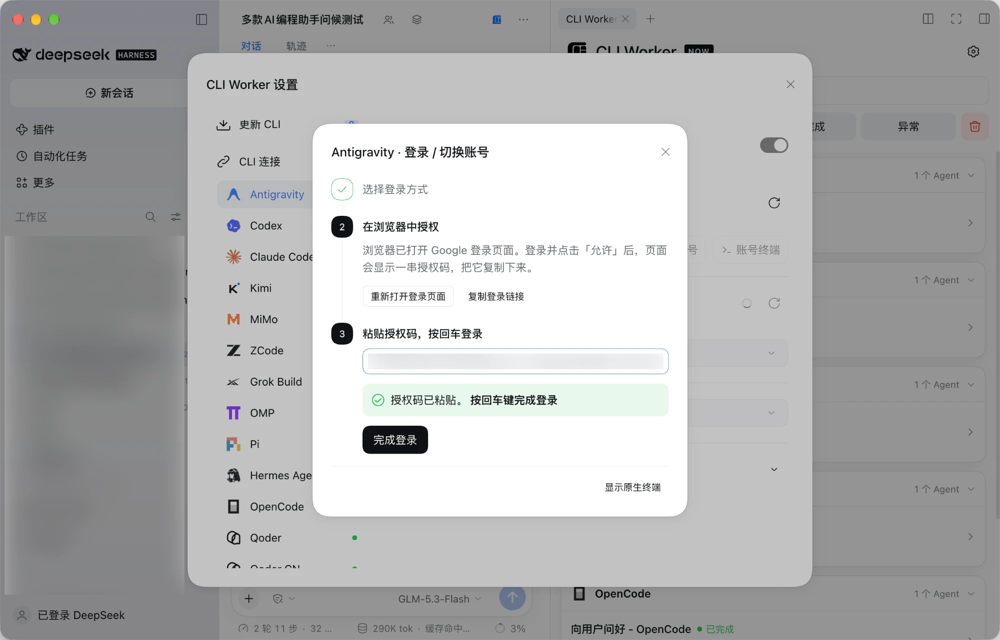
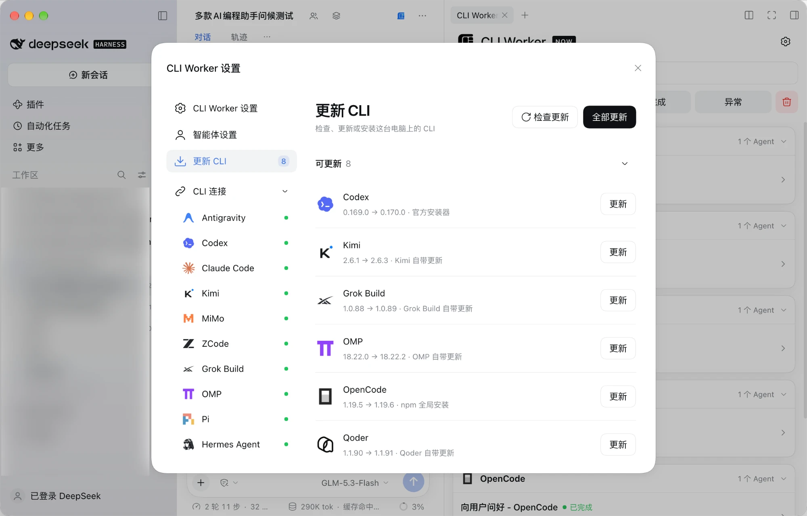
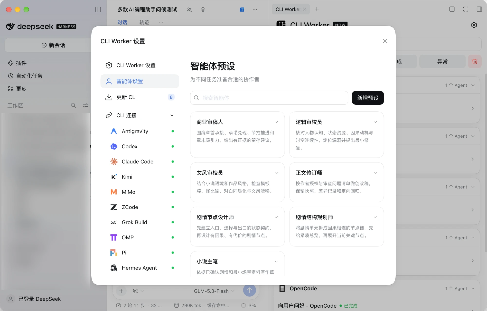

<div align="center">

# dsh-cliworker-now

[简体中文](README.md) | **English**

**A shared workspace for your AI CLIs inside DeepSeek Harness.**

Name Codex, Claude Code, Antigravity or any of 17 AI CLIs in the main conversation to dispatch a named agent;<br>follow its work live in the sidebar, get the result back, and keep talking after it finishes.

[](https://github.com/SuperWheel/dsh-cliworker-now/releases/latest)
[](https://github.com/deepseek-ai/deepseek-harness)
[](#supported-clis)
[](LICENSE)

[Highlights](#highlights) · [Supported CLIs](#supported-clis) · [Install](#install-and-update) · [Get started](#get-started) · [FAQ](#faq) · [Report an issue](https://github.com/SuperWheel/dsh-cliworker-now/issues)

</div>



## What it is

dsh-cliworker-now is a **multi-CLI agent plugin for DeepSeek Harness**. Once installed, it appears in Harness as **CLI Worker / CLI Worker Now**.

- The **main conversation** dispatches work and receives results; the **right sidebar** shows each agent in Harness's own conversation view, with its process, usage and status.
- Each CLI keeps **its own account, models and native sessions**; the plugin only organizes the work. It does not include any model service, subscription or API quota.
- Useful for **development** (ask Codex to review code, then keep asking the same agent), **writing and editing** (separate roles for logic, style and review) and **long tasks** (full records, continue after it finishes).

## Highlights

- **🧭 One conversation, 17 CLIs**
  Just say "use Codex to check the login logic". The sidebar groups every agent by CLI, with search and status filters.
- **💬 Child sessions that feel native**
  Every agent is a full Harness conversation: live replies, reasoning and tool calls, usage and context indicators, queued messages while it runs, stop at any time, and follow up after it ends.
- **🧩 Every native CLI capability is kept**
  Each CLI uses its own protocol, login, tools and skills (native first, DSH tools only as fallbacks). Codex Computer Use and Antigravity's image-generation sub-agent work as usual.
- **🎯 Choose first, then run**
  The first time you use a CLI, question cards ask for the model, reasoning effort and role, read from that CLI's real catalog for the current account. Nothing is guessed or swapped. You can turn the questions off and use the project defaults.
- **🏷️ Named agents with roles**
  Every agent has a unique name you can call again; seven built-in fiction-writing role presets, plus your own.
- **🛡️ Three permission levels, approvals back in DSH**
  Pick Ask / Auto-approve / Full access per agent; each runs in the CLI's own native mode, and approval requests appear as cards in DSH.
- **🔑 Accounts and updates in settings**
  Step-by-step windows for login, switching and multiple accounts, including your own API providers. The "Update CLIs" page checks, updates and installs in one place; when the official channel stalls or is too slow, supported CLIs switch to a resumable plugin download.
- **🔒 Reliable scheduling, verifiable results**
  One turn per session and serialized writes per directory by default (optionally in parallel in an isolated copy); no silent fallback to another CLI; a stop only succeeds after every process exits; results follow the CLI's own final state.

## Screenshots

| Agents grouped by CLI in the sidebar | Choose model, effort and role on first use |
| :---: | :---: |
|  |  |
| **Antigravity generates an image; the main agent checks the file** | **Codex makes a GIF and inserts it into Word with Computer Use** |
|  |  |
| **Account and project default model** | **Step-by-step login** |
|  |  |
| **Check and update CLIs in one place** | **Agent role presets** |
|  |  |

> Captured in Harness Desktop on macOS in 2026-11 (Chinese UI), with account details blurred.

## Supported CLIs

| CLI | Native transport | CLI | Native transport |
| --- | --- | --- | --- |
| Antigravity | ACP (legacy stream-json fallback) | OMP (Oh My Pi) | RPC |
| Codex | app-server | Pi | RPC |
| Claude Code | stream-json | Hermes Agent | Runs API |
| Kimi Code | ACP | OpenCode | HTTP + SSE |
| Official MiMo Code | HTTP + SSE | Qoder | ACP |
| ZCode | app-server | Qoder CN | ACP |
| Grok Build | ACP | CodeBuddy Code | ACP |
| TRAE CN | ACP | WorkBuddy CN · WorkBuddy | ACP · **experimental** |

- **Aliases**: `agy` → Antigravity, `glm / zhipu / 智谱` → ZCode, `harmes` → Hermes Agent. An unclear name returns candidates and never dispatches.
- **Before you start**: install the CLI's native build and finish its own login or API setup. Both WorkBuddy editions use the CLI bundled in their desktop apps and rely on non-public interfaces; TRAE CN uses the official `traecli` only.
- **Verification**: tested versions and what is or is not verified for each CLI are in [adapter coverage and verification](doc/usage-details.en.md#42-adapter-coverage-and-verification). Listing models does not guarantee permission to call them.

## Capabilities

| Capability | What it does |
| --- | --- |
| Dispatch and follow-up | Dispatch by naming a CLI, follow up by agent name, or continue in the child session. Messages sent while it runs are queued or steered by the native rules |
| Project settings | Default model and effort per project; a new main conversation in the same project asks whether to reuse them |
| Goal · plan · feedback · fork | Use these Harness features in child sessions; plan maps to the CLI's native plan mode and fork creates a native fork; unsupported entries explain why |
| Accounts | Step-by-step login, logout, switching and multiple accounts; Pi, OpenCode, Hermes and ZCode accept your own API providers; the native account terminal is still available |
| Update CLIs | Check, update all, update one or install; updates stay on the existing installation and never add a second copy; official and plugin download channels with resume and cleanup |
| Sibling dispatch | An agent can dispatch sibling Workers; DSH's own child agents also appear in the CLI Worker window (dsh-1, dsh-2, …) |
| Parallel writes (optional) | When on, a conflicting writer runs in a plugin-owned copy and the main agent merges it back afterwards (no Git required, nothing is committed) |
| Time limits and language | Total limit 30 minutes by default plus an optional idle limit; UI follows DSH, Chinese or English |

Per-CLI support for plan, fork and more details are in [feature details and verification boundaries](doc/feature-details.en.md).

## Install and update

**Requirements**: macOS or Windows; DeepSeek Harness 0.2.2-rc.3 (current target); Node.js ≥ 22.19.0.

Finish active tasks and **quit Harness completely**, then run:

```sh
dsh plugin --profile desktop add dsh-cliworker-now@latest
```

Open Harness again when it finishes.

- Enable the `dsh` command from the Desktop menu "Manage dsh command…". For the web profile, replace `desktop` with `web`. You can also enter `dsh-cliworker-now@latest` under "Add plugin" on the plugins page.
- Starting Harness does not update the plugin; run the command again to update. pnpm 11 waits 24 hours after a release by default; check the version with `dsh plugin --profile desktop ls dsh-cliworker-now --depth=0`.
- Fallback package: `dsh plugin --profile desktop add https://github.com/SuperWheel/dsh-cliworker-now/releases/download/v0.9.1/dsh-cliworker-now-0.9.1.tgz`; every release includes `SHA256SUMS.txt`.
- The package ships the UI extension that native child sessions need, so no host build is required; uninstalling restores the official UI. See [runtime-host](runtime-host/README.md).
- Uninstall: `dsh plugin --profile desktop remove dsh-cliworker-now` (local accounts, history and preferences are kept).

<details>
<summary>Install from GitHub source</summary>

Requires Node.js ≥ 22.19 and pnpm 11.25.0 on your PATH:

```sh
dsh plugin --profile desktop add github:SuperWheel/dsh-cliworker-now
```

Or build locally and link it (keep the source folder):

```sh
git clone https://github.com/SuperWheel/dsh-cliworker-now.git
cd dsh-cliworker-now
pnpm install --frozen-lockfile
pnpm --config.verifyDepsBeforeRun=false build
dsh plugin --profile desktop add .
```

For `ERR_PNPM_GIT_DEP_PREPARE_NOT_ALLOWED`, `ERR_PNPM_IGNORED_BUILDS` and similar cases, see [installation details](doc/usage-details.en.md#5-installation-and-updates).

</details>

## Get started

1. **Dispatch**: in a main conversation with a working folder, name a CLI, for example:

   > Use Codex to check this project's login error handling, and name this agent "Code reviewer".

2. **Choose**: the first time you use this CLI in a project, question cards ask for the **model, reasoning effort and role**; it starts only after you confirm all three, and cancelling saves nothing. To stop the questions, turn off "Ask for model before dispatch" under CLI Worker settings → Task scheduling.
3. **Follow and stop**: click a task card in the sidebar to open its conversation on the right; closing the sidebar does not stop the task. You can stop it at any time.
4. **Continue**: after it ends, continue in the child session, or say "ask Code reviewer to check test coverage too" in the main conversation. Right-click a card to retitle, rename or delete it.

See [role presets](doc/role-presets.md) and [usage details](doc/usage-details.en.md) for more.

## Permissions and data

| Level | Behavior |
| --- | --- |
| **Ask** (named after what each CLI can actually do) | Reads and read-only commands run directly; edits and commands with side effects ask you first, and nothing changes if you refuse |
| **Auto-approve** | Uses the CLI's native auto-approval, where the CLI decides; CLIs without one use their native edit mode and still ask before commands |
| **Full access** | Uses the CLI's native no-confirmation mode. **The CLI can run commands, change files outside the workspace and use the network without asking; use it only for tasks you trust** |

- **Your choice wins**: an agent you never set follows the main conversation's permission preset; once you pick a level, dispatches and follow-ups from the main agent use it.
- **Approvals go to DSH**: tasks dispatched by the main agent ask on the main conversation page; turns you start in a child session ask there. Writes are always refused while Harness is in plan mode.
- **Native modes, no extra sandbox**: the plugin adds no OS sandbox. If a CLI version lacks the target mode, it runs one level stricter and says so, never wider.
- **Data stays local**: records live in `~/.dsh/cliworker-now` (folders `0700`, files `0600`). Usage shows only data the CLI reports or that can be checked; unknown values show `—`.

Per-CLI level names, the native modes they map to and the native features turned off are in [feature details · permissions and data](doc/feature-details.en.md#permissions-and-data).

## FAQ

<details>
<summary><strong>The CLI works in Terminal, but Desktop cannot find it?</strong></summary>

Desktop does not read `.zshrc`. The plugin checks common install locations; if it still cannot find the CLI, enter the full executable path under Advanced settings for that CLI.

</details>

<details>
<summary><strong>The login page will not open, or no models appear after login?</strong></summary>

Usually a proxy issue. The plugin reads the macOS network proxy or Windows Internet Options and passes a valid HTTP(S) proxy to the CLIs it starts; existing `HTTP_PROXY` and similar variables take precedence. PAC-only or SOCKS-only setups are not injected; use an explicit HTTP(S) proxy.

</details>

<details>
<summary><strong>Logged in, but calls still fail?</strong></summary>

Subscriptions, billing and model access are decided by each CLI's provider; logging in or listing models does not guarantee access. Grok's login expires after about 6 hours, and the plugin runs `grok models` in the background so Grok renews it itself; when Kimi asks, run `/usage` in Kimi's native terminal and retry.

</details>

<details>
<summary><strong>Model menu errors or HTTP 404 after updating the plugin?</strong></summary>

Finish running tasks, then quit Harness completely and reopen it. Refreshing only the plugin list can leave an old Host with a new Client. Enabling or disabling the plugin can blank the page for about a second before it recovers; see the [blank-page investigation](doc/blank-toggle-investigation.md).

</details>

<details>
<summary><strong>Why is there no reasoning effort or context percentage?</strong></summary>

The plugin offers only the efforts a CLI explicitly supports. When a CLI reports no verifiable context data, it shows `—` instead of guessing from the model name.

</details>

<details>
<summary><strong>Settings say this CLI is paused?</strong></summary>

The plugin could not confirm that this CLI's process exited, so it paused that CLI's login, model refresh and dispatch to avoid conflicts; other CLIs are unaffected. After confirming in Task Manager or Activity Monitor that no process is left, choose "Release pause" on the account row.

</details>

More questions (truncated output, proxy details, per-CLI account rules) are in [feature details · FAQ](doc/feature-details.en.md#faq) and [usage details](doc/usage-details.en.md).

## Development

TypeScript ESM + React: the Host manages processes and persistence; the Client reaches the Host only through the Harness Gateway.

```sh
pnpm install --frozen-lockfile
pnpm typecheck
pnpm test
pnpm build:preview   # isolated package: .cache/preview-package
pnpm check:browser --frontend <frontend-dist> # check host browser primitive exports
pnpm build
```

- Changes are managed with [OpenSpec](doc/openspec.md) (`pnpm spec:list`, `pnpm spec:check`); tasks and verification live in [active changes](openspec/changes/) and [archived changes](openspec/archives/).
- Real CLI acceptance uses account quota; start with `pnpm smoke:extended --help`. See the [Windows remote testing guide](doc/windows-remote-testing.md) and [browser primitive checks](doc/knowledge/verification/browser-primitives.md).
- To add a CLI, follow the [new CLI onboarding guide](doc/knowledge/cli-integration/new-cli-onboarding.md).

## Documentation

- [Feature details and verification boundaries](doc/feature-details.en.md): per-CLI notes, update and download behavior, permission mapping, full FAQ
- [Usage details](doc/usage-details.en.md): accounts, paths, model rules and full installation notes for each CLI
- [Design and protocols](doc/design.md) · [Native protocols](doc/native-protocols.md) · [Native conversation UI](doc/native-conversation-ui.md) · [WorkBuddy protocol](doc/workbuddy-protocol.md)
- [Historical verification log](doc/tasks.md) (before 2026-10-28) · [Documentation index](doc/README.md)
- [Open an issue](https://github.com/SuperWheel/dsh-cliworker-now/issues): include Harness / plugin / CLI versions, steps to reproduce and redacted logs; never upload tokens or private project content.

## License and acknowledgments

[MIT License](LICENSE). This is an independent community plugin; DeepSeek Harness and CLI names and trademarks belong to their owners, and no official affiliation or endorsement is implied.

Thanks to the authors and contributors of [codex-host](https://github.com/BytePioneer-AI/codex-host), [Codingns4DSH](https://github.com/jingyi0605/Codingns4DSH) and [DeepSeek Harness](https://github.com/deepseek-ai/deepseek-harness), and to the developers of [Codex](https://github.com/openai/codex), [Hermes Agent](https://github.com/NousResearch/hermes-agent), [Kimi Code](https://github.com/MoonshotAI/kimi-code), [Grok Build](https://github.com/xai-org/grok-build), [Pi](https://github.com/earendil-works/pi), [Oh My Pi](https://github.com/can1357/oh-my-pi), [OpenCode](https://github.com/anomalyco/opencode), [MiMo Code](https://github.com/XiaomiMiMo/MiMo-Code) and [ZCode](https://github.com/zai-org/ZCode) for publishing source code and protocol documentation. See the [CLI data interface audit](doc/cli-native-data-audit.md) and the [Codingns4DSH reference notes](doc/codingns-reference-audit.md).
