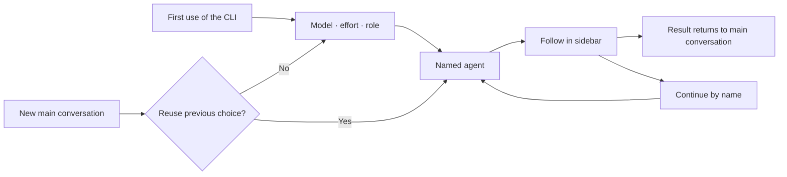

<div align="center">

# dsh-cliworker-now

[简体中文](README.md) | **English**

**A shared workspace for your AI CLIs inside DeepSeek Harness.**

Choose a CLI, model and role, dispatch a named agent, follow its work in the sidebar, and continue the same task.

[](https://github.com/SuperWheel/dsh-cliworker-now/releases/latest)
[](https://github.com/deepseek-ai/deepseek-harness)
[](#supported-clis)
[](LICENSE)

[Install](#install-and-update) · [Get started](#usage) · [FAQ](#faq) · [Report an issue](https://github.com/SuperWheel/dsh-cliworker-now/issues)

</div>

## What it is

dsh-cliworker-now is a **multi-CLI agent plugin for DeepSeek Harness**. It brings your terminal AI CLIs into Harness: the main conversation dispatches work and receives results, and the right sidebar shows each agent in Harness's own full conversation view, with its process, usage and status.

Each CLI keeps its own account, models and native sessions; the plugin organizes the work. It does not include any model service, subscription or API quota.

- **Development**: ask Codex to review code, then keep asking the same named agent.
- **Writing and editing**: set up separate roles for logic, style, commercial review and revision.
- **Long tasks**: each agent keeps its own conversation and records, so you can pick up where it stopped.

Once installed, the plugin appears in Harness as **CLI Worker / CLI Worker Now**.

## Features

- **One entry, many CLIs**: name a CLI in the main conversation and see every task grouped by CLI in the sidebar.
- **Native conversation experience**: child sessions use Harness's own conversation view, composer, model and permission controls, "+" menu and usage indicators, with queueing, stopping and follow-ups.
- **Native CLI behavior**: each CLI uses its own protocol, login and sessions. Models and reasoning effort come from that CLI's real catalog and current account.
- **Native tools first, DSH tools as fallbacks**: each CLI uses its own read, write, search, shell and web tools and skills first. DSH tools that overlap them are no longer handed to the CLI, and an MCP server configured in both places is kept only on the CLI's side. Capabilities the CLI lacks (such as shell commands in Pi) and DSH-only MCP servers and skills are offered through `dsh_worker_tools` as labelled fallbacks, and every call still goes through Harness permissions and approval. Codex, Claude Code, Pi, OpenCode, MiMo and Grok receive a short native-first note naming the offered fallbacks; it is appended to the CLI's own prompt and never changes your task or instruction files (Codex skips it when you configured `developer_instructions`). ZCode's bridge execution is not verified yet, so it gets no DSH tools; OMP, Hermes and isolated-copy runs have no bridge.
- **Named agents with roles**: unique names, role presets and custom instructions, so you can call the same agent again.
- **Predictable scheduling**: nothing starts before you explicitly choose a model (you can turn later questions off and use the saved defaults). One turn per session, serialized writes per directory by default, and no silent fallback to another CLI.
- **Optional parallel writes in one project**: turn on the same-directory parallel writes switch in CLI Worker settings, and a new writer that would wait runs in a plugin-owned copy of the project instead. Merge it back from the task card as uncommitted changes (no Git required, nothing is committed); on conflict the project stays untouched, or discard the copy.
- **Goal, plan, feedback and fork**: use these Harness features in CLI child sessions; unsupported entries explain why.

## Screenshots

Captured from a real demo session in Harness Desktop (taken with v0.6.5; details may differ in the current version).


| Role presets | CLI connections and model preferences |
| --- | --- |
|  |  |

## Supported CLIs

| CLI | Native transport | CLI | Native transport |
| --- | --- | --- | --- |
| Antigravity | ACP (legacy stream-json fallback) | OMP (Oh My Pi) | RPC |
| Codex | app-server | Pi | RPC |
| Claude Code | stream-json | Hermes Agent | Runs API |
| Kimi Code | ACP | OpenCode | HTTP + SSE |
| Official MiMo Code | HTTP + SSE | Qoder | ACP |
| ZCode | app-server | Qoder CN | ACP |
| Grok Build | ACP | CodeBuddy Code | ACP |
| TRAE CN | ACP | | |
| WorkBuddy CN (`workbuddycn`) | ACP · experimental | WorkBuddy (`workbuddy`) | ACP · experimental |

WorkBuddy CN and WorkBuddy use the CLI bundled with their respective desktop apps. **Experimental: relies on private WorkBuddy desktop interfaces.** Install the matching desktop app. The account row offers “Manage in desktop app”, a plugin guide that opens the verified edition and observes current status; it provides no CLI sign-in/sign-out commands. Sign in, sign out, or switch accounts in the desktop app. Opening the guide reads once; opening the app or continuing observation starts serial polling at least 15 seconds after each completed query, for at most five minutes or 20 automatic queries. Manual refresh shares an in-flight query. Closing the guide cancels queries without closing the desktop app. Generic authentication errors do not prove sign-out, and same-site account switches cannot be confirmed. In advanced path settings, enter an app directory, bundled runtime, or built-in CLI entry. Discovery validates the product site and never falls back to CodeBuddy on PATH or the other edition. Generic “WorkBuddy” uses the sole installed edition or asks which edition to use when both are installed; “WorkBuddy international” (also accepted as “WorkBuddy AI”) explicitly selects the international edition. Models and effort options come from a fresh native metadata handshake. Each metadata query leaves an empty native session. Native plan mode and ask/auto/full tiers are wired; Turn usage is shown in credits (read from the built-in CLI's native session file) along with native context usage and its categories such as system prompt, tool definitions and messages (read after each turn by a non-persistent helper process running the native `/context`; values are native estimates; CodeBuddy Code works the same way); DSH tools and native forks (the built-in CLI does not implement `session/fork`) are unavailable. WorkBuddy CN has passed real tasks, ask-level approvals and UI checks on macOS and Windows Desktop; the international edition remains unverified. See [WorkBuddy protocol](doc/workbuddy-protocol.md).

- **Platforms**: macOS / Windows. Install the native build of each CLI you use and complete that CLI's own login or API setup.
- **Host**: DeepSeek Harness (the current target host and all four bundled native UI packages are 0.2.2-rc.3; the earlier rc.3 resources passed isolated enable/disable, page boot and native settings checks on 0.2.1-rc.2 and rc.3); Node.js ≥ 22.19.0.
- **Verification**: for this upgrade (0.2.2-rc.3), plugin loading and the main UI were checked on an rc.3 host with an isolated DSH_HOME; on 2026-11-15 to 11-16 several CLIs were also dispatched, followed up and stopped for real on the regular Mac and Windows Desktop 0.2.2-rc.3 (scope in the v0.8.10 Release verification section). See the [upgrade verification record](openspec/archives/v0.9.0-dsh-rc3-adapt-leeyl/tasks.md) for boundaries; the 0.2.2-rc.2 record is in [rc.2 upgrade verification](openspec/archives/upgrade-host-022rc2/tasks.md). Tested versions and what has or has not been verified for each CLI are in [usage details](doc/usage-details.en.md#42-adapter-coverage-and-verification) and the [implementation log](doc/tasks.md). Listing models does not prove you can call them.

Installation, login and path notes for Qoder, Claude Code (including CC Switch), ZCode, Hermes and others are in [usage details](doc/usage-details.en.md).

Qoder / Qoder CN account and model metadata queries use a private SDK daemon for native versions newer than 1.1.80 and retain the SDK worker protocol for older versions. Unknown versions may switch protocols once, only after an explicit unsupported-protocol response. Queries send no prompt, isolate writable state in a temporary directory, and confirm protocol completion and process exit before cleanup. Custom models are retained; disabled models are not selectable. Actual Workers continue to use ACP.

**TRAE CN** (`traecn`) uses the official `traecli` only. Its official installer at `https://trae.cn/trae-cli/install_v2.sh` needs direct access to trae.cn; the 2026-11-07 probe from outside mainland China returned HTTP 403 (`denied by region block`). Use the official installer; no unofficial installer is provided. Official documentation restricts CLI access to the enterprise flagship plan. Personal login uses `traecli --enable personal_user_login login --personal` and depends on the under-development `personal_user_login` feature; enterprise SSO uses `traecli login --enterprise`, and enterprise PAT uses `traecli login --with-trae-pat`. Since v0.8.9 an Ask level is offered (native read-only sandbox plus on-request approvals); there is no effort selector. On 2026-11-11, with Seed-Code on macOS and Windows, file writes asked first and nothing was written after a rejection. On Windows, TRAE's native read-only sandbox also asks before read-only PowerShell commands; if an earlier tool in the same turn already failed, a rejection there shows the turn as failed. No official international CLI was found as of 2026-11-07. Windows sign-in and a real dispatch passed on 2026-11-09. TRAE has no native source for context categories, so system prompt, tool definitions and messages show `—`. See [TRAE installation, account and permission notes](doc/usage-details.en.md#trae-cn-installation-and-login).

TRAE CN's account window offers personal, enterprise SSO and enterprise PAT cards. Personal sign-in shows a browser link and callback URL field; enterprise methods use the native flow. Switching first runs `logout`, confirms the signed-out state and process cleanup, then asks for a method again. CodeBuddy shows the current account card and asks for folder trust in the window. It opens `/login` from a recognized empty editor, guides Chinese/International browser sign-in, and leaves enterprise/iOA to the native terminal. Switching runs `/logout` on the verified path and requires signed-out state and cleanup before login; unknown screens stay native. See the [pre-authorization capture and remaining acceptance work](openspec/archives/add-new-cli-graphical-login/capture-2026-11-07.md).

OMP DeepSeek API login does not require a custom `models.yml`. Selectable models are the intersection of OMP's native candidates and the current account's `/models` response, with native effort levels preserved. Custom routes take priority over the builtin default; a successful listing is not proof of successful inference.

The Host form API for “Other provider” supports Pi, OpenCode (v1 configuration), and Hermes. Provider ID, base URL, native API type, API key, and model IDs are validated and saved to each CLI’s native configuration and separate credential storage, with rollback on write failure and account/catalog cache invalidation on success. Pi writes to `<stateDirectory>/accounts/pi/agent`, shared with account login, and displays the actual paths. Global `~/.pi/agent` remains read-only; existing provider conflicts are rejected. Hermes follows the Worker’s selected HOME (global or private, never merged). OpenCode writes configuration and credentials under the plugin’s `accounts/opencode` and rejects global provider collisions. Forms display the actual paths and must be reopened if the source changes. Hermes HTTP execution of arbitrary custom providers remains limited by its existing provider allowlist. OMP, Kimi, and TRAE CN retain the native terminal. This stage implements the Host; client integration and Desktop acceptance are tracked separately. It does not validate keys online or call models. See the [version evidence and design](openspec/archives/vnext-custom-provider-form-leeyl/design.md).


## Install and update

The "Update CLI" page in CLI Worker settings lists every CLI's install method, current version and latest version, grouped into updatable, manual update, check failed, up to date and not installed. "Check for updates" rereads every version, "Update all" queues the updatable rows, and each row offers Update, Install or View method. The expanded row shows download progress (bytes, speed, source host, automatic resume count, and whether the official updater or the plugin takeover is downloading), the command and its output, and the final cleanup summary. Cancel reports completion only after the whole process tree has exited. "Download settings" chooses the npm source (follow npm, the npm registry, the npmmirror mirror or a custom URL); official install scripts, Homebrew and desktop installers are not affected.

"Check CLIs in the background after start" in General settings is on by default. About 60 seconds after the Host starts, and only while no task, login window or update is running and CPU use is below 50%, it reads paths, versions and the latest official versions one item at a time. On Windows the version probes run at below-normal priority; Codex and both Qoder editions are read only in the foreground. Background checks never update anything; new versions only appear on the page and as a count badge in the settings navigation. On 2026-11-15 a real Windows check saw the first background probe 120 seconds after start, with kimi, grok and node probes all at below-normal priority.

On macOS, first installs of ZCode and both WorkBuddy editions use their official feeds, verify the package digest and pinned developer signature, then install to the selected directory and verify the application version before saving the CLI path. Isolated Pi npm 1.5.2 and ZCode 3.18.2 installs passed on 2026-11-14. For international WorkBuddy on macOS, first installs and updates follow the website's same-path DMG mapping and strictly verify the feed's SHA-256, pinned Team `FN2V63AD2J`, bundle `com.workbuddy.workbuddy-ai`, and Gatekeeper. The DMG is mounted read-only and detached before the update replaces the old app. CN continues to use ZIP. On 2026-11-15, an isolated arm64 first install passed digest, signature, installed identity/version, and saved-path checks. Its 0644 mjs entry is treated as a readable bundled script; the actual app version remains `5.9.4` and CLI version `2.165.0`, while the artifact digest binds the four-part feed release. Real updates and Desktop rendering remain unverified. If the feed changes to a ZIP digest, verification fails closed; switching formats requires renewed evidence and a rule change, with no automatic fallback. Windows x64 international WorkBuddy first installation uses the official wizard. An explicitly empty SHA-256 feed requires matching COS length, whole-file MD5 and CRC-64/XZ, plus a Valid Authenticode signature from the pinned Tencent publisher before execution. When SHA-256 exists it remains mandatory, with no fallback on mismatch. The wizard appends a `WorkBuddyAI` subfolder when the chosen folder has another name, and defaults to `%ProgramFiles%\WorkBuddyAI`. Discovery checks the selected location, that appended subfolder, Program Files and `%LOCALAPPDATA%\Programs\WorkBuddyAI`, then verifies the actual site and version before saving the path. Choose a separate international directory in the wizard, never the existing CN directory. CN, ZCode and international ARM64 first installations remain manual. On 2026-11-15 a live Windows install to drive D passed the signature check and left the CN edition untouched; a reinstall confirmed that the plugin finds the entry in the appended subfolder and saves the path. Windows desktop installers open in a visible window and have no time limit while waiting for UAC and the wizard (console installs keep 10 minutes); you can still cancel from the page. The installer's own exit marks the install as done; if the finish page's "Run" option started the app and ending the installer's processes takes it down, the plugin reopens it after verification. First installs wait up to 2 minutes for the signature check of the ~500 MB package. A full check clears the previous operation results. Live Windows ZCode update 3.14.5 → 3.18.2 passed on 2026-11-15. See the [acceptance record](openspec/archives/v0.9.0-cli-update-page-leeyl/tasks.md).

ZCode Workers run the CLI bundled with the desktop app (macOS `ZCode.app/Contents/Resources/glm/zcode.cjs`; on Windows `resources\glm\zcode.cjs` under `%ProgramFiles%\ZCode` or `%LOCALAPPDATA%\Programs\ZCode`) the way the app itself does: under the app's own Electron with `ELECTRON_RUN_AS_NODE=1`, with the plugin supplying the keyring and browser packages from the app bundle. The update page shows "App 3.18.2 · CLI 0.17.1" (「应用 3.18.2 · CLI 0.17.1」), and updating the desktop app updates the CLI Workers use; on Windows the official installer still handles the wizard and UAC, and the plugin adds no elevation or silent-install options. If the app runtime fails its launch check, the same CLI temporarily runs under the Node bundled with DSH and a notice is shown. The independent runtime deployed by earlier plugin versions (`~/.local/share/cliworker-now/runtimes/zcode`) is used only when no desktop app is present; automatic path records pointing at it are switched to the in-app entry once the app passes identity and launch checks, manually chosen paths are untouched, and the plugin never deletes that directory. The desktop app ships no terminal UI, so the ZCode "Account terminal" button is hidden in that case; login and logout are unaffected. The plugin's own ZCode account directory gets a file-held key on first use (`.zcode/v2/credential-secret`, 0600); `~/.zcode` is never read or written. macOS has a real launch check without model calls; Windows has simulated coverage only.

**Using your own API Key with ZCode after the subscription expires (v0.9.0-zcode-custom-key-leeyl)**: in ZCode "Account → Add account → Other provider", enter a name, interface type (Anthropic Messages / OpenAI Chat Completions / OpenAI Responses), Base URL, API Key and model IDs, optionally prefilled from a ZCode built-in template. The configuration is saved only to the plugin account folder `<DSH_HOME>/cliworker-now/accounts/zcode/.zcode/v2/provider_config.json` (0600, atomic write, rolled back on failure) and never changes ZCode Desktop's `~/.zcode/v2/provider_config.json`; the name must not match a Desktop, plugin or built-in provider. The account window lists API-key providers from both files: ones added by the plugin can be deleted, Desktop ones are read-only. The model catalog queries `/models` with that provider's own key: on 404/405 the models you entered are listed as "local configuration" with unknown cost; on 401/403 they are hidden; configured custom headers are sent along. Model labels show the provider name instead of its UUID. Since ZCode 0.17.1 rejects workflow fields in the runtime-preferences reply, the plugin sends the workflow setting with session creation and resume instead, depending on the installed version. On 2026-11-16 a dispatch, follow-up and stop with an own DeepSeek key passed on macOS Desktop; a permission request that ZCode 0.17.1 re-sends now shows a single approval card. Windows and headless dispatch are not accepted yet.

Official native CodeBuddy Code installations (Beta) use `codebuddy update`: by default, `~/.local/bin/codebuddy` on Unix and `%LOCALAPPDATA%\codebuddy\bin\codebuddy.exe` on Windows. Automatic path records prefer the stable entry; updates recheck the installation root and actual version. npm/Homebrew keep their package managers; embedded WorkBuddy CLIs are excluded. Verification covers read-only npm path/version checks on Mac and Windows plus simulated native layouts, not real native updates.

Plugin-managed CLI downloads resume after network interruptions. When Range support is confirmed, a 10-second window below 100 KB/s reconnects, sharing the 200-recovery budget; after that, a progressing transfer continues up to the two-hour limit. External commands retry only with interruption evidence and exit/version checks, never merely because they are slow. A length or digest mismatch deletes the temporary file and permits one clean download, outside the 200-recovery count. Default native MiMo installations on macOS use the official zip and local `--binary` installer; the Xiaomi FDS API endpoint is preferred, with identity-checked failover to the original official host on slow or interrupted transfers. HEAD length, ETag and content-md5 must agree before switching; Range/If-Range preserves downloaded bytes. Length, content-md5 and zip structure are verified, without claiming an independent signature. npm main tarballs can switch between the official registry and npmmirror, always verified against the official SHA-512. The selected or current npm registry comes first; custom-address mode disables automatic switching. Settings changed during an operation take effect on the next operation. Progress includes the current source host. Desktop packages remain single-source without a verified equivalent official mirror. On Windows, recognized official default installations of Claude Code, Antigravity, OMP and TRAE CN use plugin-managed downloads with real byte and resume progress. Claude, Antigravity and OMP verify official SHA-256/SHA-512 metadata before same-directory atomic replacement; locked executables remain intact. TRAE CN uses a complete official offline bundle and restores the automatic-update marker only if it existed before installation. Claude can switch between its official download host and GCS bucket after HEAD identity checks. Same-source digests are not independent signatures. TRAE CN on macOS/Linux keeps its native updater, and Unix OMP retains the official `PI_BUILD_URL` handoff. A CLI update or version change does not clear the cached account and model status; both are re-read from the CLI's own login on their usual 10-minute expiry. Only a first install refreshes them once. Maintenance rejections do not become connection errors. Windows takeover has simulated coverage only; real proxy/update acceptance remains task 13.5.

End active tasks and quit Harness completely, then run:

```sh
dsh plugin --profile desktop add dsh-cliworker-now@latest
```

Reopen Harness afterwards. Enable the `dsh` command from the Desktop menu "Manage dsh command…". For a Web profile, replace `desktop` with `web`. You can also enter `dsh-cliworker-now@latest` under "Add plugin" on the Plugins page.

- Starting Harness does not update the plugin. pnpm 11 waits 24 hours after a release by default and may keep the previous version; check with `dsh plugin --profile desktop ls dsh-cliworker-now --depth=0`.
- Fallback package: `dsh plugin --profile desktop add https://github.com/SuperWheel/dsh-cliworker-now/releases/download/v0.9.0/dsh-cliworker-now-0.9.0.tgz`. Each release includes `SHA256SUMS.txt`.
- The package ships the interface extensions that native child conversations need; no host build is required, and uninstalling restores the official interface. If it conflicts with an existing interface override, the startup check refuses without changing your configuration. See [runtime-host](runtime-host/README.md).
- Enabling or disabling this plugin while the page is open makes DSH swap the native session UI live; the page may go blank for about a second, then the plugin has DSH remount the interface in place (unsent composer text may be lost). If an in-place recovery is not possible, the browser reloads once and DSH Desktop asks you to quit and reopen it. A failed live toggle in older dshmarket releases (such as 1.70.1) can leave inconsistent configuration, which still needs a full restart; see the [investigation and verification limits](doc/blank-toggle-investigation.md) and [dsh-market/dsh-market#1010](https://github.com/dsh-market/dsh-market/issues/1010). Native chat display and busy-Enter preferences retain their original settings entries.
- Uninstall with `dsh plugin --profile desktop remove dsh-cliworker-now`; local accounts, history and preferences are kept.

<details>
<summary>Install from GitHub source or develop locally</summary>

Requires Node.js ≥ 22.19 and pnpm 11.25.0 on `PATH`:

```sh
dsh plugin --profile desktop add github:SuperWheel/dsh-cliworker-now
```

Or build locally and link it (keep the source folder):

```sh
git clone https://github.com/SuperWheel/dsh-cliworker-now.git
cd dsh-cliworker-now
pnpm install --frozen-lockfile
pnpm --config.verifyDepsBeforeRun=false build
dsh plugin --profile desktop add .
```

For `ERR_PNPM_GIT_DEP_PREPARE_NOT_ALLOWED`, `ERR_PNPM_IGNORED_BUILDS` or pinning a commit, see [installation details](doc/usage-details.en.md#5-installation-and-updates).

</details>

## Usage

### 1. Dispatch

In a main conversation with a working folder selected, name the CLI explicitly:

> Use Codex to check this project's login error handling, and name the agent "Code Reviewer".

Short names work too: `agy` → Antigravity, `glm / zhipu` → ZCode, `harmes` → Hermes Agent. An ambiguous name returns candidates instead of dispatching.

The first time you use a CLI in a project, Harness question cards ask for the **model, reasoning effort and role**; the task starts only after all three are confirmed. A new main conversation in the same project asks whether to reuse the previous choice. Cancelling saves nothing and starts nothing.

To skip the questions, turn off **Ask for model before dispatch** under "CLI Worker settings → Task scheduling". It is on by default and applies to every CLI. When off, a new main conversation starts directly with the project's default model, effort and last confirmed role. If no complete choice was ever confirmed (for example, only a model was picked in settings) or it is no longer valid (model removed, effort unsupported, account changed), the full selection still appears; nothing is guessed.



### 2. Follow, stop and continue

- Click a task card to open that agent's native conversation on the right; closing the sidebar does not stop background tasks.
- The "+" menu matches Harness: **Add** (file, image, goal, plan, feedback) and **Commands** (permission, model, fork).
- Stop reports success only after the process has fully exited. Messages sent during a run follow the native Inbox rules.
- After a turn ends, reply in the child session, or say in the main conversation: "Ask Code Reviewer to also check test coverage."
- Right-click a card to rename it or delete it; deleted idle tasks can be restored.

### 3. Roles and CLI settings

| Setting | What it does |
| --- | --- |
| Agent settings | Manage name / summary / role-prompt presets; seven built-in fiction roles, see [role presets](doc/role-presets.md) |
| CLI connections | Enable each CLI, check login status, sign in or out through guided account windows, or open the native terminal; set the CLI path under Advanced |
| Project defaults | Save the default model and reasoning effort for the project; with “Ask for model before dispatch” off, new conversations use them directly |
| Child controls | Change the agent's model or permission with native controls; locked while running or while messages are queued |

The plugin checks that the Pi modules it loads and their dependencies are complete; a truncated install (for example after a disk-full npm install) reports "Pi installation is incomplete (missing dependency …)" and asks you to reinstall in Update CLIs, and installs or updates with an incomplete tree are reported as failed. Pi and OMP load sign-in choices from the installed native registry, including supported BigModel Coding (China) and Z.AI (international) options. Their China provider IDs differ. If discovery fails, continue in the native terminal. OMP rows and replacement choices show the native credential number so old and new keys can be distinguished. Sign-out targets one source and credential; success requires native removal and completed process cleanup. Replacement saves the new credential before removing the selected old one, and reports removal failures. Keys from environment variables remain managed in their original configuration. Providers in the native Pi/OMP model configuration file (for example `~/.omp/agent/models.yml`) can be deleted from the account window: after confirmation only that provider is removed, the original file is first backed up under `account-config-backups/` in the plugin state directory, the rest of the file and its formatting are kept, and running the CLI directly no longer offers it. Providers added through the plugin's other-provider form can be deleted as well. When one provider has several credentials, a credential the provider rejects no longer empties the model list: settings show the models of the remaining credentials and say how many rejected credentials were skipped. If every credential is rejected, settings report an authentication failure instead of an empty catalog. OpenCode reports authentication failures the same way.

### 4. Goal, plan, feedback and fork

| Feature | Behavior | Support |
| --- | --- | --- |
| Goal | Set from the goal bar, the "+" menu or `/goal`; an active goal is sent with each turn and never starts a turn by itself | All CLIs |
| Plan | Maps to the CLI's native plan or read-only mode; CLIs without it show no plan button, and the "+" menu explains why | Not on Hermes, Qoder, Qoder CN or the legacy Kimi transport; CodeBuddy Code maps to native `plan` |
| Feedback | Likes, dislikes and feedback stay in Harness and are never sent to the CLI or its vendor | All CLIs |
| Fork | Creates a native CLI fork from a completed turn as a new child session under the same main conversation | Latest turn: Codex, Claude Code, Kimi (ACP), MiMo, ZCode, Pi, OpenCode, Qoder, Qoder CN, TRAE CN; earlier turns: Codex only |

TRAE CN does not use the DSH tool bridge: its MCP configuration replacement semantics remain unverified. In-run steering is advertised but untested, so messages use the native Inbox queue. A TRAE turn ending with `cancelled` after a rejected approval, without a user stop, shows “Ended after approval was rejected” and can be continued. A failed native session load reports an error without creating a new session.

**DS Bot long-conversation segments** (since v0.8.9): when its context nears the limit, DS Bot moves the conversation to a new session and archives the old segment. The plugin reads DS Bot's `<DSH_HOME>/bot/state.json` (read-only) to recognize one segment chain; when the plugin is used from the new segment, idle Workers of earlier segments move to it with their native CLI session unchanged, so you can keep checking, continuing and opening them. A running Worker moves after it finishes. If the file cannot be read or the chain cannot be confirmed, cross-conversation access is still refused. A DS Bot data directory changed through its `home` setting is not recognized.

## Permissions and data

- **Runs what you chose**: a missing or failing CLI is never replaced by another one, and CLIs started outside the plugin are not taken over.
- **Three Worker permission levels**: a child session's permission menu (`/permission`) lists the CLI's three levels, and each turn runs in the CLI's own native mode. No extra OS sandbox is added:
  - **First level ("Ask" for most CLIs)**: reads and read-only commands run directly; file changes and commands with side effects ask you first, and nothing changes if you deny. OpenCode/MiMo cannot tell read-only commands apart, so every command asks. CLIs that cannot ask before every change are named for what they do: Kimi's is "Workspace edits only" (when the working directory is a Git repository, Kimi approves edits inside it automatically and asks for the rest); Antigravity's is "Plan only" (ACP has no verified plan mode, so native stream plan is retained); Hermes has no first level; TRAE CN implements Ask with its native read-only sandbox and on-request approvals (`approvals_reviewer="user"`), so changes need approval, and on Windows read-only commands ask as well. Pi has no native approvals, so each turn the plugin loads a private Pi extension that uses Pi's documented tool-call hook and confirm dialog to ask you; reading files does not ask.
  - **Middle level, "Auto approval"**: the CLI's native auto-approval (Codex `auto_review`, Claude Code `auto`, Kimi `yolo`, Qoder `auto`, Grok auto-review, Hermes `smart`, Antigravity ACP skipping confirmations inside its terminal sandbox, or confirming each request when the host has none (legacy `--mode auto`), MiMo `skip-all`). The CLI decides what to allow and may allow actions outside the workspace; whatever it still wants confirmed asks you. CLIs without native auto-approval use their native edit mode instead: ZCode (`edit`) and OpenCode call it "Workspace edits only", OMP (`write`) and Pi call it "Auto-approve edits": edits are approved automatically in any folder, and commands still ask you. TRAE CN uses `default` for Workspace edit: workspace changes and commands are automatically approved, while outside-workspace requests go to DSH; native `auto` is not used.
  - **Full access**: the CLI's native no-confirmation/full-access mode (Codex `danger-full-access`, Claude Code `bypassPermissions`, Kimi ACP `auto`, Qoder `bypass_permissions`/`yolo`, ZCode `yolo`, Grok `--always-approve`, Hermes approvals off, Antigravity skipping confirmations with its terminal sandbox off, OMP `yolo`, every tool allowed for OpenCode/MiMo, native shell for Pi, TRAE CN `bypass_permissions`); nothing asks. **At this level the CLI can run commands, change files outside the workspace and reach the network without asking; use it only for tasks you trust.**
  - **Your choice wins**: the menu always lists all of the CLI's levels. A Worker you never set follows the main conversation (read only → first level; workspace write → middle level; full access → full access). Once you pick a level, every turn of that Worker — including the main agent's dispatches and follow-ups — runs at it, even above the main conversation, and the main agent does not ask again. Picking full access still shows the DSH confirmation. Under read only, dispatch to an Antigravity, Hermes or Kimi Worker you never set is refused. Changing the main conversation's preset mid-run applies to Workers that follow it from the next turn; requests in the current turn are decided by the preset at that moment.
  - **Plan mode is separate from the level**: `/plan` or the plan marker only switches native plan mode, and leaving plan mode keeps the level. Hermes, Qoder and Qoder CN have no plan mode. When a Claude Code plan turn ends with native `ExitPlanMode`, the plan is returned as the turn result and the task is marked completed; the plugin does not approve leaving plan mode and nothing in the plan is executed. Turn plan mode off and follow up to execute it. With Haiku selected, Claude Code answers plan turns with Sonnet (official behavior); the plugin treats this as the same model choice.
  - **Falling back when a native mode is missing**: if the installed CLI lacks the target mode, or the mode reads back differently, the turn runs one level stricter and the timeline says so; if even the first level cannot be confirmed, the turn does not start. A wider mode is never used instead. Antigravity requires **agy 1.4.11 or later with `acp --stdio` confirmed by the installed help**. Older versions, failed capability probes and plan mode retain stream. ACP uses the project as both process and session cwd and injects the bridge through `mcpServers`, without a private workspace. Explicit project add-directories remain and can affect the native default command directory. ACP reports no sandbox state, so each auto turn first starts the stream entry once without input and reads agy's own pre-input report, the same evidence the stream fallback uses. When the host has a terminal sandbox, ACP runs with `--sandbox --dangerously-skip-permissions`, matching the previous Mac auto mode. When agy reports no terminal sandbox (for example Windows 11 23H2) or nothing can be confirmed, confirmations are not skipped: native permission requests go to DSH one at a time, with allow-once or deny and no session grant. Whether workspace edits ask is up to agy: in the Windows test, writing a file inside the project did not ask, and only the command did. Full access disables the terminal sandbox and skips confirmations. Models and effort are selected from native catalogs and read back. Existing IDs are loaded; an incompatible load falls back to stream with the same ID, never a new conversation. Sandboxless stream has no supported command approval channel and warns that commands may be denied. `denied_actions` requires verification and `finished_reason` is partial failure. Cancellation and timeout still require confirmed process cleanup; ACP usage is per turn. Real MCP loading, tool calls, continuation and stopping remain tracked in `openspec/archives/migrate-agy-acp/tasks.md`.
  - **Requests go to DSH**: denied while Harness is in plan mode; allowed automatically when the Worker is at full access (if the main conversation is also at full access, its approval policy applies); denied at the middle level when the main conversation's policy is "never"; otherwise you are asked.
  - **Codex Computer Use app approval**: verified `cua_repl` empty-form app grants (such as "Allow Codex to use DeepSeek Harness?") follow the same DSH policy, including plan-mode denial and existing full-access rules. A session grant is offered only when the native request explicitly supports it; the plugin never sends permanent grants or caches permission. A denial followed by normal Codex completion remains completed, with the denial in the timeline. Forms requiring input, URL login and unknown elicitations remain unsupported and fail the run. Synthetic regressions are covered; real Windows request frames and DSH approval round trips remain unverified.
  - Tasks started by the main agent (`cliworker_start` / `cliworker_followup`) ask on the main conversation page. Turns you start in a child session (follow-ups, queued messages, reruns) ask in that child session, and the task card shows "Waiting for approval". Where the CLI natively offers a session-wide grant (Codex, Claude Code, Kimi, Qoder, Hermes), the main-page question also offers 「本会话始终允许」 (always allow for this session; the question text is in Chinese), remembered by the CLI itself; the child-session approval panel offers only allow once / deny. Approvals requested through a DSH fallback tool (for example a fallback shell tool asking for a wider sandbox) are asked the same way, with allow once / deny only. No answer, or a stopped task, counts as a denial.
  - Write tasks are still refused while Harness is in plan mode. OMP gets its native shell at every level, and each native confirmation for a command or write goes to DSH under the rules above. Antigravity ACP forwards native permission requests to DSH; Pi gets its native shell only under full access and otherwise runs commands through the DSH fallback shell tool.
- **Native features that stay off**: the plugin keeps a CLI's native features by default (Grok web search and fetch and your own OpenCode/MiMo skills are enabled) and turns one off only for these reasons:
  - Account isolation: OpenCode/MiMo external plugins and imported Claude Code commands and MCP; for OpenCode, project config, the `~/.opencode` config in your home folder (skills there are still provided), CLAUDE.md and the `.claude`/`.agents` compatible skill folders; for MiMo, the import of Claude Code session transcripts at startup; Pi/OMP extensions, user skills and rules; Hermes plugins and MCP (including external memory services). MiMo's project config and `~/.mimocode` are its own account and model sources and stay on.
  - Cannot follow the DSH preset: Pi's native shell (except under full access).
  - Other: LSP for OpenCode/MiMo/OMP (avoids automatic downloads); ZCode's browser REPL (runs arbitrary code; to be reviewed); OMP memory (OMP rebuilds its memory files wholesale from the Worker's private session store, which holds the account, so sharing them with your own OMP or other Workers would overwrite one another).
- **CLI memory follows your own setting**: Grok, Hermes and ZCode memory is on in a Worker exactly when it is on in the CLI itself. Grok reads `~/.grok/config.toml` (plus `requirements.toml` and `GROK_MEMORY`) and is off by default; Hermes reads the memory section of the current account's `config.yaml` and is on by default; ZCode reads the desktop memory switch and is off by default. When on, the Worker shares the same memory you use directly (Grok `~/.grok/memory-v2`, `memories` in the Hermes account folder, ZCode `~/.zcode/cli/memories`), so Worker tasks are remembered too, and the CLI may call its model in the background to organize memory. Managed remote settings are not visible to the plugin and count as unset.
- **Denied authorization**: when a request is denied (including one from a DSH fallback tool) and the CLI then finishes the turn on its own, the task is marked completed with no extra notice; the denial stays in the timeline.
- **Results follow the CLI's own turn outcome**: one failed tool step does not fail the whole turn. When the CLI recovers and finishes, the task is completed with a note "N tool steps failed this turn; the CLI handled them". When the CLI stops right after a failed tool step, the task is marked "Result unverified". Only a failed or interrupted turn, a missing end signal, an unfinished tool or an abnormal CLI exit counts as a failure.
- **Sibling dispatch**: a direct CLI Worker or DSH child can call `cliworker_start`; the new Worker belongs to the same main conversation. `cliworker_status` reads that conversation's Workers without waiting for completion. Stopping or deleting the initiator does not stop its siblings. Each main conversation admits up to 6 unfinished child-initiated Workers, also subject to the global queue (2 concurrent by default, up to 8). Third-level callers and unresolved parents are rejected.
- **Sibling selection and permissions**: the main conversation supplies project, permission and plan state. The new Worker does not inherit the initiator's model, effort, role, session ID or permission level. Selection and approval follow the initiating turn: main-agent turns and DSH children ask on the main page; Worker-window turns ask in that Worker's child session. The tool bridge admits only visible `cliworker_start` and `cliworker_status`; other dispatch tools remain blocked.
- **Native CLI sub-agents follow native settings**: Grok reads `requirements.toml`, `GROK_SUBAGENTS`, then `config.toml` (native default: on). ZCode follows user/project `features.subagent`, `features.skill` and `permission.disallowedTools` (both features default on). Its native `dynamicWorkflowMode` user setting takes precedence over `ZCODE_DYNAMIC_WORKFLOW_MODE`; unset defaults to disabled. Unavailable managed remote settings count as unset. User-disabled features stay disabled, and resume follows the same deny-list rules. Native sub-agent activity stays inside the Worker's conversation at the granularity exposed by the CLI; no extra panel entries are invented. Antigravity's `invoke_subagent` (for example image generation) runs in the background and agy only hands over its result on the next message, so the Worker keeps the session open after the turn and sends checks labelled “CLI Worker automatic follow-up (not a user message)” at growing intervals until agy reports the result (waits add up to about 10 minutes, counted from the end of the turn, so time spent in the turn itself or on approvals does not count; the whole run stays within the task timeout, and on expiry the result is marked unverified). A follow-up treats a sub-agent as done once its result message has arrived or the requested output exists; agy listing a sub-agent as ALIVE only means it can still receive messages, not that it is still working. Each wait and follow-up appears as a notice line in the Worker process and its conversation window; the internal pending marker never shows in the reply.
- **Time limits**: "CLI Worker settings → Time limits" sets a total time limit (30 minutes by default; 1–8 hours or no limit, at most 24 hours) and an idle time limit (off by default; 5/10/30 minutes: the task stops only when the CLI sends no reply, tool or reasoning event for that long; time spent waiting for your answer to an authorization request, including one from a DSH fallback tool, does not count). Each task fixes its deadline when it starts, so changes apply to later tasks only. A timed-out task is marked interrupted only after every CLI process has exited, with a note saying whether the total or the idle limit was reached. A `timeoutMs` set earlier in the plugin config file becomes the default total limit.
- **DSH subagents**: native direct children of the current main conversation appear in a sibling DSH group and participate in search and status filters. The group carries the DSH mark, and cards show a name and model like CLI Worker cards. Each DSH subagent is named dsh-1, dsh-2 and so on in order of appearance (stable and never reused within a main conversation), so you can ask the main agent to continue one by name, for example “continue dsh-1”; CLI Workers cannot use dsh-<number> names. Opening one uses the same native child conversation and statistics. Continuable children support messages and stop; one-shot or unknown modes are read-only. Delete in the context menu only hides the entry here. Turn off “Show DSH subagents in the CLI Worker window” under CLI Worker Settings → CLI Worker Settings to hide the group (on by default), without changing native DSH conversations.
- **Interface language**: "CLI Worker settings → Language" offers Follow DSH (default), 中文 or English. A saved choice switches every open CLI Worker panel at once, without a reload. CLI output, model names, your own content and Host errors that are not in the dictionary stay as they are; the tool descriptions given to the main agent do not change with the interface language.
- **Local records**: stored in `~/.dsh/cliworker-now` (folders `0700`, files `0600`). Each CLI still sends model requests to its provider according to its own configuration.
- **Usage with a source**: only data the CLI provides or that can be checked is shown; unknown values show `—` and are never filled with zeros or guesses.

## FAQ

<details>
<summary><strong>The CLI works in my terminal, but Desktop can't find it.</strong></summary>

Desktop does not read `.zshrc`. The plugin checks common install locations; if it still can't find the CLI, set the full executable path under that CLI's Advanced settings.

</details>

<details>
<summary><strong>After updating, the model menu fails or shows HTTP 404.</strong></summary>

End running tasks, quit Harness completely and reopen it. Refreshing only the plugin list can leave an old Host with a new Client.

</details>

<details>
<summary><strong>Network requests or sign-ins fail on macOS / Windows.</strong></summary>

A macOS Desktop launched from the Dock may not inherit terminal proxy variables; Windows proxy apps often change only Internet Options. The plugin reads the macOS network proxy or Windows Internet Options and passes a valid explicit HTTP(S) proxy to its CLI processes, account terminals, update/install commands and probes. Its own HTTPS requests use the same proxy; injected bypass entries always include loopback. Existing `HTTP_PROXY`/`HTTPS_PROXY`/`ALL_PROXY` (including lowercase) or explicit removal in the launch environment takes priority. Settings refresh on demand after a 15-second cache: synchronous spawns use the last reading, while account terminals and Host requests await a fresh one. On macOS, PAC, auto-discovery or SOCKS alone is not injected; one diagnostic explains why. The plugin does not execute PAC or change system settings.

</details>

<details>
<summary><strong>I'm logged in, so why do calls still fail?</strong></summary>

Subscriptions, billing and model access are decided by each CLI's provider. Logging in or listing models does not guarantee access; check the CLI account's permissions when you see errors such as 403.

Grok sign-ins expire after about 6 hours. When that happens, the plugin runs `grok models` once in the background before listing models or dispatching, so Grok renews itself and writes `~/.grok/auth.json` back, just as when you run grok in a terminal; the plugin never reads or copies the refresh token, sends no renewal request of its own and makes no model call. If renewal fails, the message names the reason: “no longer valid” means sign in again in the account terminal; a temporary renewal failure means check the network or proxy and refresh; “account terminal is running” means close the account terminal first.

When a Kimi sign-in has expired but can still be renewed, the model check asks you to run `/usage` in Kimi's own terminal and try again. Kimi only renews itself before `/usage`, and the plugin sends no renewal request of its own.

</details>

<details>
<summary><strong>Why is there no reasoning effort or context percentage?</strong></summary>

The plugin offers only the effort levels the CLI supports. When the CLI provides no verifiable context data, the indicator shows `—` instead of a guess based on the model name.

</details>

<details>
<summary><strong>Output shows “truncated” when reading large files, or the model says the file was cut off.</strong></summary>

These are two different budgets:

- **Plugin display budget** (plugin settings): one tool output or reasoning block shows at most `maxToolPreviewBytes` (default 256 KiB), and one run shows at most `maxRunBytes` (default 16 MiB) of tool output and reasoning. Beyond that, only the display is cut and marked “Output truncated; the full content is in the CLI's native session or the actual output files”. The CLI keeps running and the run's result is unchanged; tool receipts passed to the main agent carry the same note. Running output is sent as increments only, never resent as it grows.
- **Inbound frame protection**: a single protocol frame from the CLI larger than `maxNativeLineBytes` (default 32 MiB) stops the run, and the error names the limit.
- **The CLI's own model-visible budget**: how much tool output the model actually reads is decided by the CLI. The plugin neither overrides it nor offers a setting for it, and raising the plugin budgets above does not let the model see more. For Codex it is decided by the `max_output_tokens` the model sets on each call and by Codex's `tool_output_token_limit` setting; the Codex launched by the plugin reads `$CODEX_HOME/config.toml` (`~/.codex/config.toml` when unset), and a project `.codex/config.toml` or command-line settings take precedence. gpt-6.x also uses the code-mode exec/wait tools in native Codex, so it behaves the same as in the plugin.

</details>

<details>
<summary><strong>Settings say “this CLI is paused”.</strong></summary>

When a CLI process that read the account or models cannot be confirmed to have exited, the plugin pauses sign-in, sign-out, model refresh and dispatch for that CLI so nothing collides with a process that may be left. Other CLIs are unaffected, and restarting Harness does not release it. The notice ends with the reason, with paths removed.

First check Task Manager (Windows) or Activity Monitor (macOS) that no process of that CLI is left, then choose “Release pause” on the account row and confirm. The plugin refuses, and says why, while that CLI still has a running or queued task, an open account terminal or a status read in progress. A failed cleanup of a real task still pauses all dispatch and has no such release.

</details>

More account, path and model rules are in [usage details](doc/usage-details.en.md).

## Development

Run `pnpm check:browser --frontend <frontend-dist>` to check browser primitive exports; see the [method and validation limits](doc/knowledge/verification/browser-primitives.md).

TypeScript ESM + React: the Host owns processes and persistence, and the Client reaches the Host only through the Harness Gateway.

```sh
pnpm install --frozen-lockfile
pnpm typecheck
pnpm test
pnpm build:preview   # isolated package in .cache/preview-package
pnpm build
```

Changes are managed with [OpenSpec](doc/openspec.md) (`pnpm spec:list`, `pnpm spec:check`). Real CLI acceptance uses account quota; start with `pnpm smoke:extended --help`. For Windows remote testing see the [guide](doc/windows-remote-testing.md).

## Documentation

- [Usage details and CLI notes](doc/usage-details.en.md): per-CLI accounts, paths, model rules and full installation notes
- [Design](doc/design.md) · [Native protocols](doc/native-protocols.md) · [Native UI contract](doc/native-conversation-ui.md)
- [Implementation log](doc/tasks.md) · [Version notes](doc/version-notes.md) · [Documentation index](doc/README.md)
- [New CLI onboarding (Chinese)](doc/knowledge/cli-integration/new-cli-onboarding.md): steps, files to change and acceptance checklist for adding a CLI
- [Report an issue](https://github.com/SuperWheel/dsh-cliworker-now/issues): include Harness / plugin / CLI versions, reproduction steps and redacted logs. Keep tokens and private project content out.

## License and acknowledgments

[MIT License](LICENSE). This is an independent community plugin; DeepSeek Harness and CLI names and trademarks belong to their owners, and no official affiliation or endorsement is implied.

Thanks to the authors and contributors of [codex-host](https://github.com/BytePioneer-AI/codex-host), [Codingns4DSH](https://github.com/jingyi0605/Codingns4DSH) and [DeepSeek Harness](https://github.com/deepseek-ai/deepseek-harness), and to the developers of [Codex](https://github.com/openai/codex), [Hermes Agent](https://github.com/NousResearch/hermes-agent), [Kimi Code](https://github.com/MoonshotAI/kimi-code), [Grok Build](https://github.com/xai-org/grok-build), [Pi](https://github.com/earendil-works/pi), [Oh My Pi](https://github.com/can1357/oh-my-pi), [OpenCode](https://github.com/anomalyco/opencode), [MiMo Code](https://github.com/XiaomiMiMo/MiMo-Code) and [ZCode](https://github.com/zai-org/ZCode) for their public source and protocol documentation. See the [CLI data interface audit](doc/cli-native-data-audit.md) and [Codingns4DSH reference notes](doc/codingns-reference-audit.md) for the scope of these references.
