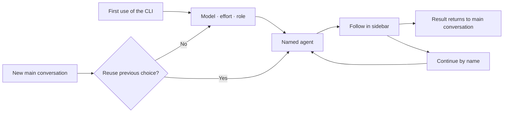

<div align="center">

# dsh-cliworker-now

[简体中文](README.md) | **English**

**A shared workspace for your AI CLIs inside DeepSeek Harness.**

Choose a CLI, model and role, dispatch a named agent, follow its work in the sidebar, and continue the same task.

[](https://github.com/SuperWheel/dsh-cliworker-now/releases/latest)
[](https://github.com/deepseek-ai/deepseek-harness)
[](#supported-clis)
[](LICENSE)

[Install](#install-and-update) · [Get started](#usage) · [FAQ](#faq) · [Report an issue](https://github.com/SuperWheel/dsh-cliworker-now/issues)

</div>

## What it is

dsh-cliworker-now is a **multi-CLI agent plugin for DeepSeek Harness**. It brings your terminal AI CLIs into Harness: the main conversation dispatches work and receives results, and the right sidebar shows each agent in Harness's own full conversation view, with its process, usage and status.

Each CLI keeps its own account, models and native sessions; the plugin organizes the work. It does not include any model service, subscription or API quota.

- **Development**: ask Codex to review code, then keep asking the same named agent.
- **Writing and editing**: set up separate roles for logic, style, commercial review and revision.
- **Long tasks**: each agent keeps its own conversation and records, so you can pick up where it stopped.

Once installed, the plugin appears in Harness as **CLI Worker / CLI Worker Now**.

## Features

- **One entry, many CLIs**: name a CLI in the main conversation and see every task grouped by CLI in the sidebar.
- **Native conversation experience**: child sessions use Harness's own conversation view, composer, model and permission controls, "+" menu and usage indicators, with queueing, stopping and follow-ups.
- **Native CLI behavior**: each CLI uses its own protocol, login and sessions. Models and reasoning effort come from that CLI's real catalog and current account.
- **Native tools first, DSH tools as fallbacks**: each CLI uses its own read, write, search, shell and web tools and skills first. DSH tools that overlap them are no longer handed to the CLI, and an MCP server configured in both places is kept only on the CLI's side. Capabilities the CLI lacks (such as shell commands in Pi) and DSH-only MCP servers and skills are offered through `dsh_worker_tools` as labelled fallbacks, and every call still goes through Harness permissions and approval. Codex, Claude Code, Pi, OpenCode, MiMo and Grok receive a short native-first note naming the offered fallbacks; it is appended to the CLI's own prompt and never changes your task or instruction files (Codex skips it when you configured `developer_instructions`). ZCode's bridge execution is not verified yet, so it gets no DSH tools; OMP, Hermes and isolated-copy runs have no bridge.
- **Named agents with roles**: unique names, role presets and custom instructions, so you can call the same agent again.
- **Predictable scheduling**: nothing starts before you explicitly choose a model (you can turn later questions off and use the saved defaults). One turn per session, serialized writes per directory by default, and no silent fallback to another CLI.
- **Optional parallel writes in one project**: turn on the same-directory parallel writes switch in CLI Worker settings, and a new writer that would wait runs in a plugin-owned copy of the project instead. Merge it back from the task card as uncommitted changes (no Git required, nothing is committed); on conflict the project stays untouched, or discard the copy.
- **Goal, plan, feedback and fork**: use these Harness features in CLI child sessions; unsupported entries explain why.

## Screenshots

Captured from a real demo session in Harness Desktop (taken with v0.6.5; details may differ in the current version).


| Role presets | CLI connections and model preferences |
| --- | --- |
|  |  |

## Supported CLIs

| CLI | Native transport | CLI | Native transport |
| --- | --- | --- | --- |
| Antigravity | stream-json | OMP (Oh My Pi) | RPC |
| Codex | app-server | Pi | RPC |
| Claude Code | stream-json | Hermes Agent | Runs API |
| Kimi Code | ACP | OpenCode | HTTP + SSE |
| Official MiMo Code | HTTP + SSE | Qoder CLI | ACP |
| ZCode | app-server | Qoder CN CLI | ACP |
| Grok Build | ACP | | |

- **Platforms**: macOS / Windows. Install the native build of each CLI you use and complete that CLI's own login or API setup.
- **Host**: DeepSeek Harness (bundled resources target 0.2.1-rc.5; the earlier rc.3 resources passed isolated enable/disable, page boot and native settings checks on 0.2.1-rc.2 and rc.3); Node.js ≥ 22.19.0.
- **Verification**: tested versions and what has or has not been verified for each CLI are in [usage details](doc/usage-details.en.md#42-adapter-coverage-and-verification) and the [implementation log](doc/tasks.md). Listing models does not prove you can call them.

Installation, login and path notes for Qoder, Claude Code (including CC Switch), ZCode, Hermes and others are in [usage details](doc/usage-details.en.md).

## Install and update

End active tasks and quit Harness completely, then run:

```sh
dsh plugin --profile desktop add dsh-cliworker-now@latest
```

Reopen Harness afterwards. Enable the `dsh` command from the Desktop menu "Manage dsh command…". For a Web profile, replace `desktop` with `web`. You can also enter `dsh-cliworker-now@latest` under "Add plugin" on the Plugins page.

- Starting Harness does not update the plugin. pnpm 11 waits 24 hours after a release by default and may keep the previous version; check with `dsh plugin --profile desktop ls dsh-cliworker-now --depth=0`.
- Fallback package: `dsh plugin --profile desktop add https://github.com/SuperWheel/dsh-cliworker-now/releases/download/v0.8.4/dsh-cliworker-now-0.8.4.tgz`. Each release includes `SHA256SUMS.txt`.
- The package ships the interface extensions that native child conversations need; no host build is required, and uninstalling restores the official interface. If it conflicts with an existing interface override, the startup check refuses without changing your configuration. See [runtime-host](runtime-host/README.md).
- Known limitation: live-toggling this plugin with dshmarket 1.70.1 can blank the current window; its restart prompt does not make the live transition safe. Fully restart Harness after toggling; a cold start after disabling restores the stock UI. The root cause is in the market's live-toggle flow and has been reported upstream ([dsh-market/dsh-market#1010](https://github.com/dsh-market/dsh-market/issues/1010)); see the [investigation and verification limits](doc/blank-toggle-investigation.md). Native chat display and busy-Enter preferences retain their original settings entries.
- Uninstall with `dsh plugin --profile desktop remove dsh-cliworker-now`; local accounts, history and preferences are kept.

<details>
<summary>Install from GitHub source or develop locally</summary>

Requires Node.js ≥ 22.19 and pnpm 11.25.0 on `PATH`:

```sh
dsh plugin --profile desktop add github:SuperWheel/dsh-cliworker-now
```

Or build locally and link it (keep the source folder):

```sh
git clone https://github.com/SuperWheel/dsh-cliworker-now.git
cd dsh-cliworker-now
pnpm install --frozen-lockfile
pnpm --config.verifyDepsBeforeRun=false build
dsh plugin --profile desktop add .
```

For `ERR_PNPM_GIT_DEP_PREPARE_NOT_ALLOWED`, `ERR_PNPM_IGNORED_BUILDS` or pinning a commit, see [installation details](doc/usage-details.en.md#5-installation-and-updates).

</details>

## Usage

### 1. Dispatch

In a main conversation with a working folder selected, name the CLI explicitly:

> Use Codex to check this project's login error handling, and name the agent "Code Reviewer".

Short names work too: `agy` → Antigravity, `glm / zhipu` → ZCode, `harmes` → Hermes Agent. An ambiguous name returns candidates instead of dispatching.

The first time you use a CLI in a project, Harness question cards ask for the **model, reasoning effort and role**; the task starts only after all three are confirmed. A new main conversation in the same project asks whether to reuse the previous choice. Cancelling saves nothing and starts nothing.

To skip the questions, turn off **Ask for model before dispatch** under "CLI Worker settings → Task scheduling". It is on by default and applies to every CLI. When off, a new main conversation starts directly with the project's default model, effort and last confirmed role. If no complete choice was ever confirmed (for example, only a model was picked in settings) or it is no longer valid (model removed, effort unsupported, account changed), the full selection still appears; nothing is guessed.



### 2. Follow, stop and continue

- Click a task card to open that agent's native conversation on the right; closing the sidebar does not stop background tasks.
- The "+" menu matches Harness: **Add** (file, image, goal, plan, feedback) and **Commands** (permission, model, fork).
- Stop reports success only after the process has fully exited. Messages sent during a run follow the native Inbox rules.
- After a turn ends, reply in the child session, or say in the main conversation: "Ask Code Reviewer to also check test coverage."
- Right-click a card to rename it or delete it; deleted idle tasks can be restored.

### 3. Roles and CLI settings

| Setting | What it does |
| --- | --- |
| Agent settings | Manage name / summary / role-prompt presets; seven built-in fiction roles, see [role presets](doc/role-presets.md) |
| CLI connections | Enable each CLI, check login status, open its native account terminal; set the CLI path under Advanced |
| Project defaults | Save the default model and reasoning effort for the project; with “Ask for model before dispatch” off, new conversations use them directly |
| Child controls | Change the agent's model or permission with native controls; locked while running or while messages are queued |

### 4. Goal, plan, feedback and fork

| Feature | Behavior | Support |
| --- | --- | --- |
| Goal | Set from the goal bar, the "+" menu or `/goal`; an active goal is sent with each turn and never starts a turn by itself | All CLIs |
| Plan | Maps to the CLI's native plan or read-only mode; CLIs without it show no plan button, and the "+" menu explains why | Not on Hermes, Qoder, Qoder CN or the legacy Kimi transport |
| Feedback | Likes, dislikes and feedback stay in Harness and are never sent to the CLI or its vendor | All CLIs |
| Fork | Creates a native CLI fork from a completed turn as a new child session under the same main conversation | Latest turn: Codex, Claude Code, Kimi (ACP), MiMo, ZCode, Pi, OpenCode, Qoder, Qoder CN; earlier turns: Codex only |

## Permissions and data

- **Runs what you chose**: a missing or failing CLI is never replaced by another one, and CLIs started outside the plugin are not taken over.
- **Three Worker permission levels**: a child session's permission menu (`/permission`) lists the CLI's three levels, and each turn runs in the CLI's own native mode. No extra OS sandbox is added:
  - **First level ("Ask" for most CLIs)**: reads and read-only commands run directly; file changes and commands with side effects ask you first, and nothing changes if you deny. OpenCode/MiMo cannot tell read-only commands apart, so every command asks. CLIs that cannot ask before every change are named for what they do: Kimi's is "Workspace edits only" (when the working directory is a Git repository, Kimi approves edits inside it automatically and asks for the rest); Antigravity's is "Plan only" (it cannot pass requests to you, so it runs its native plan mode); Hermes has no first level. Pi has no native approvals, so each turn the plugin loads a private Pi extension that uses Pi's documented tool-call hook and confirm dialog to ask you; reading files does not ask.
  - **Middle level, "Auto approval"**: the CLI's native auto-approval (Codex `auto_review`, Claude Code `auto`, Kimi `yolo`, Qoder `auto`, Grok auto-review, Hermes `smart`, Antigravity `--mode auto`, MiMo `skip-all`). The CLI decides what to allow and may allow actions outside the workspace; whatever it still wants confirmed asks you. CLIs without native auto-approval use their native edit mode instead: ZCode (`edit`) and OpenCode call it "Workspace edits only", OMP (`write`) and Pi call it "Auto-approve edits": edits are approved automatically in any folder, and commands still ask you.
  - **Full access**: the CLI's native no-confirmation/full-access mode (Codex `danger-full-access`, Claude Code `bypassPermissions`, Kimi ACP `auto`, Qoder `bypass_permissions`/`yolo`, ZCode `yolo`, Grok `--always-approve`, Hermes approvals off, Antigravity skipping confirmations with its terminal sandbox off, OMP `yolo`, every tool allowed for OpenCode/MiMo, native shell for Pi); nothing asks. **At this level the CLI can run commands, change files outside the workspace and reach the network without asking; use it only for tasks you trust.**
  - **Your choice wins**: the menu always lists all of the CLI's levels. A Worker you never set follows the main conversation (read only → first level; workspace write → middle level; full access → full access). Once you pick a level, every turn of that Worker — including the main agent's dispatches and follow-ups — runs at it, even above the main conversation, and the main agent does not ask again. Picking full access still shows the DSH confirmation. Under read only, dispatch to an Antigravity, Hermes or Kimi Worker you never set is refused. Changing the main conversation's preset mid-run applies to Workers that follow it from the next turn; requests in the current turn are decided by the preset at that moment.
  - **Plan mode is separate from the level**: `/plan` or the plan marker only switches native plan mode, and leaving plan mode keeps the level. Hermes, Qoder and Qoder CN have no plan mode.
  - **Falling back when a native mode is missing**: if the installed CLI lacks the target mode, or the mode reads back differently, the turn runs one level stricter and the timeline says so; if even the first level cannot be confirmed, the turn does not start. A wider mode is never used instead.
  - **Requests go to DSH**: denied while Harness is in plan mode; allowed automatically when the Worker is at full access (if the main conversation is also at full access, its approval policy applies); denied at the middle level when the main conversation's policy is "never"; otherwise you are asked.
  - Tasks started by the main agent (`cliworker_start` / `cliworker_followup`) ask on the main conversation page. Turns you start in a child session (follow-ups, queued messages, reruns) ask in that child session, and the task card shows "Waiting for approval". Where the CLI natively offers a session-wide grant (Codex, Claude Code, Kimi, Qoder, Hermes), the main-page question also offers 「本会话始终允许」 (always allow for this session; the question text is in Chinese), remembered by the CLI itself; the child-session approval panel offers only allow once / deny. Approvals requested through a DSH fallback tool (for example a fallback shell tool asking for a wider sandbox) are asked the same way, with allow once / deny only. No answer, or a stopped task, counts as a denial.
  - Write tasks are still refused while Harness is in plan mode. OMP gets its native shell at every level, and each native confirmation for a command or write goes to DSH under the rules above. Antigravity and Pi have no native approval protocol to answer: Pi gets its native shell only under full access and otherwise runs commands through the DSH fallback shell tool.
- **Native features that stay off**: the plugin keeps a CLI's native features by default (Grok web search and fetch and your own OpenCode/MiMo skills are enabled) and turns one off only for these reasons:
  - Two-level task tree: Grok sub-agents; ZCode Agent/Task/SendMessage/workflows and the Skill tool disabled with them (kept off by the 2026-10-29 decision; Claude Code's Task and Codex multi-agent stay as they are).
  - Account isolation: OpenCode/MiMo external plugins and imported Claude Code commands and MCP; for OpenCode, project config, the `~/.opencode` config in your home folder (skills there are still provided), CLAUDE.md and the `.claude`/`.agents` compatible skill folders; for MiMo, the import of Claude Code session transcripts at startup; Pi/OMP extensions, user skills and rules; Hermes plugins and MCP (including external memory services). MiMo's project config and `~/.mimocode` are its own account and model sources and stay on.
  - Cannot follow the DSH preset: Pi's native shell (except under full access).
  - Other: LSP for OpenCode/MiMo/OMP (avoids automatic downloads); ZCode's browser REPL (runs arbitrary code; to be reviewed); OMP memory (OMP rebuilds its memory files wholesale from the Worker's private session store, which holds the account, so sharing them with your own OMP or other Workers would overwrite one another).
- **CLI memory follows your own setting**: Grok, Hermes and ZCode memory is on in a Worker exactly when it is on in the CLI itself. Grok reads `~/.grok/config.toml` (plus `requirements.toml` and `GROK_MEMORY`) and is off by default; Hermes reads the memory section of the current account's `config.yaml` and is on by default; ZCode reads the desktop memory switch and is off by default. When on, the Worker shares the same memory you use directly (Grok `~/.grok/memory-v2`, `memories` in the Hermes account folder, ZCode `~/.zcode/cli/memories`), so Worker tasks are remembered too, and the CLI may call its model in the background to organize memory. Managed remote settings are not visible to the plugin and count as unset.
- **Denied authorization**: when a request is denied (including one from a DSH fallback tool) and the CLI then finishes the turn on its own, the task is marked completed with no extra notice; the denial stays in the timeline.
- **Results follow the CLI's own turn outcome**: one failed tool step does not fail the whole turn. When the CLI recovers and finishes, the task is completed with a note "N tool steps failed this turn; the CLI handled them". When the CLI stops right after a failed tool step, the task is marked "Result unverified". Only a failed or interrupted turn, a missing end signal, an unfinished tool or an abnormal CLI exit counts as a failure.
- **Two levels**: main conversation → direct child agents, two concurrent tasks by default (adjustable in "CLI Worker settings", shared by all CLIs, up to 8), no recursive dispatch.
- **Time limits**: "CLI Worker settings → Time limits" sets a total time limit (30 minutes by default; 1–8 hours or no limit, at most 24 hours) and an idle time limit (off by default; 5/10/30 minutes: the task stops only when the CLI sends no reply, tool or reasoning event for that long; time spent waiting for your answer to an authorization request, including one from a DSH fallback tool, does not count). Each task fixes its deadline when it starts, so changes apply to later tasks only. A timed-out task is marked interrupted only after every CLI process has exited, with a note saying whether the total or the idle limit was reached. A `timeoutMs` set earlier in the plugin config file becomes the default total limit.
- **Interface language**: "CLI Worker settings → Language" offers Follow DSH (default), 中文 or English. A saved choice switches every open CLI Worker panel at once, without a reload. CLI output, model names, your own content and Host errors that are not in the dictionary stay as they are; the tool descriptions given to the main agent do not change with the interface language.
- **Local records**: stored in `~/.dsh/cliworker-now` (folders `0700`, files `0600`). Each CLI still sends model requests to its provider according to its own configuration.
- **Usage with a source**: only data the CLI provides or that can be checked is shown; unknown values show `—` and are never filled with zeros or guesses.

## FAQ

<details>
<summary><strong>The CLI works in my terminal, but Desktop can't find it.</strong></summary>

Desktop does not read `.zshrc`. The plugin checks common install locations; if it still can't find the CLI, set the full executable path under that CLI's Advanced settings.

</details>

<details>
<summary><strong>After updating, the model menu fails or shows HTTP 404.</strong></summary>

End running tasks, quit Harness completely and reopen it. Refreshing only the plugin list can leave an old Host with a new Client.

</details>

<details>
<summary><strong>I'm logged in, so why do calls still fail?</strong></summary>

Subscriptions, billing and model access are decided by each CLI's provider. Logging in or listing models does not guarantee access; check the CLI account's permissions when you see errors such as 403.

</details>

<details>
<summary><strong>Why is there no reasoning effort or context percentage?</strong></summary>

The plugin offers only the effort levels the CLI supports. When the CLI provides no verifiable context data, the indicator shows `—` instead of a guess based on the model name.

</details>

<details>
<summary><strong>Output shows “truncated” when reading large files, or the model says the file was cut off.</strong></summary>

These are two different budgets:

- **Plugin display budget** (plugin settings): one tool output or reasoning block shows at most `maxToolPreviewBytes` (default 256 KiB), and one run shows at most `maxRunBytes` (default 16 MiB) of tool output and reasoning. Beyond that, only the display is cut and marked “Output truncated; the full content is in the CLI's native session or the actual output files”. The CLI keeps running and the run's result is unchanged; tool receipts passed to the main agent carry the same note. Running output is sent as increments only, never resent as it grows.
- **Inbound frame protection**: a single protocol frame from the CLI larger than `maxNativeLineBytes` (default 32 MiB) stops the run, and the error names the limit.
- **The CLI's own model-visible budget**: how much tool output the model actually reads is decided by the CLI. The plugin neither overrides it nor offers a setting for it, and raising the plugin budgets above does not let the model see more. For Codex it is decided by the `max_output_tokens` the model sets on each call and by Codex's `tool_output_token_limit` setting; the Codex launched by the plugin reads `$CODEX_HOME/config.toml` (`~/.codex/config.toml` when unset), and a project `.codex/config.toml` or command-line settings take precedence. gpt-6.x also uses the code-mode exec/wait tools in native Codex, so it behaves the same as in the plugin.

</details>

More account, path and model rules are in [usage details](doc/usage-details.en.md).

## Development

TypeScript ESM + React: the Host owns processes and persistence, and the Client reaches the Host only through the Harness Gateway.

```sh
pnpm install --frozen-lockfile
pnpm typecheck
pnpm test
pnpm build:preview   # isolated package in .cache/preview-package
pnpm build
```

Changes are managed with [OpenSpec](doc/openspec.md) (`pnpm spec:list`, `pnpm spec:check`). Real CLI acceptance uses account quota; start with `pnpm smoke:extended --help`. For Windows remote testing see the [guide](doc/windows-remote-testing.md).

## Documentation

- [Usage details and CLI notes](doc/usage-details.en.md): per-CLI accounts, paths, model rules and full installation notes
- [Design](doc/design.md) · [Native protocols](doc/native-protocols.md) · [Native UI contract](doc/native-conversation-ui.md)
- [Implementation log](doc/tasks.md) · [Version notes](doc/version-notes.md) · [Documentation index](doc/README.md)
- [Report an issue](https://github.com/SuperWheel/dsh-cliworker-now/issues): include Harness / plugin / CLI versions, reproduction steps and redacted logs. Keep tokens and private project content out.

## License and acknowledgments

[MIT License](LICENSE). This is an independent community plugin; DeepSeek Harness and CLI names and trademarks belong to their owners, and no official affiliation or endorsement is implied.

Thanks to the authors and contributors of [codex-host](https://github.com/BytePioneer-AI/codex-host), [Codingns4DSH](https://github.com/jingyi0605/Codingns4DSH) and [DeepSeek Harness](https://github.com/deepseek-ai/deepseek-harness), and to the developers of [Codex](https://github.com/openai/codex), [Hermes Agent](https://github.com/NousResearch/hermes-agent), [Kimi Code](https://github.com/MoonshotAI/kimi-code), [Grok Build](https://github.com/xai-org/grok-build), [Pi](https://github.com/earendil-works/pi), [Oh My Pi](https://github.com/can1357/oh-my-pi), [OpenCode](https://github.com/anomalyco/opencode), [MiMo Code](https://github.com/XiaomiMiMo/MiMo-Code) and [ZCode](https://github.com/zai-org/ZCode) for their public source and protocol documentation. See the [CLI data interface audit](doc/cli-native-data-audit.md) and [Codingns4DSH reference notes](doc/codingns-reference-audit.md) for the scope of these references.
