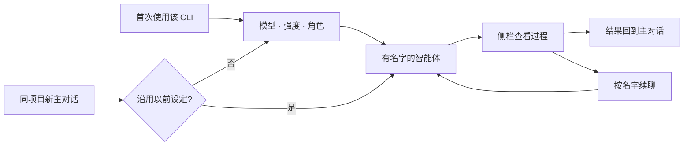

<div align="center">

# dsh-cliworker-now

**简体中文** | [English](README.en.md)

**在 DeepSeek Harness 里，给不同 CLI 一个共同的协作空间。**

选择 CLI、模型和角色，派出有名字的智能体；在侧栏查看过程、接收结果，并继续同一个任务。

[](https://github.com/SuperWheel/dsh-cliworker-now/releases/latest)
[](https://github.com/deepseek-ai/deepseek-harness)
[](#支持的-cli)
[](LICENSE)
[](https://dshfind.com/zh/plugins/SuperWheel/dsh-cliworker-now?ref=badge)

[安装](#安装与更新) · [开始使用](#使用方法) · [常见问题](#常见问题) · [反馈问题](https://github.com/SuperWheel/dsh-cliworker-now/issues)

</div>

## 这是什么

dsh-cliworker-now 是 DeepSeek Harness 的**多 CLI 智能体插件**。它把终端里的 AI CLI 接进 Harness：主对话负责派遣和接收结果，右侧栏用 Harness 原生的完整对话视图展示每个智能体的过程、用量和状态。

你仍然使用各 CLI 自己的账号、模型和原生会话；插件负责把它们组织起来。插件不附带模型服务、订阅或 API 额度。

- **开发协作**：让 Codex 审查代码，再按同一个名字继续追问。
- **写作与审校**：为逻辑、文风、商业审稿和正文修订配置不同角色。
- **长任务跟进**：独立对话和执行记录都保留，任务结束后可以接着做。

安装后在 Harness 中显示为 **CLI Worker / CLI Worker Now**。

## 特点

- **一个入口，多种 CLI**：在主对话点名 CLI，侧栏按 CLI 分组查看全部任务。
- **原生对话体验**：子会话直接使用 Harness 的对话视图、输入框、模型与权限控件、“+”菜单和用量统计，支持排队、停止和结束后续聊；切换 CLI 账号后旧任务自动以当前账号续接，原会话无法恢复时在新会话中附上此前记录继续（此前对话会发给当前账号的服务商）。
- **保留原生能力**：每个 CLI 使用自己的协议、登录和会话；模型与思考强度按 CLI 实际目录和当前账号读取，不照搬其他 CLI 的规则。
- **有名字、有角色的智能体**：唯一名称、角色预设和自定义提示词，可按名字反复调用。
- **可控调度**：首次使用前必须明确选型（可关闭后续询问，直接用已保存的默认设定）；同一会话互斥，同一目录的写任务默认串行；CLI 失败时不会悄悄换用另一个。
- **权限跟随 Harness**：CLI 按主对话的权限预设（仅可查看 / 工作区内修改 / 完全权限）以自己的原生模式运行，额外授权交给 DSH 决定：主 Agent 派出的任务在主对话页弹出授权问题，你在子会话里发起的轮次在该子会话中审批；规划模式一律拒绝写入。授权被拒绝后 CLI 仍自行完成的任务标为「结果待核实」，提醒你或主 Agent 先核对实际改动。
- **按 CLI 自己的终态判定结果**：单个工具步骤失败不会让整轮失败。CLI 失败后自行换法完成的任务记为完成，并注明「本轮有 N 个工具步骤失败，CLI 已自行处理」；最后一步工具失败后 CLI 直接结束的任务标为「结果待核实」；轮次失败、中断、缺少结束信号、仍有工具未完成或 CLI 异常退出时才为失败。
- **同目录并行写（可选）**：在「CLI Worker 设置」打开「同目录写任务并行」后，同一项目已有写任务时，新写任务会在插件私有的项目副本中同时运行；完成后由主 Agent 合并回项目，写回为未提交改动（不依赖 Git、不替你提交）；两边都改过的文件由主 Agent 读取两边版本后整合，只有两个任务的目标相互矛盾时才会问你，决定前项目保持不变。
- **目标、规划、反馈与分支**：在 CLI 子会话中使用 Harness 的这些功能；CLI 不支持的入口会说明原因。

## 界面效果

以下截图来自 Harness Desktop 的真实演示会话（v0.6.5 时拍摄，界面细节以当前版本为准）。


| 角色预设 | CLI 连接与模型偏好 |
| --- | --- |
|  |  |

## 支持的 CLI

| CLI | 原生通路 | CLI | 原生通路 |
| --- | --- | --- | --- |
| Antigravity | stream-json | OMP（Oh My Pi） | RPC |
| Codex | app-server | Pi | RPC |
| Claude Code | stream-json | Hermes Agent | Runs API |
| Kimi Code | ACP | OpenCode | HTTP + SSE |
| 官方 MiMo Code | HTTP + SSE | Qoder CLI | ACP |
| ZCode | app-server | Qoder CN CLI | ACP |
| Grok Build | ACP | | |

- **系统**：macOS / Windows。外部 CLI 需安装对应系统的原生版本，并完成该 CLI 自己的登录或 API 配置。
- **宿主**：DeepSeek Harness（当前随包资源基于 0.2.1-rc.3；已隔离验证 0.2.1-rc.2/rc.3 的启用、禁用、页面与原生设置）；Node.js ≥ 22.19.0。
- **验证范围**：每个 CLI 的实测版本、已通过和未验证的部分见 [使用细节与 CLI 说明](doc/usage-details.md#42-支持范围与验证边界) 和 [实际验证记录](doc/tasks.md)。能列出模型不代表一定有调用权限。

Qoder、Claude Code（含 CC Switch）、ZCode、Hermes 等 CLI 的安装、登录和路径说明见 [使用细节](doc/usage-details.md)。

## 安装与更新

先结束活动任务并完全退出 Harness，再执行：

```sh
dsh plugin --profile desktop add dsh-cliworker-now@latest
```

完成后重新打开 Harness。`dsh` 命令可在 Desktop 菜单“管理 dsh 命令…”中启用。Web profile 把 `desktop` 换成 `web`；也可以在插件页“添加插件”中输入 `dsh-cliworker-now@latest`。

- 启动 Harness 不会自动更新插件。pnpm 11 默认等待新版本发布满 24 小时，期间可能仍装到旧版，可用 `dsh plugin --profile desktop ls dsh-cliworker-now --depth=0` 核对。
- 备用安装包：`dsh plugin --profile desktop add https://github.com/SuperWheel/dsh-cliworker-now/releases/download/v0.8.4/dsh-cliworker-now-0.8.4.tgz`，每个 Release 附 `SHA256SUMS.txt`。
- 安装包自带原生子对话所需的界面扩展，无需手工构建宿主；卸载插件即恢复官方界面。与已有界面覆盖冲突时启动预检会明确拒绝，不改动你的配置，详见 [runtime-host](runtime-host/README.md)。
- 已知限制：在 dshmarket 1.70.1 中热切换启用/禁用此插件可能使当前窗口白屏，市场的重启提示不能保证热切换安全；切换后请完全重启 Harness，停用后的冷启动可恢复 stock 界面。根因在市场热切换流程，已向上游报告（[dsh-market/dsh-market#1010](https://github.com/dsh-market/dsh-market/issues/1010)），详见 [白屏调查及验证边界](doc/blank-toggle-investigation.md)。聊天展示和忙时 Enter 等原生偏好仍保存在原设置项中。
- 卸载：`dsh plugin --profile desktop remove dsh-cliworker-now`，保留本机账号、历史会话和偏好。

<details>
<summary>从 GitHub 源码安装或开发</summary>

需要 Node.js ≥ 22.19 和可直接调用的 pnpm 11.25.0：

```sh
dsh plugin --profile desktop add github:SuperWheel/dsh-cliworker-now
```

或本地构建后链接安装（源码目录需保留）：

```sh
git clone https://github.com/SuperWheel/dsh-cliworker-now.git
cd dsh-cliworker-now
pnpm install --frozen-lockfile
pnpm --config.verifyDepsBeforeRun=false build
dsh plugin --profile desktop add .
```

遇到 `ERR_PNPM_GIT_DEP_PREPARE_NOT_ALLOWED`、`ERR_PNPM_IGNORED_BUILDS` 或固定提交等情况，见 [安装细节](doc/usage-details.md#5-安装与更新)。

</details>

## 使用方法

### 1. 派遣

在已选工作目录的主对话里明确说出 CLI，例如：

> 用 Codex 检查这个项目的登录错误处理，把这个智能体命名为“代码审查员”。

也支持简称：`agy` → Antigravity，`glm / zhipu / 智谱` → ZCode，`harmes` → Hermes Agent。名称不明确时只返回候选，不会自动派遣。

首次在某个项目使用某个 CLI 时，通过 Harness 问题卡片依次选择**模型、思考强度和角色**，全部确认后才启动；同项目的新主对话会询问是否沿用以前的设定。取消或未答完不会保存半套设定，也不会启动任务。

如果不想每次被询问，可在「CLI Worker 设置 → 任务调度」关闭**调用前询问模型**（默认开启，对所有 CLI 生效）。关闭后，新主对话直接使用本项目的默认模型、强度和上次确认的角色启动；从未完整选过（例如只在设置页选了模型、没有确认过角色）或设定已失效（模型下架、强度不支持、账号变化）时，仍会弹出完整选型，不会猜测。



### 2. 查看、停止与继续

- 点击侧栏任务卡片，在右侧打开该智能体的原生对话；关闭侧栏不会停止后台任务。
- 输入框下方的“+”菜单与原生一致：**添加**（文件、图片、目标、计划、反馈）和**指令**（权限、模型、分支）。
- 运行中可停止；停止只在进程完全退出后才报告成功。运行中发送的消息按原生 Inbox 规则排队或引导。
- 本轮结束后，可以直接在子会话里继续，也可以在主对话说：“让代码审查员继续检查测试覆盖。”
- 右键任务卡片可改标题、改名或删除；已删除的空闲任务可以恢复。

### 3. 角色与 CLI 设置

| 设置 | 作用 |
| --- | --- |
| 智能体设置 | 管理“名称 / 概述 / 角色提示词”预设；内置七种小说创作角色，见 [角色预设](doc/role-presets.md) |
| CLI 连接 | 每个 CLI 单独开关、查看登录状态；插件分步窗口完成登录、退出与切换账号，多账号 CLI 在「账号」窗口逐个添加或退出；仍可打开原生账号终端；高级设置可指定 CLI 路径 |
| 项目默认设置 | 保存当前项目的默认模型与思考强度；关闭“调用前询问模型”后新主对话直接使用 |
| 子会话控件 | 用原生模型、权限控件修改当前智能体；运行中或有待发消息时锁定 |

### 4. 目标、规划、反馈与分支

| 功能 | 行为 | 支持范围 |
| --- | --- | --- |
| 目标 | 目标栏、“+”菜单或 `/goal` 设置；活动目标随每轮输入发给 CLI，不会自动发起新一轮 | 全部 CLI |
| 规划 | 映射到 CLI 原生的规划或只读模式；不支持的 CLI 不显示规划按钮，“+”菜单说明原因 | Hermes、Qoder、Qoder CN 及旧版 Kimi 通路不支持 |
| 反馈 | 赞、踩和反馈只记录在 Harness，不发给 CLI 或厂商 | 全部 CLI |
| 分支 | 从完成的轮次创建 CLI 原生分支，在同一主会话下生成新的子会话 | 最新轮：Codex、Claude Code、Kimi（ACP）、MiMo、ZCode、Pi、OpenCode、Qoder、Qoder CN；较早轮次仅 Codex |

## 权限与数据

- **按明确选择执行**：CLI 缺失或失败不会换用其他 CLI；不接管插件外启动的 CLI。
- **原生权限跟随 DSH 预设**：每轮启动时按主对话权限预设选择 CLI 自己的模式，不附加系统沙箱，也不会比预设更宽：
  - **仅可查看**：以 CLI 原生的只读/规划模式运行；Antigravity、Qoder、Qoder CN 和 Hermes 没有可确认的整进程只读模式，此时拒绝派遣。
  - **工作区内修改**：使用 CLI 自己的写入模式；CLI 请求额外授权（例如联网、工作区外写入）时按主对话审批策略处理：「询问」时逐项弹出 DSH 授权，「从不询问」时拒绝。
  - **完全权限**：使用 CLI 自己的免确认/完全访问模式（Codex `danger-full-access`、Claude Code `bypassPermissions`、Qoder `yolo`、ZCode `yolo`、Grok `--always-approve`、OpenCode/MiMo 全部工具允许）；仍有的授权请求自动放行并记入时间线。**此档下 CLI 可以不经确认执行命令、修改工作区外的文件和访问网络，请只在信任该任务时使用。** Kimi 与 Hermes 的免确认模式描述不一致或未核实，仍用写入模式，授权请求由插件自动放行。
  - 主 Agent 派出的任务（`cliworker_start` / `cliworker_followup`）在主对话页弹出授权问题；你在子会话中续聊、排队或重新运行的轮次在该子会话中审批，任务卡显示「等待审批」。CLI 原生提供会话级授权（Codex、Claude Code、Kimi、Qoder、Hermes）时，主对话页另有「本会话始终允许」，由 CLI 自己记住；子会话审批面板只有允许一次 / 拒绝。无人应答或任务停止时按拒绝处理。
  - Harness 处于规划模式时仍拒绝派遣写任务；Antigravity 和 Pi/OMP 没有可回复的原生授权协议，保持原有参数。
- **两层结构**：主对话 → 直接子智能体，默认两个并发（可在「CLI Worker 设置」调整，所有 CLI 共用，最多 8 个），不支持递归派遣。
- **界面语言**：「CLI Worker 设置 → 语言」可选跟随 DSH（默认）、中文或 English，保存后所有已打开的 CLI Worker 面板立即切换，不需要重载。CLI 输出、模型名、用户内容和未收录的 Host 错误保持原文；给主 Agent 的工具说明不随界面语言变化。
- **数据在本机**：记录保存在 `~/.dsh/cliworker-now`（目录 `0700`、文件 `0600`）。CLI 仍会按自己的配置向服务商发送模型请求。
- **用量有来源**：只显示 CLI 提供或可核查的数据；未知项显示 `—`，不补零、不估算冒充。

## 常见问题

<details>
<summary><strong>终端里装了 CLI，Desktop 却找不到？</strong></summary>

Desktop 不读取 `.zshrc`。插件会识别常见安装位置；仍找不到时，在该 CLI 设置的“高级设置”中填写可执行文件的完整路径。

</details>

<details>
<summary><strong>更新后模型菜单报错或出现 HTTP 404？</strong></summary>

结束运行中的任务后，完全退出并重新打开 Harness。只刷新插件列表可能留下旧 Host 与新 Client。

</details>

<details>
<summary><strong>已登录为什么调用仍失败？</strong></summary>

订阅、计费和模型权限由各 CLI 的服务商决定。能登录或列出模型不代表一定能调用，遇到 403 等错误请核对该 CLI 的账号权限。

</details>

<details>
<summary><strong>为什么没有思考强度或上下文百分比？</strong></summary>

插件只提供 CLI 明确支持的强度；CLI 没有提供可核查的上下文数据时显示 `—`，不会按模型名猜测。

</details>

更多账号、路径和模型规则见 [使用细节与 CLI 说明](doc/usage-details.md)。

## 开发

TypeScript ESM + React：Host 管理进程与持久化，Client 只通过 Harness Gateway 访问 Host。

```sh
pnpm install --frozen-lockfile
pnpm typecheck
pnpm test
pnpm build:preview   # 隔离包：.cache/preview-package
pnpm build
```

变更用 [OpenSpec](doc/openspec.md) 管理（`pnpm spec:list`、`pnpm spec:check`）。真实 CLI 验收会消耗账号额度，入口为 `pnpm smoke:extended --help`；Windows 远程测试见 [指南](doc/windows-remote-testing.md)。

## 文档

- [使用细节与 CLI 说明](doc/usage-details.md)：各 CLI 的账号、路径、模型规则及完整安装说明
- [设计与协议](doc/design.md) · [原生通信说明](doc/native-protocols.md) · [原生界面说明](doc/native-conversation-ui.md)
- [任务与实际验证](doc/tasks.md) · [历史版本与配置](doc/version-notes.md) · [文档索引](doc/README.md)
- [提交 Issue](https://github.com/SuperWheel/dsh-cliworker-now/issues)：请附 Harness / 插件 / CLI 版本、复现步骤和脱敏日志，不要上传令牌或私人项目内容。

## 许可与致谢

[MIT License](LICENSE)。本项目是独立社区插件，DeepSeek Harness 及各 CLI 的名称和商标归各自权利人所有，不表示官方关联或背书。

感谢 [codex-host](https://github.com/BytePioneer-AI/codex-host)、[Codingns4DSH](https://github.com/jingyi0605/Codingns4DSH) 和 [DeepSeek Harness](https://github.com/deepseek-ai/deepseek-harness) 的作者与贡献者，以及 [Codex](https://github.com/openai/codex)、[Hermes Agent](https://github.com/NousResearch/hermes-agent)、[Kimi Code](https://github.com/MoonshotAI/kimi-code)、[Grok Build](https://github.com/xai-org/grok-build)、[Pi](https://github.com/earendil-works/pi)、[Oh My Pi](https://github.com/can1357/oh-my-pi)、[OpenCode](https://github.com/anomalyco/opencode)、[MiMo Code](https://github.com/XiaomiMiMo/MiMo-Code) 和 [ZCode](https://github.com/zai-org/ZCode) 的开发者公开源码与协议文档。参考范围见 [CLI 数据接口核查](doc/cli-native-data-audit.md) 与 [Codingns4DSH 参考记录](doc/codingns-reference-audit.md)。
