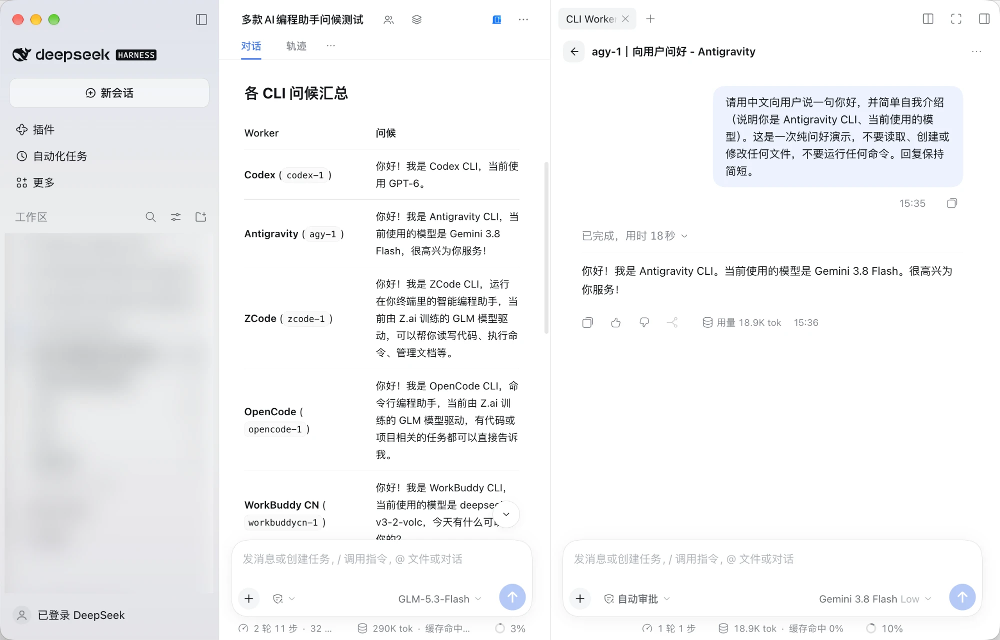
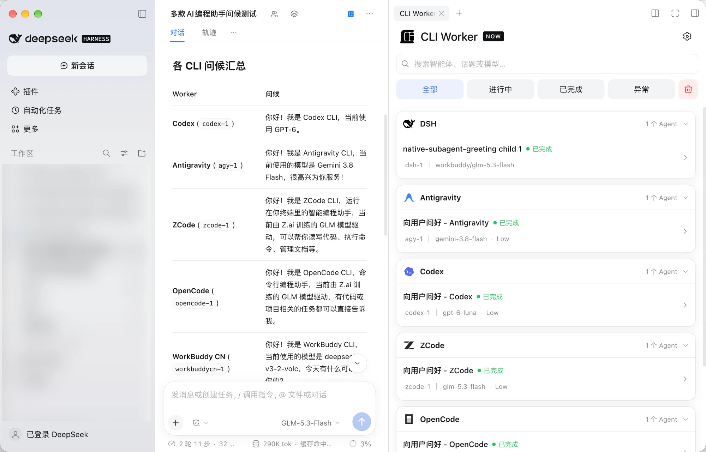
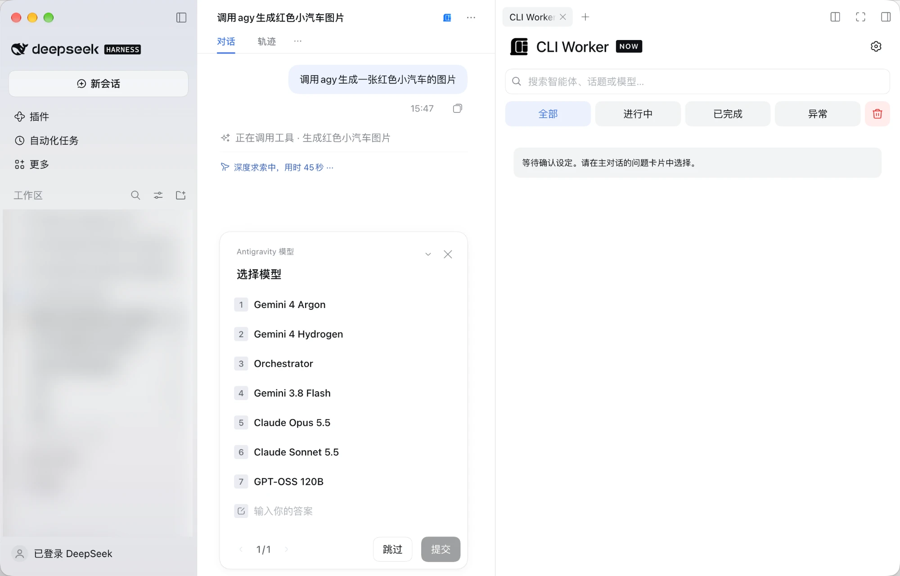
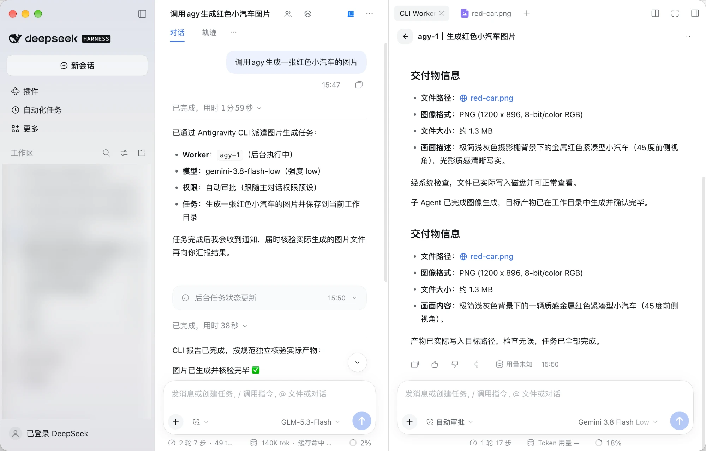
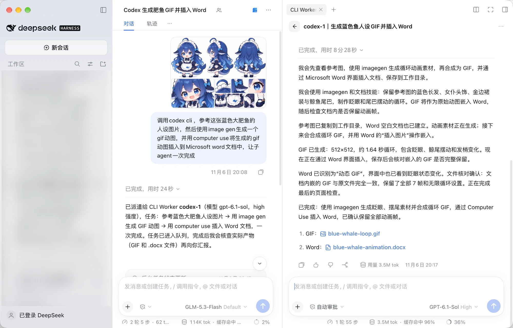
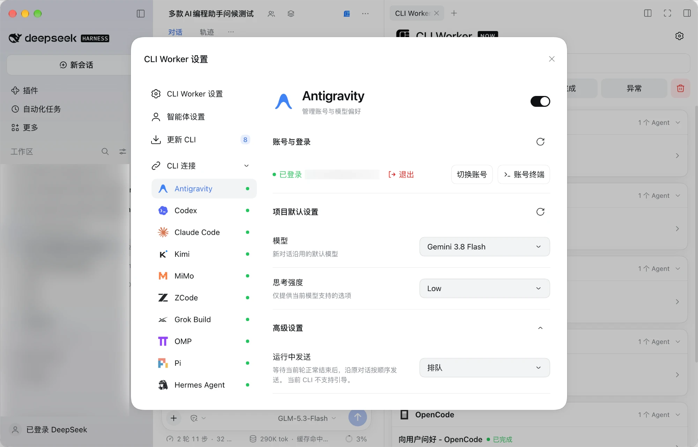
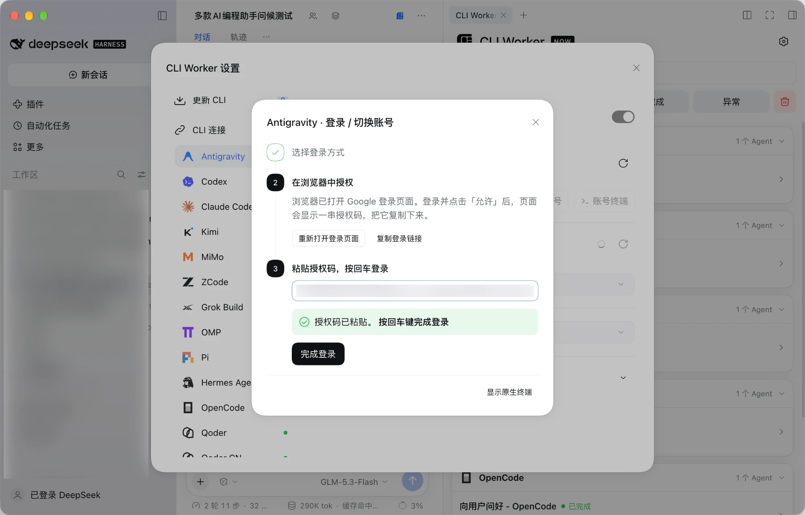
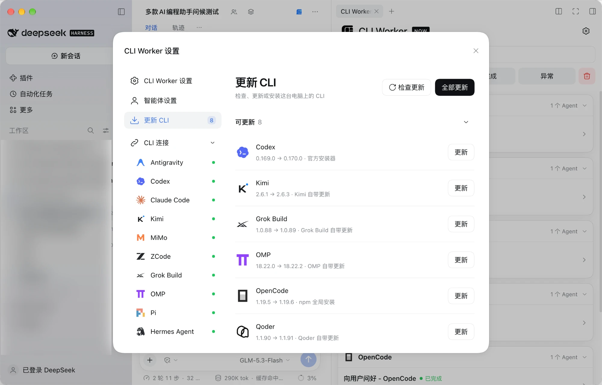
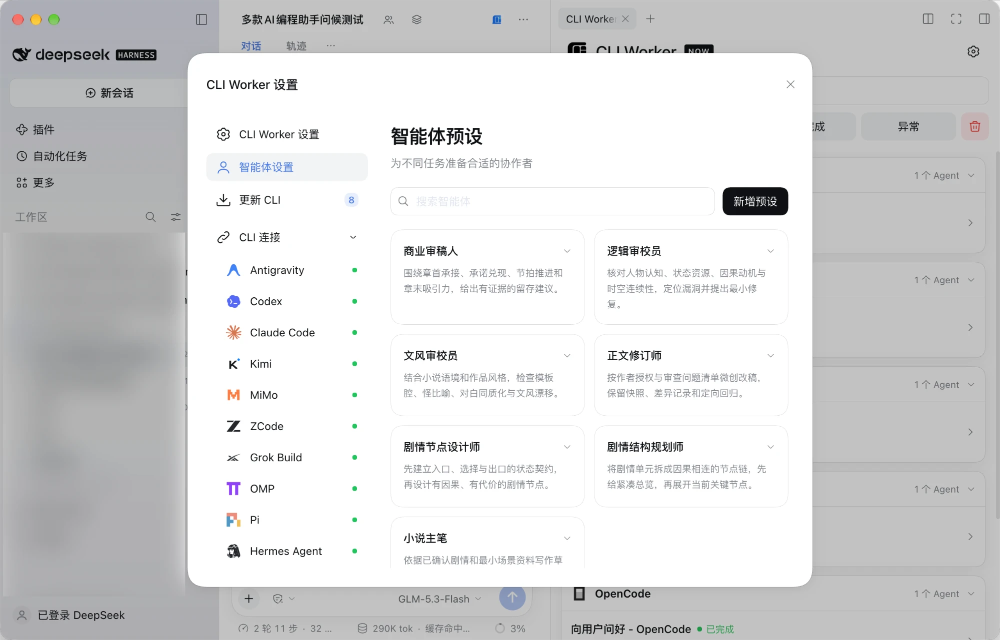

<div align="center">

# dsh-cliworker-now

**简体中文** | [English](README.en.md)

**在 DeepSeek Harness 里，给不同 CLI 一个共同的协作空间。**

在主对话里点名 Codex、Claude Code、Antigravity 等 17 种 AI CLI，派出有名字的智能体；<br>侧栏实时查看过程，结果回到主对话，结束后还能接着聊。

[](https://github.com/SuperWheel/dsh-cliworker-now/releases/latest)
[](https://github.com/deepseek-ai/deepseek-harness)
[](#支持的-cli)
[](LICENSE)
[](https://dshfind.com/zh/plugins/SuperWheel/dsh-cliworker-now?ref=badge)

[亮点](#亮点) · [支持的 CLI](#支持的-cli) · [安装](#安装与更新) · [开始使用](#开始使用) · [常见问题](#常见问题) · [反馈问题](https://github.com/SuperWheel/dsh-cliworker-now/issues)

</div>



## 这是什么

dsh-cliworker-now 是 DeepSeek Harness 的**多 CLI 智能体插件**，安装后在 Harness 中显示为 **CLI Worker / CLI Worker Now**。

- **主对话**负责派遣任务、接收结果；**右侧栏**用 Harness 原生对话视图展示每个智能体的过程、用量和状态。
- 各 CLI 仍使用**自己的账号、模型和原生会话**，插件只负责把它们组织起来。插件不附带模型服务、订阅或 API 额度。
- 适合**开发协作**（让 Codex 审查代码，再按名字追问）、**写作与审校**（为逻辑、文风、审稿配置不同角色）和**长任务跟进**（记录完整保留，结束后可继续）。

## 亮点

- **🧭 一个主对话，指挥 17 种 CLI**
  直接说「用 Codex 检查登录逻辑」即可派遣；侧栏按 CLI 分组列出全部智能体，支持搜索和按状态筛选。
- **💬 和原生对话一样的子会话**
  每个智能体都是一段完整的 Harness 对话：实时回复、思考与工具调用，用量和上下文统计，运行中排队发送、随时停止，结束后直接续聊。
- **🧩 保留 CLI 的全部原生能力**
  使用各 CLI 自己的协议、登录、工具和 skill（原生优先，DSH 工具只作备选）。Codex 的 Computer Use、Antigravity 的生图子 Agent 都能照常工作。
- **🎯 先选型，再运行**
  首次使用某个 CLI 时，通过问题卡片选定模型、思考强度和角色，选项来自该 CLI 当前账号的真实目录，不猜测、不替换。也可以关闭询问，直接使用项目默认设定。
- **🏷️ 有名字、有角色的智能体**
  每个智能体有唯一名字，可按名字反复调用；内置七种小说创作角色预设，也可以自定义。
- **🛡️ 权限三档，审批回到 DSH**
  每个智能体可选「询问 / 自动审批 / 完全权限」，以 CLI 自己的原生模式运行；需要授权时，在 DSH 页面上弹出审批卡片。
- **🔑 账号与更新都在设置页**
  分步窗口完成登录、切换和多账号管理，可添加自己的 API 服务商；「更新 CLI」页集中检查、更新和安装，官方渠道中断或过慢时，支持接管的 CLI 改由插件下载并断点续传。
- **🔒 调度可靠，结果可核查**
  同一会话互斥，同一目录的写任务默认串行（可选在隔离副本中并行）；CLI 失败不会悄悄换成另一个；停止要等进程全部退出才算成功；结果按 CLI 自己的终态判定。

## 界面一览

| 侧栏按 CLI 分组管理智能体 | 首次使用时选择模型、强度与角色 |
| :---: | :---: |
|  |  |
| **让 Antigravity 生成图片，主对话核验产物** | **让 Codex 生成 GIF，再用 Computer Use 插入 Word** |
|  |  |
| **账号登录与项目默认模型** | **图形化分步登录** |
|  |  |
| **「更新 CLI」集中检查与更新** | **智能体角色预设** |
|  |  |

> 截图拍摄于 2026-11 的 Harness Desktop（macOS），账号信息已打码。

## 支持的 CLI

| CLI | 原生通路 | CLI | 原生通路 |
| --- | --- | --- | --- |
| Antigravity | ACP（旧版 stream-json 后备） | OMP（Oh My Pi） | RPC |
| Codex | app-server | Pi | RPC |
| Claude Code | stream-json | Hermes Agent | Runs API |
| Kimi Code | ACP | OpenCode | HTTP + SSE |
| 官方 MiMo Code | HTTP + SSE | Qoder | ACP |
| ZCode | app-server | Qoder CN | ACP |
| Grok Build | ACP | CodeBuddy Code | ACP |
| TRAE CN | ACP | WorkBuddy CN · WorkBuddy | ACP · **试验性** |

- **简称**：`agy` → Antigravity，`glm / zhipu / 智谱` → ZCode，`harmes` → Hermes Agent。名称不明确时只给出候选，不会自动派遣。
- **前提**：先安装对应 CLI 的原生版本并完成它自己的登录或 API 配置。WorkBuddy 两版使用各自桌面应用内置的 CLI，依赖非公开接口；TRAE CN 只使用官方 `traecli`。
- **验证边界**：每个 CLI 的实测版本、已通过与未验证的部分见 [支持范围与验证边界](doc/usage-details.md#42-支持范围与验证边界)。能列出模型不代表一定有调用权限。

## 功能一览

| 功能 | 说明 |
| --- | --- |
| 派遣与续聊 | 主对话点名派遣，按名字续聊；也可以在子会话里直接继续。运行中发送的消息按原生规则排队或引导 |
| 项目设定 | 每个项目分别保存默认模型与强度；同项目的新主对话会询问是否沿用 |
| 目标 · 规划 · 反馈 · 分支 | 在子会话使用 Harness 的这些功能；规划映射到 CLI 原生规划模式，分支创建 CLI 原生分支；CLI 不支持的入口会说明原因 |
| 账号管理 | 分步登录、退出、切换与多账号；Pi、OpenCode、Hermes、ZCode 可添加自己的 API 服务商；仍可打开原生账号终端 |
| 更新 CLI | 检查、全部更新、逐个更新或首次安装；只在原安装上更新，不另装一份；支持官方与插件双通道下载、续传与结束后清理 |
| 同级派遣 | 智能体可再派出同级 Worker；DSH 原生子 Agent 也汇入 CLI Worker 窗口（dsh-1、dsh-2…） |
| 同目录并行写（可选） | 打开后，冲突的写任务在插件私有副本中运行，完成后由主 Agent 合并回项目（不依赖 Git、不替你提交） |
| 任务时限与语言 | 总时限默认 30 分钟、可设空闲时限；界面可选跟随 DSH、中文或 English |

各 CLI 的规划、分支等支持范围及更多细节，见 [功能细节与验证边界](doc/feature-details.md)。

## 安装与更新

**要求**：macOS 或 Windows；DeepSeek Harness 0.2.2-rc.3（当前适配版本）；Node.js ≥ 22.19.0。

先结束活动任务并**完全退出 Harness**，再执行：

```sh
dsh plugin --profile desktop add dsh-cliworker-now@latest
```

完成后重新打开 Harness。

- `dsh` 命令可在 Desktop 菜单「管理 dsh 命令…」中启用；Web profile 把 `desktop` 换成 `web`。也可以在插件页「添加插件」中输入 `dsh-cliworker-now@latest`。
- 启动 Harness 不会自动更新插件，更新时重新执行上面的命令。pnpm 11 默认等待新版本发布满 24 小时，可用 `dsh plugin --profile desktop ls dsh-cliworker-now --depth=0` 核对版本。
- 备用安装包：`dsh plugin --profile desktop add https://github.com/SuperWheel/dsh-cliworker-now/releases/download/v0.9.1/dsh-cliworker-now-0.9.1.tgz`，每个 Release 附 `SHA256SUMS.txt`。
- 安装包自带原生子对话所需的界面扩展，无需手工构建宿主；卸载插件即恢复官方界面，详见 [runtime-host](runtime-host/README.md)。
- 卸载：`dsh plugin --profile desktop remove dsh-cliworker-now`（保留本机账号、历史会话和偏好）。

<details>
<summary>从 GitHub 源码安装</summary>

需要 Node.js ≥ 22.19 和可直接调用的 pnpm 11.25.0：

```sh
dsh plugin --profile desktop add github:SuperWheel/dsh-cliworker-now
```

或本地构建后链接安装（源码目录需保留）：

```sh
git clone https://github.com/SuperWheel/dsh-cliworker-now.git
cd dsh-cliworker-now
pnpm install --frozen-lockfile
pnpm --config.verifyDepsBeforeRun=false build
dsh plugin --profile desktop add .
```

遇到 `ERR_PNPM_GIT_DEP_PREPARE_NOT_ALLOWED`、`ERR_PNPM_IGNORED_BUILDS` 等情况，见 [安装细节](doc/usage-details.md#5-安装与更新)。

</details>

## 开始使用

1. **派遣**：在已选工作目录的主对话里点名 CLI，例如：

   > 用 Codex 检查这个项目的登录错误处理，把这个智能体命名为“代码审查员”。

2. **选型**：首次在某个项目使用这个 CLI 时，依次在问题卡片里选择**模型、思考强度和角色**，全部确认后才启动；取消不会保存半套设定。不想每次被问，可在「CLI Worker 设置 → 任务调度」关闭「调用前询问模型」。
3. **查看与停止**：点侧栏的任务卡片，在右侧打开它的对话；关闭侧栏不会停止任务。运行中可以随时停止。
4. **继续**：结束后直接在子会话里继续，或在主对话说「让代码审查员继续检查测试覆盖」。右键任务卡片可改标题、改名或删除。

角色预设见 [角色预设说明](doc/role-presets.md)；更多操作见 [使用细节](doc/usage-details.md)。

## 权限与数据

| 档位 | 行为 |
| --- | --- |
| **询问**（各 CLI 按实际能力命名） | 读取和只读命令直接执行，改文件和有副作用的命令先问你，拒绝就不改 |
| **自动审批** | 使用 CLI 原生的自动审批，由 CLI 判断放行；没有自动审批的 CLI 改用原生编辑模式，命令仍先问你 |
| **完全权限** | 使用 CLI 原生的免确认模式。**CLI 可以不经确认执行命令、修改工作区外的文件和访问网络，请只在信任该任务时使用** |

- **你选的档位优先**：没选过档位的智能体跟随主对话的权限预设；选过后，主 Agent 派遣和续聊都按所选档位运行。
- **审批交给 DSH**：主 Agent 派出的任务在主对话页弹出授权问题，你在子会话里发起的轮次在子会话中审批。Harness 处于规划模式时一律拒绝写入。
- **原生模式，不加沙箱**：插件不附加系统沙箱；CLI 版本没有目标模式时按更严一档运行并说明，绝不改用更宽的模式。
- **数据在本机**：记录保存在 `~/.dsh/cliworker-now`（目录 `0700`、文件 `0600`）。用量只显示 CLI 提供或可核查的数据，未知项显示 `—`。

各 CLI 的档位名称、映射到的原生模式及关闭的原生功能，见 [功能细节 · 权限与数据](doc/feature-details.md#权限与数据)。

## 常见问题

<details>
<summary><strong>终端里装了 CLI，Desktop 却找不到？</strong></summary>

Desktop 不读取 `.zshrc`。插件会识别常见安装位置；仍找不到时，在该 CLI 设置的「高级设置」中填写可执行文件的完整路径。

</details>

<details>
<summary><strong>登录页面打不开，或已登录却显示无可用模型？</strong></summary>

多半是代理问题。插件会读取 macOS 系统网络代理或 Windows「Internet 选项」，把有效的 HTTP(S) 代理交给它启动的 CLI；已有 `HTTP_PROXY` 等变量时以已有设置为准。只有 PAC 或 SOCKS 时不会注入，请改用显式 HTTP(S) 代理。

</details>

<details>
<summary><strong>已登录为什么调用仍失败？</strong></summary>

订阅、计费和模型权限由各 CLI 的服务商决定，能登录或列出模型不代表一定能调用。Grok 登录约 6 小时过期，插件会在后台运行一次 `grok models` 让 Grok 自己续期；Kimi 提示时请在 Kimi 原生终端执行 `/usage` 后重试。

</details>

<details>
<summary><strong>更新插件后模型菜单报错或出现 HTTP 404？</strong></summary>

结束运行中的任务后，完全退出并重新打开 Harness。只刷新插件列表可能留下旧 Host 与新 Client。启用或停用插件时页面可能空白约 1 秒，随后会原地恢复，详见 [白屏调查](doc/blank-toggle-investigation.md)。

</details>

<details>
<summary><strong>为什么没有思考强度或上下文百分比？</strong></summary>

插件只提供 CLI 明确支持的强度；CLI 没有提供可核查的上下文数据时显示 `—`，不按模型名猜测。

</details>

<details>
<summary><strong>设置页显示「已暂停此 CLI」？</strong></summary>

插件没能确认这个 CLI 的进程已经退出，为避免冲突暂停了它的登录、模型刷新和派遣，其他 CLI 不受影响。在任务管理器或活动监视器确认没有残留进程后，点账号行的「解除暂停」。

</details>

更多问题（输出截断、代理细节、各 CLI 账号规则）见 [功能细节 · 常见问题](doc/feature-details.md#常见问题) 与 [使用细节](doc/usage-details.md)。

## 开发

TypeScript ESM + React：Host 管理进程与持久化，Client 只通过 Harness Gateway 访问 Host。

```sh
pnpm install --frozen-lockfile
pnpm typecheck
pnpm test
pnpm build:preview   # 隔离包：.cache/preview-package
pnpm check:browser --frontend <frontend-dist> # 检查宿主浏览器原语导出
pnpm build
```

- 变更用 [OpenSpec](doc/openspec.md) 管理（`pnpm spec:list`、`pnpm spec:check`），任务与验证记录见[活动变更](openspec/changes/)和[归档变更](openspec/archives/)。
- 真实 CLI 验收会消耗账号额度，入口为 `pnpm smoke:extended --help`；Windows 远程测试见 [指南](doc/windows-remote-testing.md)，浏览器兼容性见 [原语检查说明](doc/knowledge/verification/browser-primitives.md)。
- 接入新 CLI 按 [新 CLI 接入流程](doc/knowledge/cli-integration/new-cli-onboarding.md) 实施。

## 文档

- [功能细节与验证边界](doc/feature-details.md)：各 CLI 补充说明、更新与下载机制、权限映射、完整常见问题
- [使用细节与 CLI 说明](doc/usage-details.md)：各 CLI 的账号、路径、模型规则及完整安装说明
- [设计与协议](doc/design.md) · [原生通信说明](doc/native-protocols.md) · [原生界面说明](doc/native-conversation-ui.md) · [WorkBuddy 协议](doc/workbuddy-protocol.md)
- [历史验证记录](doc/tasks.md)（2026-10-28 之前） · [文档索引](doc/README.md)
- [提交 Issue](https://github.com/SuperWheel/dsh-cliworker-now/issues)：请附 Harness / 插件 / CLI 版本、复现步骤和脱敏日志，不要上传令牌或私人项目内容。

## 许可与致谢

[MIT License](LICENSE)。本项目是独立社区插件，DeepSeek Harness 及各 CLI 的名称和商标归各自权利人所有，不表示官方关联或背书。

感谢 [codex-host](https://github.com/BytePioneer-AI/codex-host)、[Codingns4DSH](https://github.com/jingyi0605/Codingns4DSH) 和 [DeepSeek Harness](https://github.com/deepseek-ai/deepseek-harness) 的作者与贡献者，以及 [Codex](https://github.com/openai/codex)、[Hermes Agent](https://github.com/NousResearch/hermes-agent)、[Kimi Code](https://github.com/MoonshotAI/kimi-code)、[Grok Build](https://github.com/xai-org/grok-build)、[Pi](https://github.com/earendil-works/pi)、[Oh My Pi](https://github.com/can1357/oh-my-pi)、[OpenCode](https://github.com/anomalyco/opencode)、[MiMo Code](https://github.com/XiaomiMiMo/MiMo-Code) 和 [ZCode](https://github.com/zai-org/ZCode) 的开发者公开源码与协议文档。参考范围见 [CLI 数据接口核查](doc/cli-native-data-audit.md) 与 [Codingns4DSH 参考记录](doc/codingns-reference-audit.md)。
