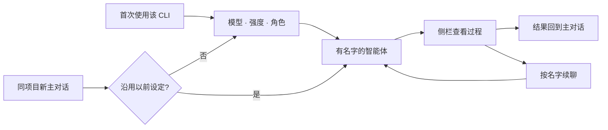

<div align="center">

# dsh-cliworker-now

**简体中文** | [English](README.en.md)

**在 DeepSeek Harness 里，给不同 CLI 一个共同的协作空间。**

选择 CLI、模型和角色，派出有名字的智能体；在侧栏查看过程、接收结果，并继续同一个任务。

[](https://github.com/SuperWheel/dsh-cliworker-now/releases/latest)
[](https://github.com/deepseek-ai/deepseek-harness)
[](#支持的-cli)
[](LICENSE)
[](https://dshfind.com/zh/plugins/SuperWheel/dsh-cliworker-now?ref=badge)

[安装](#安装与更新) · [开始使用](#使用方法) · [常见问题](#常见问题) · [反馈问题](https://github.com/SuperWheel/dsh-cliworker-now/issues)

</div>

## 这是什么

dsh-cliworker-now 是 DeepSeek Harness 的**多 CLI 智能体插件**。它把终端里的 AI CLI 接进 Harness：主对话负责派遣和接收结果，右侧栏用 Harness 原生的完整对话视图展示每个智能体的过程、用量和状态。

你仍然使用各 CLI 自己的账号、模型和原生会话；插件负责把它们组织起来。插件不附带模型服务、订阅或 API 额度。

- **开发协作**：让 Codex 审查代码，再按同一个名字继续追问。
- **写作与审校**：为逻辑、文风、商业审稿和正文修订配置不同角色。
- **长任务跟进**：独立对话和执行记录都保留，任务结束后可以接着做。

安装后在 Harness 中显示为 **CLI Worker / CLI Worker Now**。

## 特点

- **一个入口，多种 CLI**：在主对话点名 CLI，侧栏按 CLI 分组查看全部任务。
- **原生对话体验**：子会话直接使用 Harness 的对话视图、输入框、模型与权限控件、“+”菜单和用量统计，支持排队、停止和结束后续聊；切换 CLI 账号后旧任务自动以当前账号续接，原会话无法恢复时在新会话中附上此前记录继续（此前对话会发给当前账号的服务商）。
- **保留原生能力**：每个 CLI 使用自己的协议、登录和会话；模型与思考强度按 CLI 实际目录和当前账号读取，不照搬其他 CLI 的规则。
- **原生工具优先，DSH 工具作为备选**：CLI 先用自己的读写、搜索、命令、网页工具和 skill。与之重叠的 DSH 工具不再交给 CLI，同名 MCP 只保留 CLI 自己配置的那份；CLI 没有的能力（如 Pi 的命令执行）以及 DSH 独有的 MCP 和技能，经 `dsh_worker_tools` 作为备选提供，描述标明「备选」，每次执行仍经 Harness 权限与审批。Codex、Claude Code、Pi、OpenCode、MiMo 与 Grok 会收到一段简短的原生优先说明，列出实际提供的备选工具（追加到 CLI 自身提示，不改动你的任务和指令文件；Codex 已配置 `developer_instructions` 时不发送）。ZCode 的工具桥执行尚未核验，暂不提供；OMP、Hermes 及隔离副本任务不接工具桥。
- **有名字、有角色的智能体**：唯一名称、角色预设和自定义提示词，可按名字反复调用。
- **可控调度**：首次使用前必须明确选型（可关闭后续询问，直接用已保存的默认设定）；同一会话互斥，同一目录的写任务默认串行；CLI 失败时不会悄悄换用另一个。
- **权限三档**：每个 Worker 可选询问 / 自动审批 / 完全权限（按 CLI 实际能力命名），以 CLI 自己的原生模式运行；没选过的 Worker 跟随主对话的权限预设，你选过的档位按所选运行；额外授权交给 DSH 决定：主 Agent 派出的任务在主对话页弹出授权问题，你在子会话里发起的轮次在该子会话中审批；规划模式一律拒绝写入。授权被拒绝（包括 DSH 备选工具的授权）后 CLI 自行结束本轮时，任务记为「已完成」，不另加提示；拒绝记录保留在时间线中。
- **按 CLI 自己的终态判定结果**：单个工具步骤失败不会让整轮失败。CLI 失败后自行换法完成的任务记为完成，并注明「本轮有 N 个工具步骤失败，CLI 已自行处理」；最后一步工具失败后 CLI 直接结束的任务标为「结果待核实」；轮次失败、中断、缺少结束信号、仍有工具未完成或 CLI 异常退出时才为失败。
- **同目录并行写（可选）**：在「CLI Worker 设置」打开「同目录写任务并行」后，同一项目已有写任务时，新写任务会在插件私有的项目副本中同时运行；完成后由主 Agent 合并回项目，写回为未提交改动（不依赖 Git、不替你提交）；两边都改过的文件由主 Agent 读取两边版本后整合，只有两个任务的目标相互矛盾时才会问你，决定前项目保持不变。
- **目标、规划、反馈与分支**：在 CLI 子会话中使用 Harness 的这些功能；CLI 不支持的入口会说明原因。

## 界面效果

以下截图来自 Harness Desktop 的真实演示会话（v0.6.5 时拍摄，界面细节以当前版本为准）。


| 角色预设 | CLI 连接与模型偏好 |
| --- | --- |
|  |  |

## 支持的 CLI

| CLI | 原生通路 | CLI | 原生通路 |
| --- | --- | --- | --- |
| Antigravity | ACP（旧版 stream-json 后备） | OMP（Oh My Pi） | RPC |
| Codex | app-server | Pi | RPC |
| Claude Code | stream-json | Hermes Agent | Runs API |
| Kimi Code | ACP | OpenCode | HTTP + SSE |
| 官方 MiMo Code | HTTP + SSE | Qoder | ACP |
| ZCode | app-server | Qoder CN | ACP |
| Grok Build | ACP | CodeBuddy Code | ACP |
| TRAE CN | ACP | | |
| WorkBuddy CN (`workbuddycn`) | ACP · 试验性 | WorkBuddy (`workbuddy`) | ACP · 试验性 |

WorkBuddy CN（`workbuddycn`）与 WorkBuddy（`workbuddy`）使用各自桌面应用内置 CLI。**试验性：依赖 WorkBuddy 桌面端非公开接口。** 请先安装对应桌面端；设置账号行的「在桌面端管理」打开插件指引，可打开已核实的对应应用并观察当前状态。有桌面管理指引，无 CLI 登录/退出；登录、退出与换号由用户在桌面端完成。打开指引只读一次；点击打开或继续观察后，查询完成至少间隔 15 秒，最多 5 分钟或 20 次自动查询，手动刷新与在途查询合并。关闭指引取消查询，不关闭桌面端。通用认证错误不证明已退出，同站点换号也不能确认。高级路径设置可填写应用目录、自带运行时或内置 CLI 入口。发现核对 product 站点，不回退 PATH 上的 CodeBuddy 或另一版本。泛称 WorkBuddy 只装一版用该版，两版都装时通过宿主原生询问选择；显式 WorkBuddy（国际版）（兼容别名 WorkBuddy AI）固定国际版。模型与强度来自原生元数据握手，每次查询会留下空会话。已接通原生规划、询问／自动审批／完全权限；按积分显示本轮用量（读取内置 CLI 的原生会话文件），并显示原生上下文占用及系统提示词、工具定义、对话消息等分类（每轮结束后由不保存会话的副进程运行原生 `/context` 读取，数值为原生估算；CodeBuddy Code 同）；DSH 工具桥与原生分支（内置 CLI 未实现 `session/fork`）未开放。WorkBuddy CN 已在 macOS 与 Windows Desktop 完成真实任务、询问档审批与界面验收；国际版尚未验收。详见 [WorkBuddy 协议](doc/workbuddy-protocol.md)。

- **系统**：macOS / Windows。外部 CLI 需安装对应系统的原生版本，并完成该 CLI 自己的登录或 API 配置。
- **宿主**：DeepSeek Harness（当前适配目标及随包四个原生界面包均为 0.2.2-rc.3；此前 rc.3 版本已隔离验证 0.2.1-rc.2/rc.3 的启用、禁用、页面与原生设置）；Node.js ≥ 22.19.0。
- **验证范围**：本次升级（0.2.2-rc.3）已在隔离 DSH_HOME 的 rc.3 宿主上核对插件加载与主要界面；Mac 正式 Desktop、Windows 与真实模型／CLI 派遣未验证，具体边界见 [升级验证记录](openspec/archives/v0.8.10-dsh-rc3-adapt-leeyl/tasks.md)；0.2.2-rc.2 的记录见 [rc.2 升级验证](openspec/archives/upgrade-host-022rc2/tasks.md)。每个 CLI 的实测版本、已通过和未验证的部分见 [使用细节与 CLI 说明](doc/usage-details.md#42-支持范围与验证边界) 和 [实际验证记录](doc/tasks.md)。能列出模型不代表一定有调用权限。

Qoder、Claude Code（含 CC Switch）、ZCode、Hermes 等 CLI 的安装、登录和路径说明见 [使用细节](doc/usage-details.md)。

Qoder / Qoder CN 的账号与模型目录只读查询按原生版本分流：高于 1.1.80 使用本次私有 SDK daemon，较旧版本保留 SDK worker；未知版本仅在明确协议不支持时切换一次。查询不发送 prompt，配置写入隔离到临时目录，确认结束与进程退出后清理；自定义模型保留，停用模型不可选。真实 Worker 继续使用 ACP。

**TRAE CN**（`traecn`）只使用官方 `traecli`。官方安装脚本 `https://trae.cn/trae-cli/install_v2.sh` 需要直连 trae.cn；2026-11-07 境外出口探测返回 HTTP 403（`denied by region block`）。请使用官方安装脚本，不提供非官方安装包。官方文档仅对企业版旗舰版套餐开放 CLI；个人登录使用 `traecli --enable personal_user_login login --personal`，依赖开发中的 `personal_user_login` 特性；企业 SSO 使用 `traecli login --enterprise`，企业 PAT 使用 `traecli login --with-trae-pat`。v0.8.9 起提供「询问」档（原生只读沙箱 + 按需审批），不提供强度选择；2026-11-11 用 Seed-Code 在 macOS 与 Windows 实测写文件先审批、拒绝后不写入。Windows 上 TRAE 原生只读沙箱对 PowerShell 只读命令也会请求审批；拒绝后若本轮此前已有工具失败，该轮显示为运行失败。截至 2026-11-07 未发现官方国际版 CLI。Windows 已于 2026-11-09 真实登录并派遣。TRAE 没有原生上下文分类来源，系统提示词、工具定义、对话消息显示 `—`。详见 [TRAE 安装、账号与权限说明](doc/usage-details.md#trae-cn-安装与登录)。

账号窗口中，TRAE CN 先选择个人／企业 SSO／企业 PAT；个人授权提供浏览器链接与回调网址输入，企业方式保留原生流程。已登录先显示账号卡，切换时自动运行 `logout`，确认退出和清理后才重新选择方式。CodeBuddy 先显示当前账号卡；文件夹信任由用户在窗口确认，空编辑器自动打开 `/login`，中国站/国际站提供浏览器引导，企业/iOA 保留原生。切换沿已核实路径自动 `/logout`，明确退出并完成清理后再登录；未知画面回退原生。详见 [授权前采集与未完成验收](openspec/archives/add-new-cli-graphical-login/capture-2026-11-07.md)。

OMP 的 DeepSeek API 登录无需另写 `models.yml`；模型目录使用 OMP 原生候选与当前账号 `/models` 的交集，思考强度沿用原生能力。自定义路由优先于内置默认地址；列表读取成功不代表真实模型调用已验收。

「其他服务商」的 Host 表单接口支持 Pi、OpenCode（v1 配置）和 Hermes：按各自原生协议填写服务商 ID、Base URL、API 类型、API Key 与模型 ID，保存到原生配置和独立凭据位置，失败回滚并在成功后作废账号与模型目录缓存。Pi 保存到账号登录共用的 `<stateDirectory>/accounts/pi/agent`，表单显示实际路径；全局 `~/.pi/agent` 保持只读，已有服务商冲突会拒绝。Hermes 跟随 Worker 的生效 HOME（全局或插件私有来源单选），OpenCode 写入插件 `accounts/opencode` 的配置与凭据目录并检查全局重名冲突；表单均显示实际路径，来源改变须重新打开。Hermes 任意自定义服务商的 HTTP 执行仍受现有服务商白名单限制。OMP、Kimi、TRAE CN 暂保留原生终端。此阶段为 Host 实现，前端接入与 Desktop 验收另行记录；不联网验证密钥、不调用模型。原生版本证据、字段和边界见[变更设计](openspec/archives/vnext-custom-provider-form-leeyl/design.md)。


## 安装与更新

在 CLI Worker 设置中打开「更新 CLI」页，可以集中查看全部 CLI 的安装方式、当前版本与最新版本。行按可更新、需要手动更新、检查失败、已是最新、未安装分区；点「检查更新」重新读取全部版本，「全部更新」按顺序排队更新可更新项，也可逐行「更新」「安装」或「查看方法」。展开区显示下载进度（字节、速度、来源主机、已自动续传次数、通道标签：官方或插件接管）、执行的命令与输出，以及结束后的「更新清理」摘要；更新中可取消，取消只在进程范围退出后才报告完成。底部「下载设置」选择 npm 包的下载源（跟随 npm 设置、npm 官方源、国内镜像 npmmirror 或自定义地址），不影响官方安装脚本、Homebrew 和桌面安装包。

「通用」设置里的「启动后在后台检查 CLI」默认开启：Host 启动约 60 秒后，仅在没有任务、登录窗口和更新操作且 CPU 低于 50% 时，逐项读取路径、版本与官方最新版本；Windows 上的版本探测进程以低于正常的优先级运行，Codex 与 Qoder 两版的版本命令只在前台读取。后台检查不执行任何更新，有新版本时只在页面分区和设置导航的数量徽标上提示。2026-11-15 Windows 实机核对：启动后 120 秒才出现首个后台探测进程，kimi、grok、node 等探测进程均为低于正常优先级。

源码中的「更新 CLI」页已接入首次安装后端：按 Host 核实的安装方式生成计划，npm 主包及本机平台组件校验后装入当前全局前缀，官方脚本先保存到私有目录再执行。安装期间目标 CLI 暂停派遣与账号操作；只有重新探测得到有效版本才写入原有 CLI 路径设置。来源未核实的方式仍提供官方说明。Claude 全平台及 MiMo macOS/Linux 的首次安装脚本暂保持仅说明（MiMo Windows 仍用 npm）；本轮已补齐现有安装的版本检查，未重新开放首次安装脚本。macOS 桌面首次安装复用 ZCode / WorkBuddy 两版的官方更新清单，校验 SHA-512 / SHA-256 与固定开发者签名后，将应用放到所选目录并核对应用版本、写回 CLI 路径；也支持原有 DMG 流程。Windows x64 国际版首次安装见下文的 COS/签名核验说明；其他未核实组合保留官方说明。2026-11-14 隔离安装 Pi npm 版 1.5.2、ZCode 3.18.2 通过；国际版 WorkBuddy 的 macOS 首次安装与更新按官网规则选择同路径 DMG，并严格使用 feed 的 SHA-256；固定核对 Team `FN2V63AD2J`、bundle `com.workbuddy.workbuddy-ai` 与 Gatekeeper，只读挂载、确认卸载后完成更新替换。CN 仍用 ZIP。2026-11-15 国际版 arm64 隔离首次安装已通过摘要、签名、装后身份/版本与路径写回核对；包内 0644 mjs 按可读脚本识别，保留实际应用版本 `5.9.4` / CLI `2.165.0`，四段 feed 发布号由工件摘要绑定。真实更新与 Desktop 显示尚未验收；若 feed 将来改为 ZIP 摘要，会校验失败并停止，须重新核实并修订规则后切换，不自动降级。进度及边界见 [本次任务记录](openspec/archives/v0.8.10-cli-update-page-leeyl/tasks.md)。

Windows x64 国际版 WorkBuddy 首次安装使用官方向导。空 SHA-256 feed 必须通过 COS 长度、MD5、CRC-64/XZ 和运行前腾讯 Authenticode Valid 四重核验；有 SHA-256 时保持原摘要校验。向导在所选目录名不是 WorkBuddyAI 时会自动追加该子目录，默认位置为 `%ProgramFiles%\WorkBuddyAI`；插件依次检查所选位置、追加的子目录、Program Files 与 `%LOCALAPPDATA%\Programs\WorkBuddyAI`，站点与实际版本核对通过才保存路径。向导内使用国际版独立目录，不选择已有国内版目录。CN、ZCode 与国际版 ARM64 首次安装仍为手动。2026-11-15 Windows 实机已装到 D 盘并与国内版共存、签名 Valid；重装复验确认插件在向导追加的子目录找到入口并写入路径记录。

Windows 的 ZCode 固定自动 runtime 可关联 `%ProgramFiles%\ZCode` 或 `%LOCALAPPDATA%\Programs\ZCode` 中经 PE 产品名和内置 CLI 核实的桌面应用，显示应用版本并使用官方安装程序更新。向导与 UAC 由安装程序处理，插件不提权或静默安装。独立 Worker runtime 不随桌面更新；没有可核实桌面应用时仍显示原 runtime 手动更新原因。2026-11-15 Windows 实机从 3.14.5 更新到 3.18.2 通过。

Windows 官方桌面安装程序以可见窗口启动，等待 UAC 与向导期间不设时限，可在页面取消；控制台安装命令仍为 10 分钟。官方安装程序会在 `%LOCALAPPDATA%\<产品>-updater` 自留一份安装包供其自带更新使用，不属于插件下载目录。安装程序自身退出即视为装完；结束页勾选「运行」时，插件照常核对并写入路径，若应用被插件清理安装进程时一起结束，会自动重新打开。首次安装核对约 500 MB 安装包的签名最长等待 2 分钟。点「检查更新」会清除上次操作结果。

已识别的官方安装现在可通过原包管理器、自带更新命令或官方安装器更新；ZCode 与 WorkBuddy 两版接入桌面发布源与专用更新器。版本查询只读官方 GET，后台不执行 check/update 子命令，更新仍需前台用户发起。外部包管理器、未识别安装和没有可用平台工件的情况显示具体手动原因。不能锁版的命令会核对实际版本是否前进；Hermes 更新可能迁移配置、更新依赖及重启服务，原通道保持不变。Pi 更新不再受适配集合限制，未适配版本会提示 Pi Worker 需等待插件适配。

Qoder/CN 保留官方分发入口；主目录中若存在名为 `update` 的路径，Host 会拒绝启动更新并说明原因，避免被分发到 IDE。Grok 官方 bin 入口链接到 downloads 实体时，以官方 stable 文本查询目标并执行带版本参数的自带更新。WorkBuddy 的 CLI 版本与应用版本分开读取，官方 feed 返回无更新时显示「已是最新」。Windows 的 ASAR 安装可从已核实的内置产品元数据读取应用版本，无需启动桌面应用。上述自动更新新增路径均只有模拟回归证据，真实更新验收另列于任务记录。

更新后的版本校验允许新程序因首次启动扫描而较慢：校验总预算为 60 秒，版本命令为 45 秒，普通检查的版本命令仍为 5 秒。超时会明确提示「已替换，但新版本首次启动超时，无法确认版本；请稍后重新检查」，不将已写入文件回滚；仅在进程范围退出确认后结束操作。

CodeBuddy Code 官方原生安装（Beta）支持按原生来源运行 `codebuddy update`：默认 Unix `~/.local/bin/codebuddy`，Windows `%LOCALAPPDATA%\codebuddy\bin\codebuddy.exe`。自动路径优先保存稳定入口，更新后重新核对安装根与实际版本；npm/Homebrew 仍用原包管理器，WorkBuddy 内置 CLI 不适用。本次仅两机 npm 路径/版本只读核实与原生布局模拟回归，未执行真实原生更新。

插件托管的 CLI 下载支持网络中断续传；已确认支持 Range 时，10 秒窗口低于 100 KB/s 会重新连接。恢复最多 200 次，用完仍在前进则继续下载，下载总上限 2 小时。没有匹配接管描述的外部命令，仍只在中断证据和退出/版本核对满足条件后重试，不因慢速重跑。长度或摘要校验失败会删除临时文件、干净重下一次，仍不符才失败，不消耗 200 次。MiMo macOS 默认原生安装发生接管时，由插件下载官方 zip，首选小米 FDS API 域名，慢速或中断时在两个内置官方源间切换；换源先核对 HEAD 长度、ETag/content-md5，续传保留 Range 并复核响应身份。完成后校验长度、content-md5 和 zip 结构，再交官方 `--binary` 安装；同源 MD5 不代表独立签名。npm 主包和匹配实际 Node/npm 运行时 os/cpu/libc 的可选平台组件（含 npm 别名）共用下载器，显示合计字节；主包按官方 sha512、平台包按官方 integrity 或 shasum 校验。非自定义源先试官方，停滞 30 秒、60 秒均速低于 100 KB/s 或超出预算后接管并允许 npmmirror 换源，成功接管后记住失败 7 天；自定义地址关闭自动换源。目标清单与 npm 安装 registry 仍采用所选源，“跟随 npm”采用当前 registry；操作中修改设置从下一次操作生效。准备下载也按必需组件组执行：OpenCode 普通包失败可改试 baseline，满足一项即可；CodeBuddy node-pty 等可选组件预下载失败只记录提示，npm 安装时仍可能自行获取。自动选源时目标/组件清单可在所选镜像不可用或缺版本时回退官方，显式自定义源不做此回退。平台包通过 `npm cache add <本地 tgz>` 预置到下载目录内的操作私有缓存，预置与安装共用 `--cache`，安装使用 `--prefer-offline --include=optional`，不改代理；npm 仍可能查询元数据或下载普通依赖，安装阶段仅显示阶段文字。下载停滞会中断连接并从已收字节处续传；重试、换源和官方转接管保留同一断点，只有服务器不支持续传或对象校验标识变化时才从零重取。npm 退出 0 还必须通过安装树的必需组件核验和 CLI `--version` 探针，否则报告失败；OpenCode 普通版与 baseline 二选一，CodeBuddy 缺少可回退的 node-pty 不判损坏。后台只核对本地清单与已验证的平台元数据，不因注册表离线判定缺件；找不到 npm 只影响更新前置条件，不据此判坏仍可运行的 CLI；发现真实缺件时显示检查失败与具体组件，提供已有重新安装入口，不显示“已是最新”。临时文件或下载通道记忆清理失败会留下提示，仍结束操作并释放维护锁、继续队列。进度提供当前下载 host。桌面包未找到已核实同对象备用域名，保持单源。Windows 上已识别的 Claude Code、Antigravity、OMP 和 TRAE CN 官方默认布局先执行官方更新，渠道不可用时切换插件接管，接管显示实际字节与续传进度：前三项按官方 SHA-256／SHA-512 校验后用同目录临时文件替换，文件占用时保留旧入口；TRAE CN 组完整官方离线包交 `offline-install`，仅恢复更新前已存在的自动更新标记。Claude 支持主站与官方 GCS 桶的 HEAD 身份核对后换源。同源摘要不等于独立签名。macOS/Linux TRAE CN 保留原生更新，Unix OMP 保留官方 `PI_BUILD_URL` 本地交接。更新结束并释放维护锁后统一刷新连接状态，维护期读取被拒不记为错误。上述 Windows 四项已在 2026-11-15 前经 Clash 代理真实更新到最新版本（Antigravity、Claude Code、OMP、TRAE CN），详见任务 13.5；接管下载中取消仍在验收。

Windows 的短时 CLI 版本、帮助、账号和模型目录查询使用每次独立的 `cliworker-probe-` 私有 TMP/TEMP，确认整个进程范围退出后回收其中的 Bun DLL 等临时文件；未确认退出则保留并沿用过期清扫保护。正式 Worker 和官方更新沿用各自环境。共享 Temp 中已有的 `.<16 hex>-00000000.dll` 不属于插件专有名称，不自动删除；用户可确认无占用后自行手动删除历史残留。

更新或安装结束后（成功、失败或取消），插件在确认托管进程全部退出后尽力清理本次下载、半成品、暂存目录和 npm 私有缓存；操作内仍支持续传，跨操作不保留半成品，下载通道记忆独立保留。npm 的预置与安装共用下载目录内的 `--cache`，不写入用户全局 npm 缓存。输出最后一行报告清理类别、项数与已删除的逻辑字节数；锁定或无法核验的残留会保留，不改变更新结果。

OMP 仅在更新成功、托管范围退出且当前入口的新鲜版本探针严格等于目标后，回收下表已知自更新布局内的原生备份；入口与候选均须为无符号链接的普通单链接文件，父链经路径安全检查。失败或未验证时全部保留，始终保留 `omp.lock`。Grok、Qoder/Qoder CN、Claude、TRAE CN 的旧副本只有在当前入口可运行且版本记录匹配时回收；失败仅处理本次新增且未使用的副本，保留当前版本和恢复备份。Hermes 仅在本次成功回执及安装记录／HEAD 稳定标签验证均确认目标版本后，回收 bin 下的 .deleteme 普通文件和 tools/facts.json 未引用的完整工具版本目录；不运行 hermes --version。facts 无效、引用目录缺失、锁 PID 存活或无法核实时保留全部 Hermes 残留并提示；空锁或未知格式的无 PID 锁改查进程可执行路径，完整枚举确认 Hermes home／checkout 内无进程才继续清理，否则跳过并说明。外部同名进程不算占用，不按锁文件年龄判断，也不改锁文件；失败和取消不删 Hermes 原生副本。格式未知的 TRAE lease 仍保留。仅「检查更新」不删除文件。实机覆盖见[任务 10 的验证记录](openspec/archives/v0.8.10-cli-update-dual-channel-leeyl/tasks.md)；本次 macOS OMP 扩展仅完成模拟回归，真实回收仍待复验。

| OMP 平台 | 已知 self-update 入口 | 原生备份清理规则 |
| --- | --- | --- |
| Windows | `~/AppData/Local/omp/omp.exe` | 同目录 `omp.exe.<数字>.<数字>.<数字>.bak`，大小写不敏感 |
| macOS | `~/.local/bin/omp`（身份 realpath 精确匹配） | 同目录 `omp.<数字>.<数字>.<数字>.bak`，大小写敏感 |
| Linux | 无备份命名证据 | 不启用原生备份清理 |

CLI 更新双通道后端现已覆盖上述四条 Windows 路径、Kimi 三平台、Qoder/CN（不含 musl 与 Windows arm64）、MiMo 三平台、Antigravity/Claude 原生 Unix、TRAE CN Unix、Codex 独立 Unix、Grok 和 Pi 托管布局，以及 OpenCode/OMP 已支持的 Unix 默认布局。npm 安装继续走 npm。官方进度来自本次启动后新建且名称、修改时间都匹配的暂存文件，总量取官方清单或 HEAD；无法确认字节时只提供真实阶段文字和已用时间。Host 协议带有「官方 / 插件接管」来源，TRAE 多工件显示合计字节与合计续传次数；前端通道标签另行实施。官方中断、暂存停滞 30 秒、回落、持续低速或超出预算后，先终止并确认进程范围退出，只清理本次暂存，再接管；不会原样重跑已具备接管描述的命令。

共享进度协议同时支持真实阶段的当前步、总步数和步骤名，以及“已接收字节但总量未知”；未知总量时不提供字节百分比。统一下载器已用 122 个小文件模拟验证，支持从 Range 0-0 的 Content-Range 获取长度。Hermes 读取日志、最新存活回执与状态文件显示阶段；六步编号按回执结束标记推算，已完成或跳过的阶段显示下一步（最多第 6 步，fetch 对应第 3 步 apply），整体成功显示第 6 步 restart，日志和状态文字不使步数倒退；fetch 首字节宽限 60 秒，之后 30 秒无增长或 60 秒均速低于 100 KB/s 时停止并确认进程范围退出，用 Git 按稳定标签分段预取、校验目标提交后交回同一条官方更新命令。每段最多重试 3 次，仅显示段数和已接收字节，不写引用、工作区或索引。只有明确工具下载或本次活动分片的下载证据才采用 30 秒停滞规则，最多重跑 3 次且每次须有完成文件增长。Node/Python 依赖、构建及 apply/restart 的安静阶段采用可续期的 20 分钟无活动租约，不因 120 秒没有缓存写入而误停；stdout/stderr、日志、状态、回执及依赖文件写入都计入活动。出现 Update complete!、Code updated! 或匹配目标的整体成功回执后，等待退出，仅保留 20 分钟租约与用户取消。其他阶段保留 5 分钟无活动兜底；普通失败重跑一次，退出码 2 不重跑。失败前只读核对安装记录和 checkout，版本已到目标则显示成功及新版本（取消与清理未确认除外）。Python 镜像的同 venv 实验通过，但无法跨 Hermes 新 generation 离线复用，本版未启用 Python 接管。Windows 被插件停止后最终失败会提示启动一次 Hermes 恢复可能暂停的网关。下载源为官方、npmmirror 或自定义时，首次执行与所有重跑都通过 npm_config_registry 传给 Hermes 的 npm/pnpm 依赖；「跟随」不额外设置，保留用户原有 npm 配置。Git 和冻结的 Python wheel 地址不随该设置变化。Pi 托管布局校验 122 个包的 SHA-512 后，由临时环回 registry 向官方 `pi update --self` 提供文件，官方安装期间按本次 staging 的 package.json 计数；服务在成功、失败或取消时关闭。环回方案已用真实 npm 和微型包离线验证。

官方失败记录按 CLI、平台、架构和安装布局保存在本机私有目录，有效期 7 天；期间直接接管并提供原失败时间 `officialFailedAt`，供界面显示「官方更新 N 天前在这台电脑上失败」，过期后再试官方。官方成功清除记录；取消、已是最新、有效或归属不明的更新锁、接管失败不留失败记忆。目标版本仍须高于已装版本，官方退出 0 并报告「已是最新」不会触发接管。OMP 预签名地址过期会重取清单，版本、长度和摘要一致才续传；压缩工件须同时通过压缩件与解压结果校验，缺少 zstd 解码能力时，Kimi 使用清单中的裸二进制及其 SHA-256，其他压缩描述报告前提缺失。Grok 接管核对安装归属、Cursor 接管状态和版本策略，并校验长度、MD5、目标版本冒烟及 macOS/Windows 发布者签名。Codex 安全解压完整 release 后由官方脚本收尾；Qoder/CN 按 Windows build、CPU 标志与 Rosetta 选件。Antigravity/Claude Unix 的暂存路径仍属推断，官方渠道仅显示阶段；TRAE 自动更新策略文件的实际消费路径尚未核实，接管保留更新前的 auto_update 值。本轮只完成模拟测试及构建，未执行真实 CLI 更新，详见 [双通道任务记录](openspec/archives/v0.8.10-cli-update-dual-channel-leeyl/tasks.md)。

先结束活动任务并完全退出 Harness，再执行：

```sh
dsh plugin --profile desktop add dsh-cliworker-now@latest
```

完成后重新打开 Harness。`dsh` 命令可在 Desktop 菜单“管理 dsh 命令…”中启用。Web profile 把 `desktop` 换成 `web`；也可以在插件页“添加插件”中输入 `dsh-cliworker-now@latest`。

- 启动 Harness 不会自动更新插件。pnpm 11 默认等待新版本发布满 24 小时，期间可能仍装到旧版，可用 `dsh plugin --profile desktop ls dsh-cliworker-now --depth=0` 核对。
- 备用安装包：`dsh plugin --profile desktop add https://github.com/SuperWheel/dsh-cliworker-now/releases/download/v0.8.9/dsh-cliworker-now-0.8.9.tgz`，每个 Release 附 `SHA256SUMS.txt`。
- 安装包自带原生子对话所需的界面扩展，无需手工构建宿主；卸载插件即恢复官方界面。与已有界面覆盖冲突时启动预检会明确拒绝，不改动你的配置，详见 [runtime-host](runtime-host/README.md)。
- 页面打开时启用或停用此插件，DSH 会热替换原生会话界面，页面可能空白约 1 秒，插件随后让 DSH 重新挂载界面原地恢复（输入框中未发送的内容可能丢失）。无法原地恢复时，网页会刷新一次；DSH Desktop 会提示完全退出后重新打开。旧版 dshmarket（如 1.70.1）热切换失败可能留下不一致的配置，这种情况仍需完全重启，详见 [白屏调查及验证边界](doc/blank-toggle-investigation.md) 与 [dsh-market/dsh-market#1010](https://github.com/dsh-market/dsh-market/issues/1010)。聊天展示和忙时 Enter 等原生偏好仍保存在原设置项中。
- 卸载：`dsh plugin --profile desktop remove dsh-cliworker-now`，保留本机账号、历史会话和偏好。

<details>
<summary>从 GitHub 源码安装或开发</summary>

需要 Node.js ≥ 22.19 和可直接调用的 pnpm 11.25.0：

```sh
dsh plugin --profile desktop add github:SuperWheel/dsh-cliworker-now
```

或本地构建后链接安装（源码目录需保留）：

```sh
git clone https://github.com/SuperWheel/dsh-cliworker-now.git
cd dsh-cliworker-now
pnpm install --frozen-lockfile
pnpm --config.verifyDepsBeforeRun=false build
dsh plugin --profile desktop add .
```

遇到 `ERR_PNPM_GIT_DEP_PREPARE_NOT_ALLOWED`、`ERR_PNPM_IGNORED_BUILDS` 或固定提交等情况，见 [安装细节](doc/usage-details.md#5-安装与更新)。

</details>

## 使用方法

### 1. 派遣

在已选工作目录的主对话里明确说出 CLI，例如：

> 用 Codex 检查这个项目的登录错误处理，把这个智能体命名为“代码审查员”。

也支持简称：`agy` → Antigravity，`glm / zhipu / 智谱` → ZCode，`harmes` → Hermes Agent。名称不明确时只返回候选，不会自动派遣。

首次在某个项目使用某个 CLI 时，通过 Harness 问题卡片依次选择**模型、思考强度和角色**，全部确认后才启动；同项目的新主对话会询问是否沿用以前的设定。取消或未答完不会保存半套设定，也不会启动任务。

如果不想每次被询问，可在「CLI Worker 设置 → 任务调度」关闭**调用前询问模型**（默认开启，对所有 CLI 生效）。关闭后，新主对话直接使用本项目的默认模型、强度和上次确认的角色启动；从未完整选过（例如只在设置页选了模型、没有确认过角色）或设定已失效（模型下架、强度不支持、账号变化）时，仍会弹出完整选型，不会猜测。



### 2. 查看、停止与继续

- 点击侧栏任务卡片，在右侧打开该智能体的原生对话；关闭侧栏不会停止后台任务。
- 输入框下方的“+”菜单与原生一致：**添加**（文件、图片、目标、计划、反馈）和**指令**（权限、模型、分支）。
- 运行中可停止；停止只在进程完全退出后才报告成功。运行中发送的消息按原生 Inbox 规则排队或引导。
- 本轮结束后，可以直接在子会话里继续，也可以在主对话说：“让代码审查员继续检查测试覆盖。”
- 右键任务卡片可改标题、改名或删除；已删除的空闲任务可以恢复。

### 3. 角色与 CLI 设置

| 设置 | 作用 |
| --- | --- |
| 智能体设置 | 管理“名称 / 概述 / 角色提示词”预设；内置七种小说创作角色，见 [角色预设](doc/role-presets.md) |
| CLI 连接 | 每个 CLI 单独开关、查看登录状态；插件分步窗口完成登录、退出与切换账号，多账号 CLI 在「账号」窗口逐个添加或退出；仍可打开原生账号终端；高级设置可指定 CLI 路径 |
| 项目默认设置 | 保存当前项目的默认模型与思考强度；关闭“调用前询问模型”后新主对话直接使用 |
| 子会话控件 | 用原生模型、权限控件修改当前智能体；运行中或有待发消息时锁定 |

设置页保留账号检查的具体结果：绑定未确认时显示「请重新登录」，等待续期或需检查登录时显示对应原因。ZCode 退出 OAuth 后若仍有 API Key，会显示「已配置 ZCode API」；没有账号或 API 配置时显示「未登录」。灰点表示尚未确认登录，账号窗口没有账号行也不代表 API 配置已删除。

Pi 和 OMP 的「登录到」选项从当前安装的原生注册表读取，包含各自支持的智谱 BigModel Coding（中国）与 Z.AI（国际）；读取失败时可进入原生终端选择。两者的国内 provider ID 不相同，不能互换。OMP 账号行及替换选项显示原生凭据编号，便于区分同一服务商的新旧 key。退出只移除选中的来源和凭据，原生记录确认移除且账号进程清理完成后才报成功；「替换」先保存新凭据，再退出选中的旧凭据，失败时保留结果供重试。环境变量中的 key 仍在原配置中管理。Pi／OMP 原生模型配置文件（如 `~/.omp/agent/models.yml`）中的服务商可在账号窗口「删除」：确认后只移除这一个服务商，先把原文件备份到插件状态目录的 `account-config-backups/`，保留其余内容与格式，直接运行该 CLI 时也不再可用；插件「其他服务商」表单添加的服务商同样可删除。同一服务商有多条凭据时，被服务商拒绝认证的凭据不再让模型目录变空：设置页会按其余凭据显示模型，并提示已跳过几条认证失败的凭据；全部被拒绝时提示账号认证失败，而不是「暂无可用模型」。OpenCode 同样会说明认证失败。

Pi Coding Agent 明确支持 **1.0.2、1.0.4、1.1.0、1.5.2**，安装、登录、模型发现与更新检查使用同一版本名单；未核验版本会明确拒绝。1.5.2 已核对本地 SDK/RPC、扩展、模型目录与隔离空会话列表；本次未调用真实模型，未执行 Windows 真机验收。插件会检查实际加载的 Pi 模块及其依赖是否完整：安装中断留下的残缺安装会提示「Pi 安装不完整（缺少依赖 …），请在「更新 CLI」中重新安装」，安装或更新后同样核对，不完整即判失败。Windows 修复保留 Git Bash 原生安装目录环境，并在正常完成后先等待进程范围自然退出，避免收尾重复终止导致误报清理失败；真实清理失败仍暂停派遣。修复后 Windows 实机复验待进行。详细差异与证据见 [Pi 1.5.2 适配记录](openspec/changes/vnext-pi-1-5-adapt-leeyl/design.md)。

### 4. 目标、规划、反馈与分支

| 功能 | 行为 | 支持范围 |
| --- | --- | --- |
| 目标 | 目标栏、“+”菜单或 `/goal` 设置；活动目标随每轮输入发给 CLI，不会自动发起新一轮 | 全部 CLI |
| 规划 | 映射到 CLI 原生的规划或只读模式；不支持的 CLI 不显示规划按钮，“+”菜单说明原因 | Hermes、Qoder、Qoder CN 及旧版 Kimi 通路不支持；CodeBuddy Code 映射原生 `plan` |
| 反馈 | 赞、踩和反馈只记录在 Harness，不发给 CLI 或厂商 | 全部 CLI |
| 分支 | 从完成的轮次创建 CLI 原生分支，在同一主会话下生成新的子会话 | 最新轮：Codex、Claude Code、Kimi（ACP）、MiMo、ZCode、Pi、OpenCode、Qoder、Qoder CN、TRAE CN；较早轮次仅 Codex |

TRAE CN 本期不接 DSH 工具桥（MCP 配置替换语义未核实），运行中引导仅有声明、未实测，消息按原生 Inbox 排队。TRAE 拒绝审批后以 `cancelled` 结束且用户未停止时，显示「因拒绝审批而结束」并可续聊；原生会话恢复失败直接报错，不新建会话。

**DS Bot 长对话换段**（v0.8.9 起）：DS Bot 在上下文接近上限时会把对话换到新的会话并归档旧段。插件只读 DS Bot 的 `<DSH_HOME>/bot/state.json` 识别同一条段链，在新段调用插件时把旧段上空闲的 Worker 移到新段，原生 CLI 会话不变，可继续查看、续聊和打开会话；运行中的 Worker 结束后再移动。读不到或无法确认段链时，跨会话访问照旧拒绝。DS Bot 改了数据目录（插件配置 `home`）时不识别。

## 权限与数据

- **按明确选择执行**：CLI 缺失或失败不会换用其他 CLI；不接管插件外启动的 CLI。
- **Worker 权限三档**：子会话的权限菜单（`/permission`）列出该 CLI 的三档，每轮以 CLI 自己的原生模式运行，不附加系统沙箱：
  - **第一项（多数 CLI 叫「询问」）**：读取和只读命令直接执行，改文件和有副作用的命令先问你，拒绝就不改；OpenCode/MiMo 无法区分只读命令，所有命令都先问。做不到「改动先问」的 CLI 按实际行为命名：Kimi 叫「仅工作区编辑」（工作目录是 Git 仓库时，仓库内的编辑由 Kimi 自动批准，其余先问）；Antigravity 叫「仅规划」（ACP 未确认规划模式，保留 stream 原生规划）；Hermes 没有这一档；TRAE CN 用原生只读沙箱加按需审批（`approvals_reviewer="user"`）实现「询问」，改动需审批；Windows 上只读命令也会询问。Pi 没有原生审批，插件每轮给 Pi 加载一个私有扩展，用 Pi 官方的工具拦截和确认接口先问你，读文件不问。
  - **中档「自动审批」**：使用 CLI 原生的自动审批（Codex `auto_review`、Claude Code `auto`、Kimi `yolo`、Qoder `auto`、Grok 自动审核、Hermes `smart`、Antigravity ACP 在终端沙箱内跳过确认，主机没有终端沙箱时逐条确认（旧版 `--mode auto`）、MiMo `skip-all`），由 CLI 自行判断放行，可能放行工作区外的操作；它仍要确认的请求会问你。没有原生自动审批的 CLI 用原生编辑模式：ZCode（`edit`）和 OpenCode 叫「仅工作区编辑」，OMP（`write`）和 Pi 叫「自动批准编辑」，编辑自动批准、命令仍先问你，二者都不限制编辑目录。TRAE CN 的中档「仅工作区编辑」使用 `default`，工作区内改动和命令自动批准，工作区外请求转 DSH，不使用原生 `auto`。
  - **完全权限**：使用 CLI 原生的免确认/完全访问模式（Codex `danger-full-access`、Claude Code `bypassPermissions`、Kimi ACP `auto`、Qoder `bypass_permissions`/`yolo`、ZCode `yolo`、Grok `--always-approve`、Hermes 关闭审批、Antigravity 跳过确认并关闭终端沙箱、OMP `yolo`、OpenCode/MiMo 全部工具允许、Pi 开放原生命令、TRAE CN `bypass_permissions`），不再询问。**此档下 CLI 可以不经确认执行命令、修改工作区外的文件和访问网络，请只在信任该任务时使用。**
  - **你选的档位优先**：菜单一直列出该 CLI 的全部档位。没选过的 Worker 跟随主对话（仅可查看 → 第一项；工作区内修改 → 中档；完全权限 → 完全权限）；你选过档位后，该 Worker 的每一轮——包括主 Agent 派遣和续聊——都按你选的档位运行，可以高于主对话，主 Agent 不再另外询问。选择完全权限仍会弹出 DSH 的确认。主对话为「仅可查看」时，没选过档位的 Antigravity、Hermes 和 Kimi 拒绝派遣。运行中改动主对话权限，对跟随主对话的 Worker 从下一轮生效，本轮的授权请求按当时的主对话权限判定。
  - **规划模式与档位分开**：`/plan` 或规划标记只开关原生规划模式，退出规划后档位不变；Hermes、Qoder、Qoder CN 没有规划模式。Claude Code 规划轮以原生 `ExitPlanMode` 收尾时，方案作为本轮结果交回、记为「已完成」，插件不批准退出规划，也不执行方案；要执行请关闭规划后续聊。选 Haiku 时 Claude Code 会用 Sonnet 回答规划轮（官方行为），插件按同一模型选择处理。
  - **原生模式不可用时降级**：安装的 CLI 版本没有目标模式，或设置后回读不一致时，按更严一档运行并在时间线说明（如「本轮按询问运行」）；第一项也无法确认时拒绝启动，绝不改用更宽的模式。Antigravity 需要 **agy 1.4.11 及以上且实际帮助确认 `acp --stdio`** 才使用 ACP；探测失败、旧版或仅规划使用 stream。ACP 进程和会话目录均为项目，工具桥经 `mcpServers` 注入，不添加私有工作区；用户项目额外工作区仍可能影响原生命令默认目录。ACP 不报告沙箱状态，自动档每轮先以 stream 入口零输入启动一次，读取 agy 自己在输入前报告的原因（与 stream 降级同一依据）：确认主机有终端沙箱时以 `--sandbox --dangerously-skip-permissions` 运行，与原先 Mac 自动审批一致；报告没有终端沙箱（如 Windows 11 23H2）或无法确认时不跳过确认，实际权限请求逐条经 DSH「允许一次／拒绝」，无会话授权。工作区编辑是否请求确认由 agy 决定：Windows 实测中，项目内写文件没有请求确认，只有命令请求了确认。完全权限关闭终端沙箱并跳过确认。模型及强度以原生目录设置并回读；旧会话先尝试 ACP load，不兼容时保留同一 ID 走 stream，绝不静默新建。stream 无沙箱后备没有可用的命令审批通道，提示命令可能被拒；`denied_actions` 为待核实，`finished_reason` 为部分结束失败。ACP 取消、超时仍须确认进程范围退出；usage 记为本轮。真实 MCP 加载与调用、续聊及停止验收见 `openspec/archives/migrate-agy-acp/tasks.md`。
  - **授权请求交给 DSH**：Harness 处于规划模式时一律拒绝；Worker 为完全权限时自动放行（主对话也是完全权限时按它的审批策略）；中档且主对话「从不询问」时拒绝；其余情况询问你。
  - **Codex Computer Use 应用授权**：已核实的 `cua_repl` 空表单应用授权（如「Allow Codex to use DeepSeek Harness?」）也按上述档位转交 DSH，规划模式拒绝，完全权限按现有规则自动放行。仅原生请求明确支持时提供「本会话始终允许」，不发送永久授权、不由插件缓存；拒绝后 Codex 正常结束仍为「已完成」，时间线保留拒绝记录。需要填写内容的表单、URL 登录及未知 elicitation 仍不支持并判失败。当前已覆盖模拟回归，Windows 真实请求帧及 DSH 审批往返尚未验证。
  - 主 Agent 派出的任务（`cliworker_start` / `cliworker_followup`）在主对话页弹出授权问题；你在子会话中续聊、排队或重新运行的轮次在该子会话中审批，任务卡显示「等待审批」。CLI 原生提供会话级授权（Codex、Claude Code、Kimi、Qoder、Hermes）时，主对话页另有「本会话始终允许」，由 CLI 自己记住；子会话审批面板只有允许一次 / 拒绝。Worker 经 DSH 备选工具（例如备选命令工具申请更宽的沙箱）请求审批时按同样规则询问，只有允许一次 / 拒绝。无人应答或任务停止时按拒绝处理。
  - Harness 处于规划模式时仍拒绝派遣写任务。OMP 三档都开放原生命令，每次需要确认的命令和写入同样按上述规则交给 DSH。Antigravity ACP 的原生授权请求逐条转交 DSH；Pi 只在「完全权限」下开放原生命令，其余档位经 DSH 备选命令工具执行。
- **关闭的原生功能**：插件默认保留 CLI 原生功能（Grok 网页搜索与抓取、OpenCode/MiMo 用户自己的 skill 已启用），只因以下理由关闭：
  - 账号隔离：OpenCode/MiMo 外部插件与 Claude Code 命令、MCP 导入；OpenCode 项目配置、主目录 `~/.opencode` 配置（其中 skill 照常提供）、CLAUDE.md 与 `.claude`/`.agents` 兼容 skill 目录；MiMo 启动时导入 Claude Code 会话记录；Pi/OMP 扩展、用户 skill 与规则；Hermes 插件与 MCP（包括外部记忆服务）。MiMo 的项目配置与 `~/.mimocode` 是它自己的账号与模型来源，不关闭。
  - 无法遵循 DSH 权限：Pi 原生命令（「完全权限」除外）。
  - 其他：OpenCode/MiMo/OMP 的 LSP（避免自动下载）；ZCode 浏览器 REPL（可执行任意代码，待核实后再议）；OMP 记忆（OMP 按 Worker 私有的会话库整理并整份重写记忆文件，库里有账号凭据，与原生或其他 Worker 共用会互相覆盖）。
- **CLI 记忆跟随你自己的设置**：Grok、Hermes、ZCode 的记忆是否开启，与你在原生 CLI 里的设置一致。Grok 读 `~/.grok/config.toml`（以及 `requirements.toml`、`GROK_MEMORY`），默认关闭；Hermes 读当前账号目录 `config.yaml` 的记忆段，默认开启；ZCode 读桌面端设置里的记忆开关，默认关闭。开启时 Worker 与你直接使用该 CLI 共用同一份记忆（Grok `~/.grok/memory-v2`、Hermes 账号目录下的 `memories`、ZCode `~/.zcode/cli/memories`），Worker 的任务内容也会被记进去；CLI 会按自己的方式在后台整理记忆，可能额外调用模型。远端托管设置插件看不到，按未设置处理。
- **同级派遣**：主对话的直接子 Agent（CLI Worker 或 DSH 子 Agent）可调用 `cliworker_start`，新 Worker 仍挂在主对话下；`cliworker_status` 只读查询同一主对话的 Worker，不等待任务结束。发起者停止或删除不影响新 Worker。每个主对话最多 6 个由子 Agent 发起且未结束的 Worker，仍计入全局并发队列（默认 2 个、最多 8 个）。第三层或无法解析主对话的调用被拒绝。
- **同级派遣的选型与权限**：使用主对话的项目设定、权限及规划状态，新 Worker 不继承发起者的模型、强度、角色、会话 ID 或档位。选型与审批沿用发起者当前轮的位置：主 Agent 发起的轮次及 DSH 子 Agent 在主页面询问，Worker 窗口发起的轮次在该 Worker 子会话询问。工具桥只放行可见的 `cliworker_start`、`cliworker_status`，其他派遣工具继续拒绝。
- **CLI 原生子 Agent 跟随原生设置**：Grok 读取 `requirements.toml`、`GROK_SUBAGENTS` 和 `config.toml`（按此优先级，原生默认开启）；ZCode 遵循用户及项目的 `features.subagent`、`features.skill` 和 `permission.disallowedTools`（前两项原生默认开启）。ZCode 工作流遵循原生 `dynamicWorkflowMode`，用户设置优先于 `ZCODE_DYNAMIC_WORKFLOW_MODE`，未设置默认关闭；不可见的远端托管设置按未设置处理。用户关闭的功能不被重新打开，续聊使用同样的禁用列表规则。CLI 内部子 Agent 只按公开粒度显示在当前 Worker 对话内，不新增面板条目。Antigravity 的 `invoke_subagent`（如生图）在后台运行，agy 要等下一条消息才交出结果，因此 Worker 在本轮结束后保持会话，按递增间隔自动发送标注为「CLI Worker 自动跟进（非用户消息）」的检查，直到 agy 汇报子 Agent 结果（等待间隔累计最多约 10 分钟，从本轮结束时算起，主回合与审批的耗时不计入；整体不超过任务超时，超时显示「结果待核实」）。跟进以「子 Agent 已送达结果或要求的产物已存在」为完成依据；agy 列出的 ALIVE 只表示子 Agent 仍可接收消息，不代表仍在工作。每次等待和跟进都以说明行显示在 Worker 过程与子会话窗口中，内部的待完成标记不出现在回复里。
- **DSH 子 Agent**：当前主对话的原生直接子 Agent 显示在同级「DSH」分组，参与搜索和状态筛选；分组带 DSH 图标，卡片与 CLI Worker 卡片同样显示名称与模型。每个 DSH 子 Agent 按出现顺序命名为 dsh-1、dsh-2 等（同一主对话内不变、不复用），可让主 Agent 按名称续聊，例如「继续 dsh-1」；CLI Worker 不能使用 dsh-数字 名称。点开复用原生子会话窗口与统计。可续聊模式支持发送和停止，一次性或未知模式只读；右键菜单中的删除只在此窗口隐藏。可在「CLI Worker 设置 → CLI Worker 设置」关闭「在 CLI Worker 窗口显示 DSH 子 Agent」（默认开启），不影响 DSH 原生会话。
- **任务时限**：「CLI Worker 设置 → 任务时限」可设总时限（默认 30 分钟，可选 1–8 小时或不限制，最长 24 小时）与空闲时限（默认不启用，可选 5/10/30 分钟：CLI 连续这么久没有任何回复、工具或思考事件才停止；等待你回答授权期间不计，包括 DSH 备选工具的授权）。每个任务开始时确定截止时间，运行中修改只影响之后的任务；超时后等 CLI 进程全部退出才标记为中断，并说明是总时限还是空闲时限。此前在插件配置文件里设置的 `timeoutMs` 作为总时限的默认值。
- **界面语言**：「CLI Worker 设置 → 语言」可选跟随 DSH（默认）、中文或 English，保存后所有已打开的 CLI Worker 面板立即切换，不需要重载。CLI 输出、模型名、用户内容和未收录的 Host 错误保持原文；给主 Agent 的工具说明不随界面语言变化。
- **数据在本机**：记录保存在 `~/.dsh/cliworker-now`（目录 `0700`、文件 `0600`）。OMP 探测共用其中的 `omp-natives/` 缓存，保留最新三个版本（近期或占用中的旧版本延后回收）；Host 启动和目录查询会尽力清理超过一小时的插件临时目录，活动目录与链接不清理。CLI 仍会按自己的配置向服务商发送模型请求。
- **用量有来源**：只显示 CLI 提供或可核查的数据；未知项显示 `—`，不补零、不估算冒充。

## 常见问题

<details>
<summary><strong>终端里装了 CLI，Desktop 却找不到？</strong></summary>

Desktop 不读取 `.zshrc`。插件会识别常见安装位置；仍找不到时，在该 CLI 设置的“高级设置”中填写可执行文件的完整路径。

</details>

<details>
<summary><strong>macOS / Windows 上网络请求失败、登录页面打不开，或已登录却显示无可用模型？</strong></summary>

从 Dock 打开的 macOS Desktop 不一定继承终端里的代理变量；Windows 代理软件也常只打开「Internet 选项」里的系统代理。插件会读取 macOS 系统网络代理或 Windows Internet 选项，把有效的显式 HTTP(S) 代理交给它启动的 CLI、登录终端、更新/安装命令和探测进程，插件自身的 HTTPS 请求也使用它；注入的例外列表始终包含本机回环地址。已有 `HTTP_PROXY`/`HTTPS_PROXY`/`ALL_PROXY`（含小写）或启动配置明确删除这些变量时，以已有决定为准，不覆盖。关掉或修改系统代理后，约 15 秒的按需缓存过期后刷新；同步启动使用上次读数，登录终端与 Host 查询等待刷新。macOS 只有 PAC、自动发现或 SOCKS 而没有有效显式 HTTP(S) 代理时不会注入，并记录一次诊断；不会执行 PAC 或修改系统设置。

Hermes Nous 的模型与思考强度按当前账号目录读取，不依赖 Hermes 配置中的默认模型。若提示「Nous 元数据请求被网络服务拦截」，请检查代理或网络后刷新；这条提示不表示登录已失效。

Hermes Nous 短期登录到期时，插件使用原生同账号续期并重读状态，兼容 Hermes 0.23.1 的共享凭据续期接口。暂时失败可稍后刷新；明确提示登录已失效时需重新登录。未知原生接口会在兑换刷新凭据前拒绝，并提示更新 CLI。

</details>

<details>
<summary><strong>更新后模型菜单报错或出现 HTTP 404？</strong></summary>

结束运行中的任务后，完全退出并重新打开 Harness。只刷新插件列表可能留下旧 Host 与新 Client。

</details>

<details>
<summary><strong>已登录为什么调用仍失败？</strong></summary>

订阅、计费和模型权限由各 CLI 的服务商决定。能登录或列出模型不代表一定能调用，遇到 403 等错误请核对该 CLI 的账号权限。

Grok 的登录凭据约 6 小时过期。过期后，插件在查询模型或派遣前会在后台运行一次 `grok models`，由 Grok 自己续期并写回 `~/.grok/auth.json`，和你在终端里直接运行 grok 的效果相同；插件不读取或复制 refresh 凭据、不自己发续期请求，也不发起模型调用。续期失败时会按原因提示：「Grok 登录已失效」需要在「账号终端」重新登录；「续期暂时失败」请检查网络或代理后刷新；「账号终端正在运行」请先关闭账号终端。

</details>

<details>
<summary><strong>为什么没有思考强度或上下文百分比？</strong></summary>

插件只提供 CLI 明确支持的强度；CLI 没有提供可核查的上下文数据时显示 `—`，不会按模型名猜测。

</details>

<details>
<summary><strong>读大文件时输出显示“已截断”，或模型说文件内容被截断？</strong></summary>

这是两层不同的预算：

- **插件展示预算**（插件配置项）：单个工具输出或思考块最多显示 `maxToolPreviewBytes`（默认 256 KiB），整轮工具输出与思考最多显示 `maxRunBytes`（默认 16 MiB）。超出时只截断界面显示并标注“输出已截断，完整内容见 CLI 原生会话或实际产物”，CLI 继续运行，本轮结果不变；转给主 Agent 的工具回执也带同样的说明。运行中的输出只传新增部分，不再随输出变长重复发送。
  工具事件因超长命令或调用元数据超过单帧上限时，也会逐级缩为带截断标记的摘要；CLI 自身的工具失败仍按原有逻辑处理。完整命令与输出查看 CLI 原生会话或实际产物。
- **入站单帧保护**：CLI 发来的单个协议帧超过 `maxNativeLineBytes`（默认 32 MiB）时停止运行，错误中写明上限。
- **CLI 自己的模型可见预算**：模型实际能读到多少工具输出由 CLI 决定，插件不覆盖、也不提供调整入口，调大上面的插件预算不会让模型看到更多。Codex 由模型每次调用自填的 `max_output_tokens` 和 Codex 配置 `tool_output_token_limit` 决定；插件启动的 Codex 读取 `$CODEX_HOME/config.toml`（未设置时为 `~/.codex/config.toml`），项目 `.codex/config.toml` 与命令行配置的优先级更高。gpt-6.x 在原生 Codex 中同样使用代码模式的 exec/wait 工具，表现与插件内一致。

</details>

<details>
<summary><strong>设置页显示「已暂停此 CLI」？</strong></summary>

读取账号或模型的 CLI 进程没能确认已经退出时，插件会暂停这个 CLI 的登录、退出、模型刷新和派遣，以免和可能残留的进程冲突。其他 CLI 不受影响，重启 Harness 也不会自动解除。提示后面会附上原因（路径已隐去）。

先在任务管理器（Windows）或活动监视器（macOS）里确认没有这个 CLI 的残留进程，再点账号行的「解除暂停」并确认。该 CLI 还有运行或排队中的任务、打开的账号终端或正在读取的状态时，插件会拒绝解除并说明原因。真实任务的进程清理失败仍会暂停全部派遣，不提供这个入口。

</details>

更多账号、路径和模型规则见 [使用细节与 CLI 说明](doc/usage-details.md)。

## 开发

TypeScript ESM + React：Host 管理进程与持久化，Client 只通过 Harness Gateway 访问 Host。

```sh
pnpm install --frozen-lockfile
pnpm typecheck
pnpm test
pnpm build:preview   # 隔离包：.cache/preview-package
pnpm check:browser --frontend <frontend-dist> # 检查宿主浏览器原语导出
pnpm build
```

浏览器兼容性检查及验收边界见 [原语检查说明](doc/knowledge/verification/browser-primitives.md)。

变更用 [OpenSpec](doc/openspec.md) 管理（`pnpm spec:list`、`pnpm spec:check`）。真实 CLI 验收会消耗账号额度，入口为 `pnpm smoke:extended --help`；Windows 远程测试见 [指南](doc/windows-remote-testing.md)。

## 文档

- [使用细节与 CLI 说明](doc/usage-details.md)：各 CLI 的账号、路径、模型规则及完整安装说明
- [设计与协议](doc/design.md) · [原生通信说明](doc/native-protocols.md) · [原生界面说明](doc/native-conversation-ui.md)
- [任务与实际验证](doc/tasks.md) · [历史版本与配置](doc/version-notes.md) · [文档索引](doc/README.md)
- [新 CLI 接入流程](doc/knowledge/cli-integration/new-cli-onboarding.md)：接入新 CLI 的步骤、改动文件与验收清单
- [提交 Issue](https://github.com/SuperWheel/dsh-cliworker-now/issues)：请附 Harness / 插件 / CLI 版本、复现步骤和脱敏日志，不要上传令牌或私人项目内容。

## 许可与致谢

[MIT License](LICENSE)。本项目是独立社区插件，DeepSeek Harness 及各 CLI 的名称和商标归各自权利人所有，不表示官方关联或背书。

感谢 [codex-host](https://github.com/BytePioneer-AI/codex-host)、[Codingns4DSH](https://github.com/jingyi0605/Codingns4DSH) 和 [DeepSeek Harness](https://github.com/deepseek-ai/deepseek-harness) 的作者与贡献者，以及 [Codex](https://github.com/openai/codex)、[Hermes Agent](https://github.com/NousResearch/hermes-agent)、[Kimi Code](https://github.com/MoonshotAI/kimi-code)、[Grok Build](https://github.com/xai-org/grok-build)、[Pi](https://github.com/earendil-works/pi)、[Oh My Pi](https://github.com/can1357/oh-my-pi)、[OpenCode](https://github.com/anomalyco/opencode)、[MiMo Code](https://github.com/XiaomiMiMo/MiMo-Code) 和 [ZCode](https://github.com/zai-org/ZCode) 的开发者公开源码与协议文档。参考范围见 [CLI 数据接口核查](doc/cli-native-data-audit.md) 与 [Codingns4DSH 参考记录](doc/codingns-reference-audit.md)。

设置页连接状态的 Host 预加载：启动约 1 分钟后，在 CPU 低于 50% 且无任务、登录或更新时，按项目串行查询。2026-11-14 起纳入 Codex、Claude Code、Kimi、MiMo、Grok、OMP、Pi、Hermes、OpenCode、ZCode 的账号、模型与强度，以及 CodeBuddy 账号；允许与打开设置相同的原生初始化、令牌续期和插件运行配置写入。Antigravity（钥匙串授权）、Qoder 两版和 TRAE CN（原生会话）、WorkBuddy 两版（bootstrap 密钥）、CodeBuddy 模型目录（session/new）仍在前台读取。后台不发 prompt、不调用模型、不弹窗口、不升级 CLI，保持宿主代理。结果按项目和 CLI 分槽缓存 10 分钟，前后台共用读取与去重；登录、退出、入口或启用变化后作废，打断后等待清理并在 30 秒空闲后重试。设置页通过连接快照和订阅消费已有结果；具体范围见 [连接预加载设计](openspec/archives/v0.8.10-cli-update-page-leeyl/design.md)。
